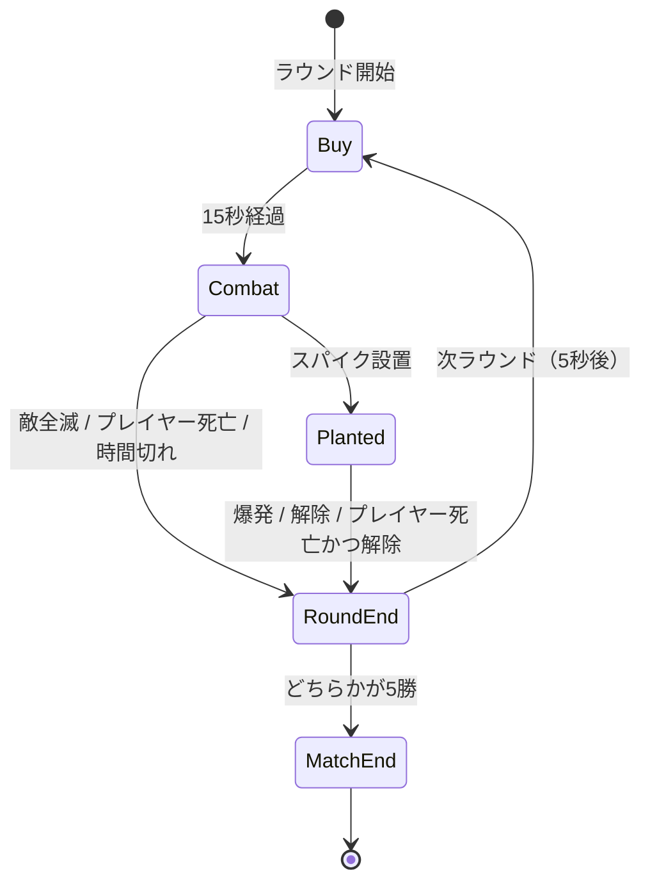

# 02. ゲームルール

## 試合

| 項目 | 値 |
|---|---|
| 勝利条件 | 先に **3ラウンド** 取る |
| 最大ラウンド数 | 5 |
| プレイヤー陣営 | 攻撃側（固定） |
| 人数 | プレイヤー1 vs Bot 3 |

延長戦（オーバータイム）は発生しない（最大5ラウンドで必ず決着）。

## ラウンドの流れ

| フェーズ | 時間 | 内容 |
|---|---|---|
| 購入（Buy） | 15秒 | スポーン地点の壁の内側で武器を買う。敵も配置につく |
| 戦闘（Combat） | 100秒 | 壁が消えて行動開始 |
| 設置後（Planted） | 45秒 | スパイク爆発までのカウントダウン（ラウンドタイマーは止まる） |
| ラウンド終了 | 5秒 | 勝敗表示、スロー演出 |

## 勝敗条件

| 状況 | 結果 |
|---|---|
| 設置前に敵3体を全滅 | **勝ち** |
| 設置後に敵3体を全滅 | **勝ち**（爆発を待たずに終了） |
| スパイクが爆発 | **勝ち** |
| 設置前にプレイヤーが死亡 | 負け |
| 100秒経過して未設置 | 負け |
| スパイクを解除された | 負け |
| 設置後にプレイヤーが死亡 | **ラウンドは続行**。Bot が解除できれば負け、爆発すれば勝ち（観戦表示） |

> 設置後のプレイヤー死亡を即負けにしないのは、本家のルールに近く、「設置して死んでも勝てる」逆転要素が残るため。

## スパイク

| 項目 | 値 |
|---|---|
| 所持 | ラウンド開始時からプレイヤーが所持 |
| 設置可能場所 | A/B サイトの設置エリア内のみ |
| 設置時間 | 4秒（キー長押し、移動・射撃で中断） |
| 爆発までの時間 | 45秒 |
| 解除時間 | 7秒（3.5秒で半分解除、以後は途中から再開可能） |
| 爆発範囲 | 半径約 15m、範囲内は即死 |
| 音 | 残り10秒からビープ音が速くなる |

- スパイクを落とす機能は最小構成では入れない（プレイヤー1人なので不要）。

### 実装（段階5）

- 設置は **4 キーを4秒長押し**（キー設定で変更可）。設置エリアの中で止まっている間だけ進み、動く・キーを離すと最初からやり直し。
  - 仕様の「4 で持ち替えて左クリック長押し」から簡略化した。射撃・スキルの使用でも中断し、4 キーを離すまで再開しない（Step 23、[18](18_skills_minimap.md) §6.1）。動けば中断される。
- 設置後は 45 秒で爆発。半径 15m 以内のプレイヤー・Bot は即死。
- 解除は 7 秒。3.5 秒を超えていれば、中断しても 3.5 秒から再開できる。複数の Bot が同時に触っても速くはならない（1体分の速さ）。
- 設置後の勝敗：敵全滅 → 勝ち、爆発 → 勝ち、解除される → 負け。プレイヤーが死んでもラウンドは続く。
- ビープ音は実装済み（設置後に鳴り、残り10秒で0.5秒間隔、5秒で0.25秒間隔と速くなる）。あわせてスパイクの赤い光と画面の「SPIKE PLANTED」が点滅し、残り10秒で点滅が速くなる。

## 経済（簡略版）

| 項目 | クレジット |
|---|---|
| 開始資金（第1ラウンド） | 800 |
| ラウンド勝利 | +3000 |
| ラウンド敗北 | +1900 |
| キル | +200 / 体 |
| スパイク設置 | +300 |
| 所持上限 | 9000 |

- 生き残った場合、武器とアーマー（減った分はそのまま）は次ラウンドに持ち越す。死亡時は失い、次ラウンドはクラシックだけで始まる。
- 試合開始時（第1ラウンド）はクラシックのみ・アーマーなし・800クレジット。
- 段階6で実装済み。キルは「プレイヤーの弾で倒したとき」だけ数える（スパイクの爆発で倒れた Bot は対象外）。勝敗の報酬はラウンド終了の瞬間に入る。
- Bot は経済を持たず、ラウンドごとに難易度設定に応じた武器を持つ（詳細は [04_enemy_ai](04_enemy_ai.md)）。

### 想定される展開の例

| ラウンド | 開始資金 | 買える物 |
|---|---|---|
| 1 | 800 | シェリフ、またはライトアーマー＋クラシック |
| 2（R1勝利時） | 約3,400〜4,000 | ヴァンダル＋ライトアーマー |
| 2（R1敗北時） | 約1,900〜2,700 | スペクター＋ライトアーマー |
