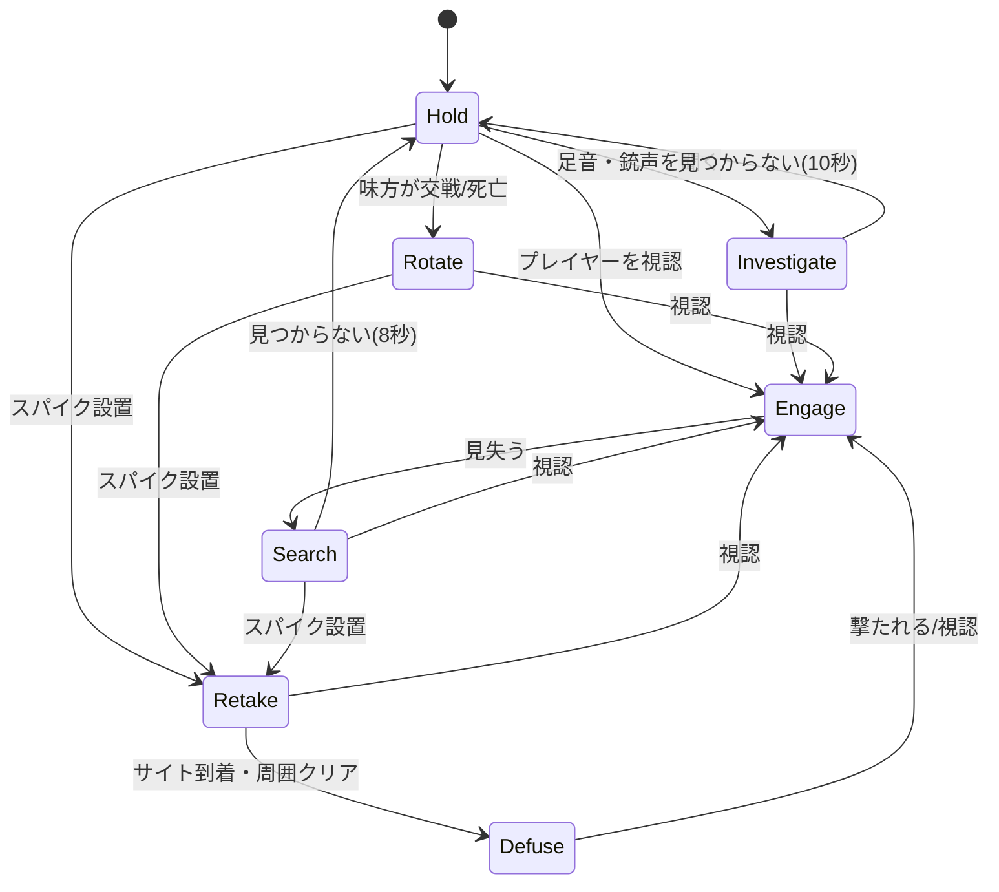

# 04. 敵 AI（Bot）

ゲームの面白さの大半を決める部分。防衛側なので「持ち場を守る → 反応する → 寄る → 解除する」が基本の動き。

## 基本仕様

| 項目 | 値 |
|---|---|
| 人数 | 基本3体（配置パターンで2〜4体。[10](10_defense_director.md)） |
| 体力 | 100、アーマーは常に 50（v0.9。`BP_PR_GameMode.BotArmor`。難易度による変化は段階7で検討） |
| 見た目 | 段階3では箱の組み合わせ（胴・脚が赤、頭が橙）。マネキンへの差し替えは後で |
| 実装 | AI Controller の Blueprint で作る状態機械（段階3。Behavior Tree は使っていない） |

## 配置（持ち場）

- マップ上に **持ち場ポイント**（`BP_HoldPoint`）を十数か所置く。各ポイントは「A」「B」「ミッド」などのエリアと、見張る方向を持つ。
- ラウンド開始時、次のパターンからランダムに選んで3体を割り当てる。

| パターン | A | ミッド | B | 備考 |
|---|---|---|---|---|
| 標準 | 1 | 1 | 1 | 最も多く出る |
| A寄り | 2 | 0 | 1 | |
| B寄り | 1 | 0 | 2 | |
| 前に出る | 1 | 1（前寄りの位置） | 1 | 1体が攻撃側の通路まで出ている |

- 同じパターンが続かないよう、前ラウンドと違うものを優先する（段階4）。
- 段階3で、人数と装備も変わる10パターンに広げた。詳細は [10_defense_director](10_defense_director.md)。

## 知覚（AI Perception）

| 感覚 | 設定 |
|---|---|
| 視覚 | 視野角 90°（左右45°）、距離 50m。スモーク（将来）で遮断 |
| 聴覚 | 走りの足音 15m、銃声 40m、スパイク設置音 マップ全体 |
| ダメージ | 撃たれたら撃たれた方向を把握 |

- 視界に入っても即反応せず、**反応時間**（難易度で変化）が経過してから撃ち始める。
- 歩き（Shift）中のプレイヤーの足音は聞こえない。

## 行動の状態

| 状態 | 動き |
|---|---|
| Hold（待機） | 持ち場で見張り方向を向いて待つ。ときどき角度を少し変える |
| Investigate（警戒） | 音がした方向を向き、少し近づく |
| Engage（交戦） | 射撃。基本は止まって撃つ。体力が減ったら物陰に下がる |
| Search（捜索） | 最後に見た位置へゆっくり向かう |
| Rotate（寄り） | 味方が交戦したエリアへ移動（全員ではなく最寄りの1体） |
| Retake（取り返し） | 設置されたサイトへ全員で向かう |
| Defuse（解除） | スパイクの解除。撃たれたら中断して応戦 |

- **Bot も止まって撃つ**ルールにして、プレイヤーと同じ精度ルール（[03_combat](03_combat.md)）を適用する。
- Rotate は「1体だけが寄る」ことで、1人で対処できる難しさに抑える。

## 難易度

| パラメータ | イージー | ノーマル | ハード | ベリーハード |
|---|---|---|---|---|
| 反応時間 | 0.6秒 | 0.4秒 | 0.25秒 |
| 命中率（狙いのブレ） | ±4° | ±2° | ±1° |
| 頭を狙う割合 | 10% | 25% | 45% |
| 武器 | クラシック / スペクター | スペクター / ヴァンダル | ヴァンダル |
| アーマー | 0 | 25 | 50 |
| Rotate する | しない | 最寄り1体 | 最寄り1体＋設置前から予測移動 |

- ハードの「設置前の予測移動」は Step 23 で実装（[18](18_skills_minimap.md) §6.5。`CallRotate` ではなく Director の `Predict`）。
- 最初はノーマルのみで作り、遊んでから値を調整する。

## ナビゲーション

- マップ全体に Nav Mesh Bounds Volume を置く。
- サイトへの移動は最短経路だが、プレイヤーの最後の目撃位置を避ける重み付けは後回し。

## 実装（段階3）

当初は Behavior Tree と AI Perception で作る予定だったが、状態が2つ（Hold / Engage）のうちは Blueprint だけの方が作りやすく直しやすいので、`BP_PR_AIController` の中の状態機械にした。状態が増える段階7で、Behavior Tree に移すか改めて決める。

| 項目 | 実装 |
|---|---|
| 考える間隔 | 0.1秒ごと（タイマーで `Think` を呼ぶ） |
| 視覚 | 距離 50m 以内、正面から左右45°以内、目の高さからプレイヤーの頭まで Visibility の線を引いて遮られていなければ「見えた」。交戦中は角度を問わない |
| Hold | 持ち場へ歩いて行き、着いたら持ち場の向きに少しずつ向き直る |
| Engage | 止まって撃つ。見えてから **反応時間** が経つまで撃たない。0.35秒撃って0.35秒止める（指切り） |
| 狙い | 頭（15%）か胴を狙い、上下左右に ±2.5° のブレを足す |
| 見失ったとき | 最後に見た位置を向いたまま待つ。3秒見えなければ Hold に戻って持ち場へ |
| 撃たれたとき | 撃ってきた相手の方を向いて Engage に入る（見えていなくても） |
| 弾 | 予備弾は無制限、マガジンが空になったらリロード |

調整用の値（`BP_PR_AIController` の Tuning カテゴリ）

| 変数 | 値 | 意味 |
|---|---|---|
| ReactionTime | 0.9 | 反応時間（秒） |
| AimError | 4.0 | 狙いのブレ（度） |
| HeadChance | 0.15 | 頭を狙う割合 |
| SightRange | 5000 | 見える距離（cm） |
| LoseTime | 3 | 見失ってから持ち場に戻るまで（秒） |
| BurstOnTime / BurstOffTime | 0.35 / 0.35 | 指切りの長さ（秒） |

> 0.4秒・±2°・25% で試すと、止まっているプレイヤーが一瞬で倒されて理不尽だったので、少し弱めた。

### 設置後の動き（段階5で追加）

- 設置されると、プレイヤーが見えていない Bot は全員スパイクへ向かう（Retake）。
- スパイクの 1.2m 以内に着いたら止まって解除する（Defuse）。0.1秒ごとに解除を0.1秒進める。
- 途中でプレイヤーが見えたら撃ち合い（Engage）を優先し、見えなくなったらすぐにスパイクへ戻る（設置前のように3秒待たない）。
- プレイヤーが死んでいても取り返し・解除は続ける。
- 状態の切り替えは `IdleThink`（見えていないときの行動を、設置後なら `RetakeThink`、それ以外は待機／見失い中に振り分ける）。

### 段階7で追加した動き

状態の番号（`State`）：0 待機 / 1 交戦（見失い中を含む）/ 2 捜索 / 3 警戒 / 4 寄り

| 状態 | 実装 |
|---|---|
| Search | 見失って `LoseTime`（3秒）たつと捜索へ。最後に見た位置へ歩き、`SearchTime`（8秒）で待機に戻る |
| Investigate | 待機・捜索・警戒中に、走っているプレイヤー（横の速さ 400 以上）が `HearRunRange`（15m）以内、または撃ってから0.3秒以内で `HearShotRange`（40m）以内なら、その位置へ向かう（5m 手前で止まる）。10秒で待機に戻る |
| Rotate | 交戦に入った瞬間（`CallRotate`）、他の Bot のうち待機中で生きている、プレイヤーに一番近い1体を寄りにする。すでに誰かが寄り中なら送らない。300cm 手前まで寄って15秒で戻る |

難易度（`BP_PR_GameInstance.Difficulty`、0〜3。設定画面で変更・保存。Bot が出てくるときに `ApplyDifficulty` で反映）

| パラメータ | イージー | ノーマル | ハード | ベリーハード |
|---|---|---|---|---|
| 反応時間 | 1.2秒 | 0.9秒 | 0.6秒 | 0.35秒 |
| 狙いのブレ | 5.5° | 4.0° | 2.5° | 1.5° |
| 頭を狙う割合 | 5% | 15% | 25% | 40% |
| プレイヤーの体力（v0.13） | 300 | 200 | 100 | 100 |
| 使える武器（v0.13） | 全部 | 全部 | 全部 | ハンドガンのみ（購入・拾い不可） |
| Rotate | しない | 1体 | 1体 | 1体 |
| アーマー | 50 | 50 | 50 | 50 |

> 上の「難易度」の表（構想段階）より全体に弱めにしている。v0.9〜0.10 の調整（敵が強すぎる）を受けて、今のノーマルを基準にした。

## Bot の装備ロジック（v0.22・Step 10）

配置パターンの装備の強さ（[10](10_defense_director.md)）で武器を決めたあと、`BP_PR_GameMode.ClampBotWeapon` が **ラウンドと難易度に応じた上限** で武器を弱める。Bot に所持金は持たせない。

| 武器のランク | 武器 |
|---|---|
| 0 | クラシック / シェリフ |
| 1 | スペクター |
| 2 | ヴァンダル |

- 実効ラウンド = `Round` ＋（ハード・ベリーハード：+1、イージー：−1、ノーマル：0）
- 上限ランク：実効ラウンド < `SpectreRound`（2）なら 0、`SpectreRound` 以上 `VandalRound`（3）未満なら 1、それ以上なら 2
- 上限を超える武器は、ヴァンダル → スペクター（上限1）、スペクター／ヴァンダル → クラシックかシェリフを半々（上限0）に下げる
- `SpectreRound` / `VandalRound` は `BP_PR_GameMode` の Tuning 変数。解禁ラウンドを変えるときはここを直す
- 呼び出し位置：`SpawnBot` で武器を抽選した直後、Bot を出す直前
- 重装（全員ヴァンダル）の配置パターンも、序盤のラウンドでは上限で弱くなる

| 難易度 | R1 | R2 | R3 | R4以降 |
|---|---|---|---|---|
| イージー | ハンドガン | ハンドガン | スペクターまで | ヴァンダルまで |
| ノーマル | ハンドガン | スペクターまで | ヴァンダルまで | ヴァンダルまで |
| ハード／ベリーハード | スペクターまで | ヴァンダルまで | ヴァンダルまで | ヴァンダルまで |

- 確認（PIE、ノーマル、R1）：Bot 3体の武器がクラシック・シェリフ・シェリフで、ヴァンダルとスペクターは出なかった。
- 未対応：Bot がピストルを持ったときの `GunMesh` の向き（Step 13 で見た目を確認して直す）。アーマーは全難易度で 50 のまま。

## Bot AI の改善（v0.23・Step 11）

`BP_PR_AIController` に最小限の動きを足した。いずれも数値は Tuning 変数で調整できる。

| 動き | 実装 |
|---|---|
| 撃ち合い中の位置取り | 新関数 `EngageMove`（`EngageSeen` の旧 StopMovement の代わりに呼ぶ）。**撃つ間（`bBurstOn`）は止まり、休む間に動く**。休む間は、プレイヤーが `FarDist`（2200cm）より遠ければ詰め（`MoveToLocation`）、`NearDist`（600cm）より近ければ後ろへ下がり、その間なら左右へストレイフする（約4秒周期で向きが入れ替わる）。下がる・ストレイフは、300cm 先への `MoveToLocation` で行う（`AddMovementInput` は 0.1 秒ごとの `Think` から呼ぶと 1 フレームしか効かず、ほとんど動かなかったため v0.25 で変更） |
| 別の角度から覗き直す | `SearchThink` の移動先を「最後に見た位置」から、Bot の右方向へ ±700cm ずらした位置に変更 |
| 待機中の巡回 | `HoldThink` で、持ち場に着いているとき 6〜14 秒ごとに持ち場の周囲 ±400cm へ歩き出し（`NextWanderTime` / `WanderUntil`）、4秒後に持ち場へ戻る |
| 捜索中のゆっくり歩き | `Think` の先頭で、捜索中（State 2）は `MaxWalkSpeed` を 300、それ以外は 600 にする |

- 確認（PIE、ノーマル、ラウンド1）：全 Blueprint がエラーなしでコンパイル。待機中の Bot が約 30 秒の間に持ち場の周囲 300cm ほどを歩いて戻ることを位置の記録で確認した。
- 未確認（Step 13）：撃ち合い中のストレイフ・距離調整、捜索の覗き直しの見た目。プレイヤーから見える位置での確認が必要。
- 旧 StopMovement ノードは `EngageSeen` に未接続のまま残っている（Step 14 で整理）。
- 見送り：ハードの「設置前の予測移動」は将来対応検討事項へ。
