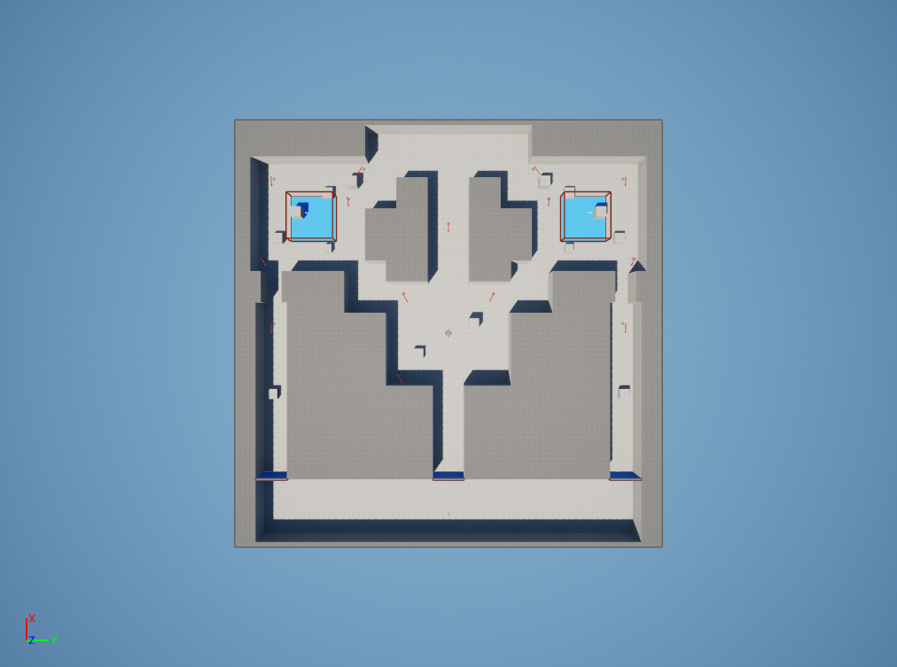

# 05. マップ

## 方針

- 最初は **ブロックアウト**（箱と壁だけ）で作り、遊んでから形を詰める。
- テンプレート付属の `LevelPrototyping` のマテリアルとメッシュを使う。
- VALORANT の小さめのマップ（例：アセントやバインドの半分程度）をイメージ。
- 新規レベル `/Game/PARORANT/Maps/L_Proto` を作る（テンプレートの FirstPersonMap は残す）。

## レイアウト

```
                 北（防衛側）
   ┌──────────────────────────────────┐
   │   [Aサイト]       [防衛スポーン]       [Bサイト]   │
   │    ▣ 設置エリア         │            ▣ 設置エリア │
   │      │                 │                │       │
   │   [Aメイン]  ──── [ミッド] ────  [Bメイン]  │
   │      │                 │                │       │
   │   [A通路]              │             [B通路]   │
   │      └──────── [攻撃スポーン] ────────┘       │
   └──────────────────────────────────┘
                 南（攻撃側＝プレイヤー）
```

| エリア | 役割 |
|---|---|
| 攻撃スポーン | プレイヤーの開始地点。購入フェーズ中は見えない壁で囲う |
| A通路 / B通路 | 攻撃側からサイトへの主要ルート（長め、遮蔽物あり） |
| ミッド | 中央の広場。両サイトへ抜ける近道があり、撃ち合いが起きやすい |
| Aメイン / Bメイン | サイト手前の入口（狭い。チョーク） |
| A / B サイト | 設置エリア。箱（遮蔽物）を3〜5個置く |
| 防衛スポーン | Bot が戻る / 寄る中継地点 |

## 寸法の目安

| 項目 | 値 |
|---|---|
| マップ全体 | 約 80m × 80m |
| 攻撃スポーンからサイトまで | 走って 12〜15秒 |
| 防衛スポーンからサイトまで | 走って 5〜7秒 |
| 通路の幅 | 4〜6m |
| サイト入口の幅 | 3〜4m |
| 壁の高さ | 4m（乗り越え不可） |
| 遮蔽箱 | 1m（しゃがみで隠れる）と 2m（立って隠れる）の2種類 |

> 走って12〜15秒は、100秒のラウンドでじっくりクリアリングしても間に合う長さ。

## 配置するもの

| 配置物 | 数 | 用途 |
|---|---|---|
| PlayerStart | 1 | 攻撃スポーン |
| 設置エリア（`BP_PlantZone`） | 2 | A、B |
| 持ち場ポイント（`BP_HoldPoint`） | 12〜15 | Bot の待機位置と見張り方向 |
| 購入バリア（`BP_SpawnBarrier`） | 1 | 購入フェーズ中の壁 |
| Nav Mesh Bounds Volume | 1 | マップ全体 |
| ライト | 一式 | Directional Light、Sky Light、Sky Atmosphere（明るめ、影ははっきり） |

## 作り方の流れ

1. 床（80m四方）と外壁を置く
2. 主要な壁で通路とサイトを区切る
3. 遮蔽箱を置く
4. プレイヤーの走りで所要時間を確かめて調整
5. 設置エリア、持ち場ポイント、ナビメッシュを配置

## 実装（段階2・2026-11-04）

`/Game/PARORANT/Maps/L_Proto` として仮組み済み。プロジェクトの起動マップに設定している（射撃場は `L_Range`）。



### 座標の決まり

- 1マス = 1m、マップは X・Y ともに -40m〜+40m
- **+X が北（防衛側）**、+Y が東（B側）
- 壁の高さ 4m、床の上面が Z=0
- 壁は「歩ける範囲」を指定して残りを埋める方式で生成（`docs/tools/map_layout_l_proto.py`）。形を変えるときはこのスクリプトの `WALK` を直して作り直す

### エリアの範囲（m）

| エリア | X | Y | 備考 |
|---|---|---|---|
| 攻撃スポーン | -40〜-28 | -37〜37 | PlayerStart は (-36, 0)、北向き |
| A通路 / B通路 | -28〜6 | -37〜-31 / 31〜37 | 幅6m |
| Aメイン / Bメイン | 6〜12 | -36〜-32 / 32〜36 | 幅4m（チョーク） |
| A / B サイト | 12〜34 | -38〜-16 / 16〜38 | 22m × 22m |
| ミッド通路 | -28〜-10 | -3〜3 | 幅6m |
| ミッド | -10〜10 | -12〜12 | 広場 |
| Aショート / Bショート | 4〜14 | -20〜-12 / 12〜20 | ミッドからサイトへの近道（入口幅4m） |
| ミッド奥 | 10〜30 | -4〜4 | ミッドと防衛スポーンをつなぐ |
| 防衛スポーン | 30〜40 | -10〜10 | |
| 防衛→A / 防衛→B | 24〜40 | -16〜-10 / 10〜16 | 防衛側の寄り道 |

### 配置したもの

| 配置物 | 数 | 内容 |
|---|---|---|
| 壁 | 26 | 4m の高さ（外周の4枚を含む） |
| 遮蔽物 | 14 | 各サイト5個、ミッド2個、各通路1個。高さ1m（しゃがみで隠れる）と2m（立って隠れる） |
| `BP_PlantZone` | 2 | 各サイトの中央に 9m × 9m。床の青い印と大きな「A」「B」の文字 |
| `BP_HoldPoint` | 14 | A×4、B×4、ミッド×3、前に出る位置×3（A通路・B通路・ミッド）。赤い矢印が見張る方向。ゲーム中は非表示 |
| `BP_SpawnBarrier` | 3 | 攻撃スポーンから出る3つの出口。初期状態は無効（段階4のラウンド管理で購入フェーズ中だけ有効にする） |
| NavMeshBoundsVolume | 1 | マップ全体 |
| ライト | 一式 | 太陽光、スカイライト、大気、フォグ（すべてリアルタイム） |

### ナビメッシュで測った所要時間（走り 675cm/s）

| 経路 | 距離 | 時間 | 目標 |
|---|---|---|---|
| 攻撃スポーン → A サイト（A通路経由） | 86.6m | 12.8秒 | 12〜15秒 ✅ |
| 攻撃スポーン → B サイト（B通路経由） | 86.6m（左右対称） | 12.8秒 | 12〜15秒 ✅ |
| 攻撃スポーン → A / B サイト（ミッド経由の近道） | 67.8m | 10.0秒 | 近道なので短め |
| 防衛スポーン中央 → A / B サイト | 29.6m | 4.4秒 | 5〜7秒（やや短い） |

- ミッドの近道が10秒と短いのは意図どおり（その代わりミッドで撃ち合いが起きやすい）。遊んでみて強すぎれば、ミッドに遮蔽や曲がり角を足して長くする
- 防衛スポーン→サイトがやや短いが、Bot は持ち場から始まるので、取り返し（Retake）で寄ってくる時間として遊んで確認する

## L_Pind（バインドをもじった名前。LP_FPSLite_JC 版・2026-11-06、旧名 L_Nature）

`L_Proto` を複製した `/Game/PARORANT/Maps/L_Pind`。形・当たり判定・持ち場ポイントは L_Proto と同じで、見た目だけ Fab の `LP_FPSLite_JC` に差し替えた。起動マップは L_Pind（GameDefaultMap/EditorStartupMap 設定済み）。壁・床・外周は単色マテリアル `Materials/M_NatureFlat` のインスタンス（MI_Nature_Wall クリーム / MI_Nature_Floor 茶色（バインド風） / MI_Nature_Ring 濃いベージュ）で塗り、LP のパレット柄（縞になる）は使わない。

- 遮蔽物14個: `SM_Box_01` に差し替え（大きさは元の1m/2m相当に拡縮）
- 壁パネル46枚（`SM_Wall_01`、フォルダ `Decor`）: 両サイトの奥・外側、防衛スポーン奥、攻撃スポーン奥
- 建物2棟（`SM_Building_01`）: 攻撃スポーンの両隅
- 壁の箱は元のグレー格子のまま（LP のマテリアルはパレット画像で、箱に貼ると縞になるため）
- 角のパネル同士で一部Zファイトあり（目立たない位置）
