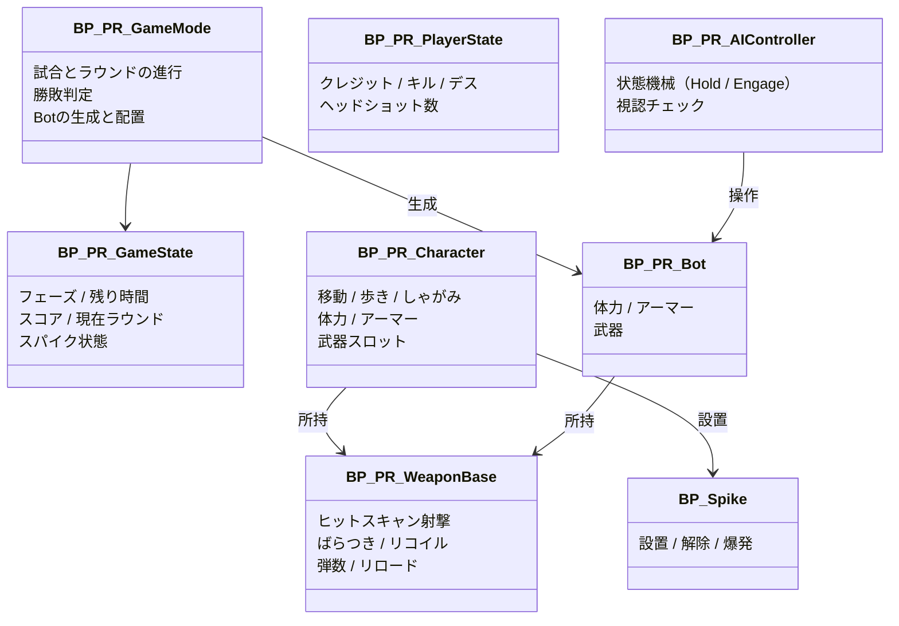

# 07. 技術設計

## 前提

- Unreal Engine 5.3、**Blueprint のみ**で作る（C++ は使わない）。
- テンプレートの資産は直接書き換えず、`/Game/PARORANT/` 以下に複製・新規作成する。
- 作業は Claude から Unreal MCP（EngineWire）経由で行う。

## フォルダ構成

```
/Game/PARORANT/
├─ Blueprints/
│  ├─ Core/        GameMode, GameState, PlayerController, PlayerState
│  ├─ Player/      プレイヤーキャラクター
│  ├─ Weapons/     武器の基底と各武器
│  ├─ AI/          Bot、AI Controller、Behavior Tree、Blackboard
│  └─ World/       設置エリア、持ち場ポイント、スパイク、バリア
├─ Data/           武器データ、難易度データ（DataTable / 構造体）
├─ UI/             HUD、購入画面、リザルト、タイトル
├─ Maps/           L_Range（射撃場・段階1）、L_Proto（試作マップ）、L_Title
├─ Input/          入力アクションとマッピング
└─ Audio/
```

## クラス構成



| クラス | 親クラス | 主な役割 |
|---|---|---|
| `BP_PR_GameMode` | GameModeBase | 試合とラウンドの進行、フェーズ切り替え、勝敗判定、Bot の配置（段階3：`DT_DefenseSetups` から配置パターンを抽選） |
| `BP_PR_GameState` | GameStateBase | （段階4では作っていない。1人用なのでラウンドの状態は GameMode が持ち、HUD は GameMode を直接読む） |
| `BP_PR_PlayerController` | PlayerController | 入力（`IMC_PR` と実行時に作るキー割り当て）、設定画面の開閉（`ToggleMenu`）、購入画面の開閉（`OpenBuy` / `CloseBuy` / `ToggleBuy`、`IA_Buy`） |
| `BP_PR_GameInstance` | GameInstance | キー割り当ての保持・保存・読込（`LoadBinds` / `SaveBinds` / `SetBind` / `ResetBinds` / `BuildIMC`）、マウス感度（`SetSensitivity` / `SaveSens` / `LoadSens`） |
| `WBP_BuyMenu` | UserWidget | 購入画面（段階6）。毎フレーム `ItemState` で各ボタンの表示と押せるかを更新し、クリックで `TryBuy` |
| `SG_PR_Settings` | SaveGame | 保存されるキー割り当て（`KeyBinds`：操作名 → キー） |
| `WBP_KeyBinds` / `WBP_KeyBindRow` | UserWidget | キー設定画面と、その1行（InputKeySelector） |
| `BP_PR_PlayerState` | PlayerState | クレジット、戦績 |
| `BP_PR_Character` | テンプレートの `BP_FirstPersonCharacter` を継承 | 移動、体力、武器の所持と切り替え（腕のアニメーションはテンプレートのものを流用するため継承にした） |
| `BP_PR_WeaponBase` | Actor | 射撃の共通処理。各武器は子クラスでデータだけ変える |
| `BP_PR_Bot` | Character | Bot の体。部位タグ付きの箱（Head / Body / Leg）、プレイヤーと同じダメージ処理。生成時に `WeaponId`・`StartArmor`・`HoldPoint` を受け取る |
| `BP_PR_AIController` | AIController | 0.1秒ごとの `Think` で動く状態機械（段階3。Behavior Tree は段階7で再検討） |
| `BP_Spike` | Actor | 設置後のスパイク。`AddDefuse`（解除を進める、半分で保存）、`IsBeingDefused`、`Explode`（半径内の全キャラクターに 999 ダメージ）、光の点滅 |
| `BP_PlantZone` | Actor（Box Collision） | 設置可能エリア（A/B）。`SiteName` を持つ |
| `BP_HoldPoint` | Actor（Arrow 付き） | Bot の持ち場と見張り方向。`Area`（A / B / Mid）と `bForward`（前に出る位置）を持つ |
| `BP_SpawnBarrier` | Actor | 購入フェーズ中の壁。`SetBarrierActive(bool)` で当たり判定と見た目を切り替え。幅は `Width` で指定 |
| `BP_PR_HUD` | HUD | 試作用の HUD。Canvas に直接描画（クロスヘア、弾数、体力、ヒット表示） |
| `BP_TargetDummy` | Actor | 射撃確認用の的人形（部位判定、ダメージ表示、倒れると1.5秒で復活） |
| `BFL_PR` | BlueprintFunctionLibrary | 共通計算（`ApplyArmor`：アーマー吸収の計算） |

## 共通の仕組み

### ダメージと部位判定

- プレイヤーと Bot の両方に **共通のダメージ処理**（Blueprint Interface `BPI_Damageable`）を持たせる。
- 部位判定は **当たったコンポーネントのタグ** で行う（`Head` → 頭、`Leg` → 脚、それ以外 → 胴）。プロジェクトに全身のマネキンが無いため、Bot・的人形は部位ごとの当たり判定コンポーネントを持たせる。
- プレイヤーも、見えない当たり判定（`HitHead` 球・`HitBody` 箱・`HitLeg` 箱、コリジョンプリセット `UI`＝Visibility だけを止める）を持つ。
- 射撃のトレースは `Visibility` チャンネルを使い、撃った本人は無視する。Bot のカプセルは `Visibility` を無視する設定にして、部位コンポーネントだけに当たるようにする（専用チャンネルの追加はエディタ再起動が必要なため見送り）。

### フェーズ管理（段階4で実装）

- `BP_PR_GameMode` が `Phase`（整数：0=購入、1=戦闘、2=設置後〈段階5〉、3=ラウンド終了、4=試合終了）と `PhaseEndTime` を持ち、0.1秒ごとの `MatchTick` で切り替える。
- 列挙型と Event Dispatcher は使っていない（HUD もバリアも GameMode から直接読む・呼ぶ方が単純なため）。

| 関数・イベント | 内容 |
|---|---|
| `StartRound` | ラウンド番号+1 → `CleanupRound`（Bot・AI・落ちている武器を消す）→ `ResetPlayer` → `SpawnDefenders` → バリアを出す → 購入フェーズ |
| `ResetPlayer` | 生きていればスポーン地点へ戻して体力100（武器と弾はそのまま）。死んでいれば体と武器を消して `RestartPlayer` |
| `SpawnDefenders` | `PickDifferentSetup`（前ラウンドと違う配置を最大3回まで引き直す）→ 配置どおりに Bot を出す |
| `PlantSpike(Location, SiteName)` | スパイクを出して設置後フェーズへ。`PhaseEndTime` は爆発時刻 |
| `Phase2Tick` | 解除されたら負け、爆発時刻になったら `Explode` して勝ち、敵全滅なら勝ち |
| `MatchTick` | 購入の時間切れ → 戦闘（バリアを消す）。戦闘中に敵全滅 → 勝ち、プレイヤー死亡 → 負け、時間切れ → 負け。結果表示の後、どちらかが5勝（`WinsNeeded`）なら試合終了、でなければ次ラウンド。試合終了から10秒でマップを読み直して新しい試合 |
| `EndRound(bWin, Reason)` | スコア、`RoundHistory`（例：`WLW`）、`ResultText` を更新 |

調整用の値（Tuning）：`BuyTime` 15、`CombatTime` 100、`RoundEndTime` 5、`MatchEndTime` 10、`WinsNeeded` 3。

### データ

| データ | 形式 | 中身 |
|---|---|---|
| `DT_Weapons` | DataTable（`S_WeaponData`） | 価格、連射、装弾数、部位ダメージ、ばらつき、リコイル、メッシュ |
| `DT_Difficulty` | DataTable（`S_BotDifficulty`） | 反応時間、命中ブレ、頭を狙う割合、武器、アーマー |
| `DT_DefenseSetups` | DataTable（`S_DefenseSetup`） | 配置パターン（エリアごとの人数、前に出る位置、装備の強さ、抽選の重み）。[10](10_defense_director.md) |

> 数値は全てデータに逃がし、Blueprint に直接書かない。遊びながら調整しやすくするため。

### 入力とキー設定

- `IMC_PR` には、変えない操作だけを入れる：視点（マウス＝`IA_LookPR`、ゲームパッド右スティック＝テンプレートの `IA_Look`）と `IA_Menu`（P と Esc、一時停止中も反応する）。F1 は UE のデバッグキー（`viewmode wireframe`）と重なるので使わない。
- 変えられる操作は `DT_KeyBinds`（`S_KeyBind`：表示名、入力アクション、初期キー）に並べる。行名が操作名になる。
- 起動時に `BP_PR_GameInstance` がセーブデータを読み、無ければ `DT_KeyBinds` の初期キーを使う（新しい行が増えても初期キーで補う）。
- PlayerController の `ApplyBinds` が、実行時に新しい Input Mapping Context を作って各アクションにキーを割り当て（`MapKey`）、優先度1で追加する。キーを変えるたびに作り直す。
- 移動は、テンプレートの `IA_Move`（2D 軸）をやめ、`IA_MoveForward/Back/Left/Right`（それぞれボタン）に分けた。WASD を1つずつ変えられるようにするため。
- Enhanced Input の User Settings（UE5.3 では実験的機能）は使っていない。
- マウスホイール：`InputKeySelector` はホイールを拾わないので、`WBP_KeyBindRow` で `OnMouseWheel` を上書きし、選択待ち（`GetIsSelectingKey`）のときだけ `MouseScrollDown`／`MouseScrollUp` を `ApplyWheelKey` で割り当てる（選択待ちを抜けるためフォーカスをゲーム画面へ戻す）。選択待ちでなければ Unhandled を返し、一覧のスクロールに回す。

### マウス感度

- 視点（マウス）は、テンプレートの `IA_Look` から専用の `IA_LookPR`（2D 軸、修飾なし）に移した。`BP_PR_Character` が `IA_LookPR` の Triggered で `AddControllerYawInput(X×感度)`、`AddControllerPitchInput(−Y×感度)` を呼ぶ（Y の反転はテンプレートの Negate 修飾と同じ向き）。
- 感度は `BP_PR_GameInstance.MouseSensitivity`（初期値 1.0）。`SetSensitivity` で 0.1〜3.0 に丸めて保存（`SaveSens`）、起動時に `LoadSens`。保存先はキー設定とは別スロット `PR_Sens`（`SG_PR_Settings.MouseSensitivity` を使用）。

### 経済と購入（段階6で実装）

- クレジットは `BP_PR_GameMode.Credits`（PlayerState は作っていない。1人用なので GameMode が持つ）。
- 調整用の値（Economy）：`Credits` 初期 800、`MaxCredits` 9000、`WinCredits` 3000、`LossCredits` 1900、`KillCredits` 200、`PlantCredits` 300。
- 商品表：`ShopPrices`（名前 → 価格）、`ShopSlots`（名前 → 枠：1 メイン、2 サブ、3 アーマー）、`ShopArmor`（名前 → アーマー量）。いずれも GameMode の Map 変数。

| 関数 | 内容 |
|---|---|
| `AddCredits(Amount)` | 0〜`MaxCredits` に収めて加算（支払いは負の値） |
| `ItemState(Id)` | 0 買える／1 お金不足／2 所持中／3 この購入フェーズに買った（売却可）／4 購入フェーズ外 |
| `TryBuy(Id)` | 状態3なら売却（返金して `RestoreSlot`）。状態0なら、同じ枠を今回すでに買っていれば先に返金、まだなら元の装備を `PhasePrev` に記録してから支払い、`GiveItem` |
| `GiveItem(Id, Slot)` | キャラクターの `SetPrimaryItem` / `SetSecondaryItem`、またはアーマー量を設定 |
| `RestoreSlot(Slot)` | 売却時に `PhasePrev` の装備（メインは「なし」もあり）、アーマーは `PrevArmor` に戻す |
| `SlotWeaponId(Slot)` | 今持っている武器の名前 |

- `PhaseBought`・`PhasePrev`（枠 → 名前）は `StartRound` で空にする（＝売却は同じ購入フェーズ中だけ）。
- 報酬：`EndRound` の最後に勝ち／負けの額、`PlantSpike` の最後に設置報酬、`BP_PR_Bot` の死亡直前に「ダメージの主がプレイヤー」ならキル報酬。
- キャラクター：`PrimaryId` の初期値を「なし」にし、`BeginPlay` はメインが無ければサブだけ作る。`EquipWeapon` は空の武器を受け取ったら何もしない（メイン無しで 1 を押しても無反応）。買った武器は `SetPrimaryItem` / `SetSecondaryItem`（古い武器は消して新しく作り、持ち替える）。

## AI の構成

> 段階3では Behavior Tree を使わず、`BP_PR_AIController` の関数（`Think`、`CanSeeTarget`、`EngageSeen`、`EngageLost`、`HoldThink`）で作った。下の表は、状態が増えて Behavior Tree に移す場合の案。

| 資産 | 内容 |
|---|---|
| `BB_Bot` | Blackboard。TargetActor、LastSeenLocation、HoldPoint、State、SpikeLocation など |
| `BT_Bot` | Behavior Tree。State ごとのサブツリー（Hold / Investigate / Engage / Search / Rotate / Retake / Defuse） |
| `BTT_*` | 独自タスク（射撃、持ち場へ移動、解除 など） |
| `BTS_*` | 独自サービス（視認チェック、体力チェック など） |

## 命名規則

| 種類 | 接頭辞 |
|---|---|
| Blueprint | `BP_` |
| Widget | `WBP_` |
| 構造体 / 列挙 | `S_` / `E_` |
| DataTable | `DT_` |
| Behavior Tree / Blackboard / Task / Service | `BT_` / `BB_` / `BTT_` / `BTS_` |
| マテリアル / インスタンス | `M_` / `MI_` |
| レベル | `L_` |
