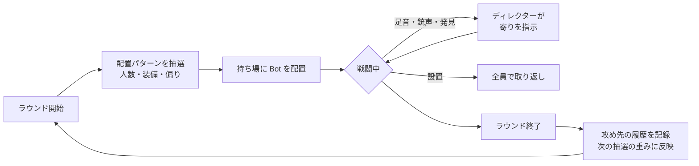

# 10. 防衛配置の読み合い（防衛ディレクター）

VALORANT の面白さの一つは「防衛が各サイトに何人置いているか」と「攻めがそれをどう見破るか」の駆け引き。
PARORANT はプレイヤーが攻め固定なので、**防衛側を動かす「ディレクター」** を作り、配置を毎ラウンド変えて、プレイヤーが情報を集めて読む遊びにする。

## 1. 目指す体験

- ラウンド開始時、プレイヤーは **敵が何人いるか** は分かるが、**どこに何人いるか** は分からない
- 足音・撃ち合い・クリアリングで少しずつ情報が集まり、「B が薄そうだ」と判断して攻める
- 逆に、プレイヤーが音を立てると防衛が寄ってくるので、**フェイク**（A で音を出して B に行く）が成立する
- 同じ攻め方を続けると防衛が対応してくるので、攻め先を散らす意味が生まれる

## 2. 仕組みの全体

## 3. 配置パターン（段階3で実装）

`DT_DefenseSetups` の行を毎ラウンド重み付きで抽選する。行ごとに「A・ミッド・B に何人」「前に出る Bot がいるか」「装備の強さ」を持つ。

| パターン | A | ミッド | B | 前に出る | 合計 | 装備 | 重み | ねらい |
|---|---|---|---|---|---|---|---|---|
| 標準 | 1 | 1 | 1 | — | 3 | 標準 | 4 | 基本形 |
| A寄り | 2 | 0 | 1 | — | 3 | 標準 | 2 | B が薄い |
| B寄り | 1 | 0 | 2 | — | 3 | 標準 | 2 | A が薄い |
| Aスタック | 3 | 0 | 0 | — | 3 | 標準 | 1 | B が空。読めれば楽勝、読み違えると3対1 |
| Bスタック | 0 | 0 | 3 | — | 3 | 標準 | 1 | 同上 |
| 前のめり（ミッド） | 1 | 0 | 1 | ミッド | 3 | 標準 | 2 | 1体がミッドの攻撃側寄りまで出てくる |
| 前のめり（A） | 1 | 1 | 0 | A | 3 | 標準 | 1 | A通路で早い接敵 |
| 前のめり（B） | 0 | 1 | 1 | B | 3 | 標準 | 1 | B通路で早い接敵 |
| 少数精鋭 | 1 | 0 | 1 | — | **2** | 重装 | 1 | 人数は少ないが全員ヴァンダル＋ヘビー |
| 大人数 | 1 | 1 | 1 | ミッド | **4** | 軽装 | 1 | 人数は多いが全員クラシック／スペクター、アーマー無し |

**装備の強さ**

| 装備 | 武器 | アーマー |
|---|---|---|
| 軽装 | クラシック or スペクター | 0 |
| 標準 | スペクター or ヴァンダル | 25 |
| 重装 | ヴァンダル | 50 |

- **人数は 2〜4 人で変わる**。人数が多いほど装備が弱く、少ないほど強くして、どのパターンも勝ち目があるようにする。
- 画面上部に「敵の残り人数 / 開始時の人数」を表示する（本家で5人と分かっているのと同じく、人数だけは分かる）。
- 「2人＝重装」「4人＝軽装」は、人数を見た時点で「撃ち合いは避けたほうがいい／強気に行ける」という判断材料になる。
- どのパターンが選ばれたかは画面に出さない（デバッグ用に、出力ログには記録する）。

### 実装（段階3）

- `Data/S_DefenseSetup` と `Data/DT_DefenseSetups` に上の10パターンを入れた（列：DisplayName、CountA、CountMid、CountB、ForwardArea、Weight、Loadout）。Loadout は 0=軽装、1=標準、2=重装。
- `BP_PR_GameMode` の BeginPlay で抽選する。行名を Weight の数だけ並べた配列から1つをランダムに取る（`PickSetup`）。
- エリアごとに、そのエリアの持ち場（前に出る持ち場は除く）を集めてシャッフルし、人数分だけ Bot を出す（`SpawnGroup` → `SpawnBot`）。ForwardArea が None 以外なら、そのエリアの前寄りの持ち場にもう1体出す。
- 武器は装備の強さから決める（軽装：クラシックかスペクター、標準：スペクターかヴァンダル、重装：ヴァンダル）。アーマーは Loadout × 25。
- 選ばれたパターンは出力ログに `[Defense] setup = <行名>` と出る（画面には出さない）。
- 画面上部に `ENEMIES 生存数 / 開始時の人数` を出す。
- 確認：3回の再生で HeavyA（A寄り）、Standard、HeavyB（B寄り）が選ばれ、それぞれ正しいエリアに Bot が出た。

## 4. 見破る手段（攻め側の情報源）

| 情報源 | 内容 | 段階 |
|---|---|---|
| 敵の人数 | 画面上部に表示 | 3 |
| 交戦 | 接敵した場所に「少なくとも1人いる」 | 3 |
| 敵の足音 | 戦闘開始直後に持ち場へ微調整で動く Bot や、寄ってくる Bot の足音が聞こえる | 7 |
| 寄りの音 | 交戦後に寄ってくる Bot の足音で「こっちに1人増える」が分かる | 7 |
| 倒した数と場所 | 「A で1人倒した → 残り2人は B とミッドのどこか」 | 3 |
| 偵察アビリティ | 例：一度だけ使える索敵ダーツで、範囲内の Bot を数秒表示（アビリティ導入時） | 9 |

## 5. 防衛側の反応（フェイクを成立させる仕組み・段階7）

- ディレクターは「どこで音や交戦があったか」を記録する。
- **交戦・銃声** があったエリアには、最寄りの Bot を1人寄らせる（ノーマル）。
- **走りの足音** だけなら、そのエリアの Bot は警戒するが、寄りはしない。
- 寄った後に別のサイトで音がしたら、寄った Bot を戻すかどうかは確率で決める。これで「A で撃って B へ回る」フェイクが成功することも、読まれることもある。
- 設置後は、生き残り全員が設置サイトへ向かう（段階5）。

## 6. ラウンドをまたいだ適応（段階7）

- 前のラウンドでプレイヤーが攻めたサイトを記録する。
- 次のラウンドの抽選では、そのサイトを厚くするパターンの重みを少し上げる（例：A を2回続けて攻められたら「A寄り」「Aスタック」の重みを1.5倍）。
- プレイヤーは「前回 A を取ったから、次は A が厚いかも」と読んで裏をかける。
- ラウンド内ですぐには反映しないので、理不尽にはならない。

## 7. 段階ごとの実装範囲

| 段階 | 実装すること |
|---|---|
| 3 | 配置パターン（人数2〜4・装備の強さ）、重み付き抽選、敵人数の表示 |
| 4 | ラウンドごとに抽選し直す、前のラウンドと同じパターンは避ける |
| 5 | 設置後の取り返し |
| 7 | 音・交戦による寄り、フェイク、ラウンドをまたいだ適応、足音 |

## 8. 遊んでから決めたいこと

- 人数をラウンド開始時に見せるか、交戦するまで「?」にするか（見せない方が緊張感は出るが、理不尽さも増す）→ 見せない（2026-11-11 決定）
- 2人／4人パターンの出やすさ
- 全員が片方のサイトに寄る「スタック」の出やすさ（読めた時の爽快感と、読み違えた時の理不尽さのバランス）
