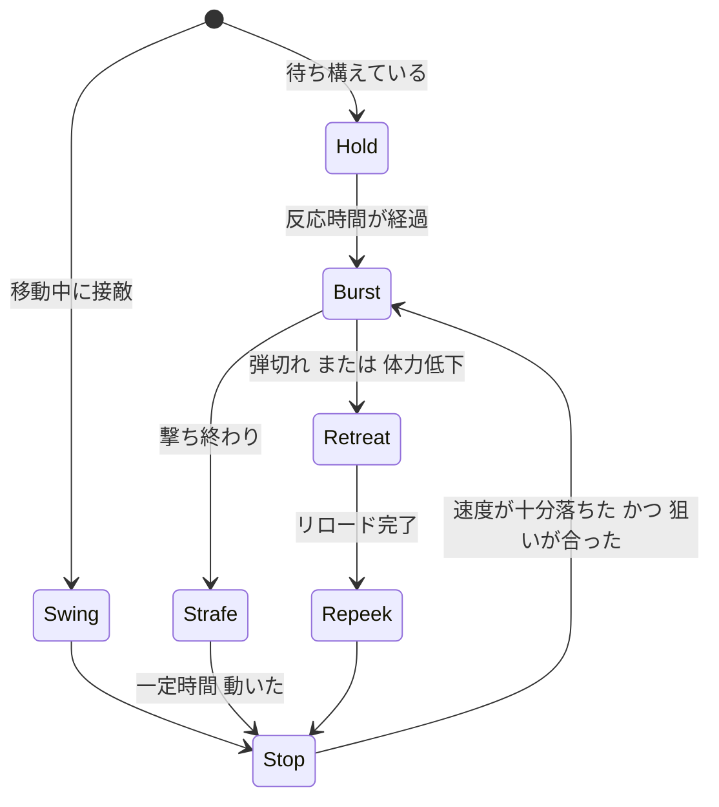

# 11. Bot の撃ち合い（再設計）

Step 11 の「休む間に動く」方式をやめ、タクティカル FPS の対人戦でプレイヤーがやっている動きを基準に作り直した仕様。**v0.28 で実装済み**（実装との差分と確認結果は末尾の「実装結果」）。

## 1. 今の動きが不自然な原因

実装を調べて分かった原因。見た目の問題は、ほぼこの5つから出ている。

| # | 症状 | 原因 |
|---|---|---|
| 1 | 体と銃がガタガタ震える | `EngageSeen` が 0.1 秒ごとに、狙いへ ±`AimError` の乱数を足した向きを `SetControlRotation` で直接入れている。`bUseControllerRotationYaw` が true なので体ごと毎回飛ぶ |
| 2 | 撃ち合い中に背を向ける | 移動が `MoveToLocation`。AIController は進行方向へ向きを更新するので、下がるときも横へ動くときも体がそちらを向く。しかも 0.1 秒ごとに経路を出し直している |
| 3 | 動きが機械的 | 撃つ・動くが 0.35 秒ずつの固定周期（`bBurstOn`）で、速度と無関係。「止まったから撃つ」になっていない |
| 4 | 横に滑って見える | アニメが速度だけの 1D（`BS_Swat_Locomotion`）。横移動でも前走りのポーズになる |
| 5 | 駆け引きがない | 判断材料が距離だけ。遮蔽への退避、リロードの隠れ、覗き直しが撃ち合いに無い |

## 2. 目指す動き

熟練者の撃ち合いは「**動いて避ける → 止まって撃つ → また動く**」の繰り返しで、次の性質がある。

- 狙いは滑らかに動く。最初は少しずれていて、撃つまでに合っていく
- 体は常に敵を向き、足だけが左右に動く
- 撃つのは止まった瞬間（カウンターストレイフ）。走りながらは基本的に撃たない
- 距離で撃ち方が変わる（近距離は連射、遠距離は単発〜数発）
- 待ち構えている側は動かずに先に撃つ。動くのは撃ち合いが始まってから
- 不利になったら隠れる（リロード、体力が少ない）。同じ場所から同じように顔を出さない

## 3. 構成

処理を2層に分ける。

| 層 | 周期 | 担当 |
|---|---|---|
| 判断層 | 0.1 秒（既存の `Think`） | 見えているか、どのモードか、次の行動 |
| 実行層（新規） | 毎フレーム（Tick） | 狙いの更新、足の入力、撃てるかの判定 |

撃ち合い中は `MoveToLocation` を使わず、毎フレームの `AddMovementInput` で動く（Step 13 で効かなかったのは 0.1 秒ごとに呼んだため）。AI のフォーカスが向きを奪わないので、体は敵を向いたまま足だけ動く。

## 4. 狙いのモデル

0.1 秒ごとの乱数をやめ、**誤差が時間で収束する狙い**にする。

```
狙いの点 = 敵の胴または頭 + 誤差
誤差     = 初期誤差 × exp(−経過時間 ÷ 収束時間) + 手ブレ
手ブレ   = 複数の sin を重ねた滑らかな揺れ（毎フレームの乱数は使わない）
向き     = 現在の向きから、上限速度つきで狙いの点へ補間
```

- 初期誤差の方向はランダムだが、1回の接敵で1つに固定する（狙いが「寄っていく」動きになる）
- 敵（プレイヤー）が速く動くと誤差を足す（置きエイムが遅れる）
- 頭を狙うかは、接敵ごとに決める（毎発変えない）

## 5. 撃ち合いの流れ（デュエル）

`State`＝交戦の中に、小さな状態機械 `DuelMode` を置く。



| モード | 内容 |
|---|---|
| Hold | 動かずに狙いを合わせ、先に撃つ。撃たれるか撃ち終わるまで動かない |
| Swing | 遮蔽から横へ大きく出る |
| Strafe | 敵に対して左右へ 0.2〜0.45 秒走る。次の向きは 70% で反対、30% で同じ（読まれない左右の切り返し） |
| Stop | 逆方向の入力で急停止（カウンターストレイフ）。速度が走りの 25% 以下で次へ |
| Burst | 下の表の発数を撃つ。動いたら中断 |
| Retreat | 近くの遮蔽へ走り、見えない位置でリロード |
| Repeek | 0.5〜1.5 秒おいて、元の場所か別の角から出直す |

### 距離ごとの撃ち方

| 距離 | 撃ち方 | Strafe の幅 |
|---|---|---|
| 8m 以下 | 連射 5〜8 発。動きながらの発砲も少し許す | 大きく切り返す |
| 8〜25m | 2〜4 発の指切り | 1〜2 歩 |
| 25m 以上 | 1〜2 発の単発。ほぼ動かない | ほぼなし |

- ハンドガンは距離によらず単発寄り、スペクターは近距離を好む（遠距離で無理に撃ち続けない）
- **Bot もプレイヤーと同じ精度ルール**：動いていれば武器のばらつきが増える。止まる理由が仕組みで生まれる

### 遮蔽の探し方（Retreat / Repeek）

- Bot の周囲 8 方向・3〜6m の点をナビメッシュに投影
- プレイヤーの目から線を引いて遮られる点を候補にし、一番近い点へ走る
- 見つからなければ下がりながら撃つ
- 壁際では、Strafe の前に進行方向へ短い線を引き、塞がっていれば反対へ動く

## 6. 体の動きとアニメ

| 項目 | 内容 |
|---|---|
| 向き | 撃ち合い中は常に敵を向く（`bUseControllerRotationYaw` はそのまま） |
| 速度 | プレイヤーと同じ 675cm/s |
| 加減速 | `MaxAcceleration` と `BrakingDecelerationWalking` を上げ、0.1 秒前後で止まれるようにする |
| アニメ | `BS_Swat_Locomotion` を **2D（向き × 速さ）** に作り直す。前 `rifle run`、後 `run backwards`、左右 `strafe` / `strafe (2)`（`download/shooter_pack` に素材あり） |
| 発砲 | 今の上半身レイヤー（`bFiring`）を流用 |

- 素材の取り込みは SWAT と同じ手順（Blender でルートボーンを除去して cm スケールで書き出し、`SK_Swat8` のスケルトンへ）。**ここが一番の不確定要素**
- しゃがみ撃ちは今回は入れない（素材にしゃがみのアニメが無い）

## 7. 難易度

| 値 | イージー | ノーマル | ハード | ベリーハード |
|---|---|---|---|---|
| 反応時間（秒） | 0.55 | 0.40 | 0.28 | 0.20 |
| 初期誤差（度） | 7 | 5 | 3.5 | 2 |
| 収束時間（秒） | 0.55 | 0.40 | 0.28 | 0.18 |
| 頭を狙う割合 | 5% | 15% | 30% | 45% |
| Stop の成功率 | 60% | 80% | 92% | 98% |
| Retreat する体力 | しない | 35% 未満 | 50% 未満 | 50% 未満 |

- 初期値であり、遊んで調整する。Stop に失敗すると走りながら撃って外れやすくなる（下手さの表現）
- 現行の `ReactionTime` 0.9 秒は、構えの動きが無い分を遅さで補っていた値。動きが入るので短くできる想定

## 8. 実装の順番

| 段階 | 内容 | 確認 |
|---|---|---|
| 1 | 実行層の追加と狙いのモデル（震えの解消） | 止まった Bot の向きが滑らかに敵へ寄る |
| 2 | デュエル（Hold / Strafe / Stop / Burst）、毎フレームの足の入力 | 距離 5 / 15 / 30m で、止まった瞬間にだけ撃つことを速度の記録で確認 |
| 3 | 2D ブレンドスペースとアニメ取り込み | 横移動で横走りに見える |
| 4 | Retreat / Repeek、遮蔽探し | リロード時に隠れる |
| 5 | 難易度の値の反映と調整 | 4段階で手応えが変わる |

Step 11 の `EngageMove` と、`SearchThink` の覗き直しは、段階 2・4 で置き換える。待機中の巡回はそのまま残す。

## 9. 実装結果（v0.28）

`BP_PR_AIController` に実装した。Tick から `DuelTick` を呼び、`DuelMode`（0 Hold / 1 Strafe / 2 Stop / 3 Burst / 4 Retreat / 5 Repeek 待ち）で動く。

### 仕様との差分
| 項目 | 実装 |
|---|---|
| Stop | 逆入力はせず、`MaxAcceleration` / `BrakingDecelerationWalking` を 6000 にしてブレーキだけで約 0.1 秒で止める |
| Swing | 独立のモードにせず、移動中に接敵したら Stop から入る |
| 手ブレ | 難易度ごとの `AimSway` を追加（イージー 1.6 / ノーマル 1.1 / ハード 0.7 / ベリーハード 0.4 度）。収束だけだと命中が高すぎるため |
| 撃てる条件 | 誤差の収束と、目標の向きへの到達で判定（`bAimReady`） |
| Repeek | 遮蔽でリロード後 3〜4 秒待ち、捜索（State 2）に移って別の角から出る |
| 弾 | Bot のリロード時に予備弾を 999 に補充（`WReload`）。旧来は予備が尽きて撃てなくなっていた |

### アニメ
- `BS_Swat_Move2D_V2`（横軸 Direction、縦軸 Speed 0〜675）。前 `A_Swat_Run`、左右 `A_Swat_StrafeL_V2` / `A_Swat_StrafeR_V2`、後 `A_Swat_RunBack_V2`
- Shooter Pack の FBX は Blender で Hips の水平移動を除去し（その場再生）、Armature の回転を Hips に焼き込んで書き出した。焼き込まないと UE で倒れた姿勢になる
- `ABP_PR_Swat` に `Direction`（`CalculateDirection`）を追加し、ブレンドスペースの X に接続
- 変換スクリプトは Git 管理していない。必要なら `docs/tools` へ移す

### 確認できたこと（PIE、ノーマル）
- 距離 12m：左右に ±675cm/s で切り返し、Strafe → Stop → Burst の順に遷移する。体は敵を向いたまま（横移動中も向きがほぼ変わらない）
- 横移動中も骨の高さが立ち姿のまま（腰 約 100cm、頭 約 165cm）

### 確認できていないこと
- 実際に撃ち合ったときの手応え、難易度ごとの強さ（値は初期値）
- Retreat / Repeek が実際に発生して隠れるか（狙って発生させた確認はできていない）
- 横走りアニメと足の滑りの細部（数値は確認したが、見た目は実プレイで要確認）
