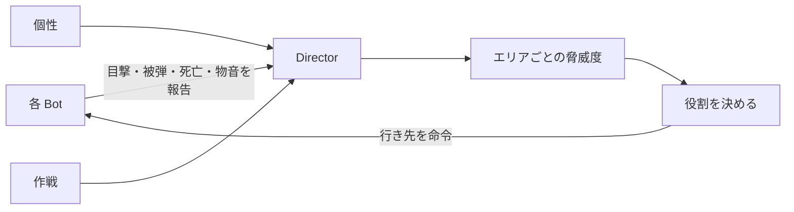

# 12. Bot のマクロな立ち回り（ローテート・裏取り・個性）

サイトへの寄り、裏取り、読み合いなど、撃ち合いの外の判断の仕様。機械学習は使わず、ルールベースで作る。**未実装**（方針の確認待ち）。

[10_defense_director](10_defense_director.md) の「防衛ディレクター」の §5 を具体化する。撃ち合いそのものは [11_bot_combat](11_bot_combat.md)。

## 1. 今の問題

| # | 症状 | 原因（実装を確認） |
|---|---|---|
| 1 | 誰も寄ってこない | `CallRotate` は他の Bot を探しているが、状態を書き換える先が「呼んだ Bot 自身」になっている。選ばれた味方は何も命令されず、自分の状態もその直後の `EngageSeen` で交戦に上書きされる |
| 2 | 味方が死んでも反応しない | 死亡を他の Bot に伝える処理が無い |
| 3 | チームの判断が無い | Bot ごとの判断しかない。「誰が残り、誰が行くか」を決める場所が無い |
| 4 | 毎回同じ | ラウンドや相手による立ち回りの違いが無い |

## 2. 目指す遊び

- **撃てば寄ってくる**：サイトで撃ち合う・倒すと味方が寄ってくる。時間をかけるほど不利になる
- **裏をかける**：A で1キルして寄ってくる間に B へ走れば、B は手薄になる
- **読み負けもある**：フェイクが通ることも、途中で引き返されることもある
- **背中が怖い**：攻めている最中に、後ろから Bot が来ることがある
- **相手の癖が読める／読めない**：弱い相手は毎回同じことをしてくるので、癖を見抜けば勝てる。強い相手は1ラウンド目に裏詰めで圧をかけ、次からは普通に守るなど、的を絞らせない

## 3. 守ること

1. **ズルをしない**。チームが知っている情報だけで判断する。プレイヤーの現在位置を直接読んで動かない
2. **情報には遅れがある**。この遅れがプレイヤーの「裏をかく時間」になる
3. **判断は1回の出来事につき1回**。0.25 秒ごとに抽選し直さない（挙動がブレるため）
4. **決めたら少しは続ける**。短い時間で行ったり来たりしない

## 4. 全体の構成

判断を3つの層に分ける。

| 層 | いつ決まるか | 内容 |
|---|---|---|
| 個性 | 試合開始時（試合中は固定） | Bot ごとの性格。何をしたがるか |
| 作戦 | ラウンド開始時 | そのラウンドのチーム方針。弱い相手は同じ作戦を繰り返す |
| 状況判断 | 試合中ずっと（0.25 秒ごと） | 脅威度を見て、誰がどこへ行くかを決める |

新しいアクター `BP_PR_Director` が判断を担当する。`AIController` には、命令された場所へ移動する State 5「Reinforce」と State 6「Flank」を足す。

Bot の判断の優先順位：**交戦 ＞ Director の命令 ＞ 持ち場・巡回**。設置後の取り返しは Director より優先する。

## 5. 個性

試合開始時に、各 Bot へ次のどれかを割り当てる。ラウンドが変わっても同じ枠の Bot は同じ個性（Bot は毎ラウンド作り直すので、`GameMode` が枠番号ごとに覚える）。

| 個性 | 特徴 | 残る | 寄る | 裏取り | 引っかかる |
|---|---|---|---|---|---|
| 堅実 | 持ち場を離れない | 高 0.85 | 低 0.30 | 低 0.05 | 低 0.5 倍 |
| 寄り屋 | すぐ助けに行く | 低 0.30 | 高 0.90 | 低 0.10 | 高 1.3 倍 |
| 裏取り屋 | 一人で後ろへ回る | 低 0.30 | 中 0.40 | 高 0.75 | 中 1.0 倍 |
| 前のめり | 前へ出て圧をかける | 低 0.15 | 高 0.80 | 中 0.35 | 高 1.3 倍 |

数値は確率。使い方は §7。

### チーム編成の決め方

| 難易度 | 編成 |
|---|---|
| イージー | 完全にランダム（全員同じ個性になることもある＝偏ったチーム） |
| ノーマル | ランダムだが、3 体全員が同じ個性にはならない |
| ハード／ベリーハード | 必ず 堅実 1 と、寄り屋か裏取り屋を 1 含む（バランスの良いチーム） |

## 6. 作戦（ラウンド開始時に決める）

| 作戦 | 内容 |
|---|---|
| 標準 | 持ち場を守り、情報が入ったら寄る |
| 裏詰め | 裏取りをしたがる Bot が、戦闘開始と同時に攻撃側へ回り込み、背後から圧をかける |
| 前圧 | 前のめりの Bot が、前に出る持ち場（`bForward`）まで出て早めに接敵し、撃ったら下がる |

試合の最初に、チームの「癖」となる作戦を1つ決める。作戦の選び方を難易度で変える。

| 難易度 | 選び方 | 遊んだときの印象 |
|---|---|---|
| イージー | 85% で癖の作戦。毎回同じことをする | 「また裏から来た」と読める |
| ノーマル | 55% で癖の作戦、残りはランダム | 癖はあるが外れることもある |
| ハード | R1 は 70% で裏詰めか前圧。R2 以降は前ラウンドと同じ作戦を選ばず、標準を多めに | 開幕に圧をかけ、次は普通に守る |
| ベリーハード | ハードと同じ。加えて前ラウンドの結果を見る：裏取りが効いた（裏取り役が倒した）なら続け、すぐ倒されたらやめて数ラウンド後にまた使う | 対応すると変えてくる |

## 7. 情報と判断

### 脅威度

各エリア（A / ミッド / B）に脅威度を持つ。位置は最寄りの `BP_HoldPoint` の `Area` で分類する。

| 出来事 | 加点 | 報告する位置 |
|---|---|---|
| 味方の死亡 | +100 | 死亡した場所 |
| 敵を目撃（接敵した瞬間のみ） | +60 | 敵の位置 |
| 被弾 | +50 | 撃たれた Bot の位置 |
| 銃声を聞いた | +30 | 音の位置 |
| 足音を聞いた | +15 | 音の位置 |

- 時間で減る（半減期 8 秒）
- 本人以外に届くまで `CallDelay` の遅れがある（ノーマル 1.5 秒）
- 脅威度が 40 以上で最大のエリアを「ホット」とする。切り替えるには現在のホットより 30 以上高い必要がある

### 判断のルール（上から順に評価）

| 順 | 条件 | 動き |
|---|---|---|
| 1 | スパイク設置済み | 全員取り返し（既存）。裏取り中の Bot は背後から向かう |
| 2 | 生存 1 体 | 最も近いサイトの奥で待ち伏せ。自分からは攻めない |
| 3 | 新しい出来事でサイトがホットになった | 各 Bot が1回だけ抽選し、**寄る／残る／裏取りする** を決める（下） |
| 4 | ホットなミッドあり | ミッドに近い1体だけが確認に行く |
| 5 | 情報なしが続く | 密集を崩す（§9） |
| 6 | それ以外 | 持ち場・巡回 |

### 抽選（誰が行くか）

サイトがホットになった出来事ごとに、交戦していない Bot が1回ずつ抽選する。

1. 裏取りの確率で当たれば「裏取り」（1 ラウンドに 1 体まで。生存 2 体以下では行わない）
2. 外れたら、出来事の強さに応じた寄りの確率で「寄る」、外れたら「残る」

| 出来事 | 寄りの確率 |
|---|---|
| 目撃・銃声だけ | 個性の「寄る」× 0.5 |
| 味方が死んだ | 個性の「寄る」そのまま |
| 2 体以上死んだ／複数回の目撃 | 全員寄る（抽選なし） |

- 「残る」が1体も出なければ全員が寄る。**反対側を空けるかどうかは抽選の結果で決まる**（全員寄りが起きることも、誰も寄らないこともある）
- 誰も寄らない結果は少し寂しいので、味方が死んだのに寄る Bot が 0 体なら、一番近い Bot を1体寄らせる
- 交戦中の Bot は対象外

## 8. 移動

### 寄る

- 目的地は**敵の位置ではなく**、そのサイトの空いている持ち場のうち一番近いもの
- 走る（足音が鳴る。プレイヤーの情報源になる）。サイト間は約 7〜10 秒の見込み
- 到着したら止まって入口を見張り、3 秒間何も無ければ報告された位置へ歩いて確認する
- 2 体で寄るときは、片方が手前で最大 2.5 秒待ち、なるべく同時に入る（ノーマル以上）

### 裏取り

攻撃側を通って背後へ回る。新しい配置物 `BP_FlankPoint`（通過点）を `L_Pind` に置いて経路を決める。

| 向かう先 | 経路（座標は m） | 所要 |
|---|---|---|
| A サイトの背後 | ミッド → ミッド通路 (-19, 0) → 攻撃スポーン (-34, -34) → A 通路 (-20, -34) → A メイン手前 (3, -34) | 約 15 秒 |
| B サイトの背後 | 上の左右反転 | 約 15 秒 |

- 途中は走り、最後の約 20m は歩いて足音を消す（新しい `bSilentStep`）
- 道中でプレイヤーを見つけたら撃ち合い
- 着いても誰もいなければ、最後に報告された位置へ向かう
- プレイヤーの位置を知っているわけではない。「ホットなサイトの背後」へ向かうだけなので、外れることもある
- 裏詰めの作戦では、戦闘開始と同時に出発する（情報なしで、Bot の割り当てられたサイト側へ）

## 9. 読み合いのルール

| 仕組み | 内容 |
|---|---|
| フェイクへの反応 | 寄っている途中で別のサイトがホットになったとき、**道のりの半分より手前なら確率で引き返す**（難易度の値 × 個性の「引っかかる」）。半分を過ぎたら引き返さない |
| 引き返しの制限 | 1 体につき 20 秒に 1 回まで |
| 空振り | 到着して 6 秒間何も起きなければ、最も手薄なサイトへ戻る |
| 穴埋め | 死亡で誰もいなくなったサイトには、10 秒間情報が無ければ 1 体が移動する |
| 密集を崩す | サイトに 2 体以上いて一定時間情報が無ければ、個性の「残る」が低い Bot から 1 体が反対へ移る |
| 終盤 | 残り 25 秒で未設置なら深追いしない（時間切れで防衛側の勝ち）。裏取りも新しくは始めない |

## 10. 難易度

| 値 | イージー | ノーマル | ハード | ベリーハード |
|---|---|---|---|---|
| 報告の遅れ（秒） | 2.5 | 1.5 | 0.8 | 0.4 |
| フェイクで引き返す確率（基準） | 20% | 40% | 60% | 75% |
| 2 体の合流待ち | しない | する | する | する |
| 密集を崩すまで（秒） | 45 | 30 | 20 | 15 |

現行の「イージーは寄らない」はやめる（遅いが寄る）。

## 11. 想定する場面

| 場面 | 期待する動き |
|---|---|
| 標準配置で A の1体を倒す（ノーマル） | 約 1.5 秒後に各 Bot が抽選。寄り屋は高確率で A へ、堅実は B に残りやすい。全員寄ることも稀にある |
| A で1キルしてすぐ B へ走る | 寄った Bot が着く頃には B は手薄。B で音を立てると、途中なら引き返すことがある |
| A に 3 体（スタック）で B へ回る | B は無人。音が出て初めて向かう。その前に静かな時間が続けば 1 体が B へ移っている |
| イージーで毎ラウンド裏詰めが癖 | 開始直後に裏から来る。読めれば待ち伏せして倒せる |
| ハードの R1 で裏詰め、R2 で標準 | R1 の背後を警戒して動きが遅くなると、R2 は普通に守られて噛み合わない |
| 攻めている最中に裏取りが来る | 最後の約 20m は足音が無く、背後から撃たれる |
| 2 体倒して残り 1 体 | 最後の 1 体はサイト奥で待ち、設置されたら取り返しに来る |

## 12. 実装の順番と確認

| 段階 | 内容 | 確認（PIE） |
|---|---|---|
| 1 | Director、報告、脅威度。`[Director]` のログ | 死亡や目撃で脅威度が上がる |
| 2 | 個性の割り当て、State 5 Reinforce、抽選。`CallRotate` を置き換え | 1 体倒すと個性どおりに寄る／残る |
| 3 | 到着後の見張りと確認、合流待ち | 敵の位置へ直行しない |
| 4 | `BP_FlankPoint`、State 6 Flank、足音を消す | 裏取りの経路を通り背後へ出る |
| 5 | 作戦の選択、癖、前ラウンドの結果 | 難易度ごとの作戦の出方をログで確認 |
| 6 | フェイクへの反応、空振り、穴埋め、密集崩し、終盤 | §11 の場面を順に確認 |
| 7 | 難易度の値 | 4 段階の差 |

個性と作戦は画面には出さず、ログにだけ出す。

今回の対象外：前ラウンドの攻め先による配置の変更（[10](10_defense_director.md) §6）。

## 13. 実装結果（v0.29）

`BP_PR_Director`（新規）、`BP_PR_AIController`（Reinforce / StartFlank / FlankThink）、`BP_PR_GameMode`（`SetupMacro`）、`BFL_PR`（`DirReport` / `DirShot`）に実装した。ラウンド開始時に `[Macro] plan=… habit=…` をログへ出す。

### 実装時に直した不具合
- 配列のつもりの変数（`Personality`、Director の `Pend*`）を単体の値で作っていたため、範囲外アクセスと、Director の Tick の無限ループでエディタが固まった。配列の変数（`Personality`、`QTime` / `QArea` / `QPts` / `QKind` / `QLoc`）に作り直し、ループの配線も切った。古い `Pend*` は未使用のまま残っている

### 仕様との差分（簡略化）
| 項目 | 実装 |
|---|---|
| 個性の割り当て | AIController の並び順で Personality の配列を引く |
| 寄る先 | サイトごとの固定点（ランダム ±300cm）。HoldPoint ベースではない |
| 裏取りの経路 | `BP_FlankPoint` は作らず、経由点を Director に直書き |
| ベリーハード | ハードと同じ扱い |
| 穴埋め・密集崩し | **未実装**（`DenseTime` の値だけ難易度で持っている） |
| 足音を消す、到着後の確認、2 体の合流待ち | **未実装** |

### 確認できたこと（PIE、イージー）
- `StartRound` で Director が生成され、`[Macro]` のログが出る。スクリプトエラーは出ない
- A 側の Bot を倒すと、ミッドにいた Bot が A サイト付近（x≈2400, y≈-1780）へ走って止まった

### 確認できていないこと
- 裏取り（State 6）の経路と背後への到達
- 作戦（標準 / 裏詰め / 前圧）の出方と、難易度ごとの違い
- フェイクへの反応、「聞こえた」による寄り、実プレイでの手応え
