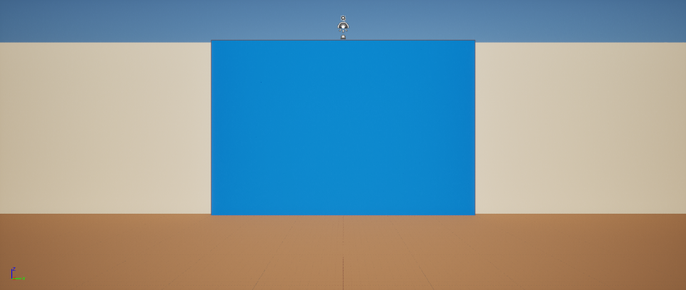
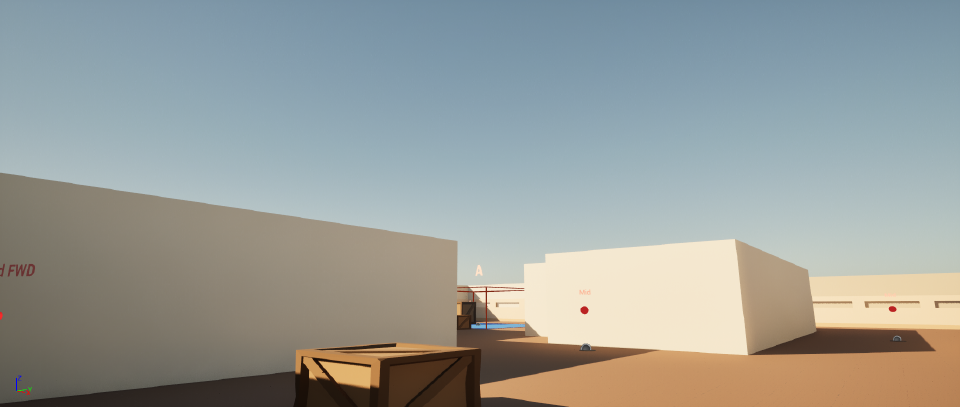
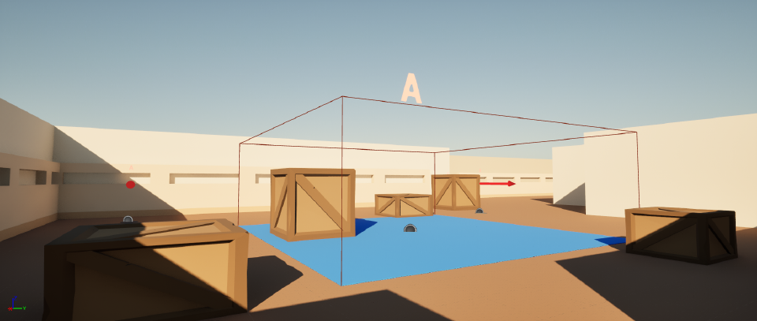

# 20. 面白さの再検討（運河の町・Bot の人間っぽさ・見た目）

v1.1 で基本機能がそろったので、ゲーム単体の面白さの観点で、マップ・Bot・見た目を作り直す方針。2026-11-12 作成。
値に（仮）と付けたものは、作って遊んでから調整する。Step の分け方は §9 と [TASK.md](TASK.md)。作るための細かい仕様は [21](21_impl_rules.md)〜[26](26_art_meshy.md)。

## 1. 決定事項（2026-11-12 ユーザー確認）

- 世界観はヨーロッパの町並み。VALORANT のアセントのような雰囲気で、参考にする実在の町はヴェネツィア
- 舞台は「運河の町」（§3）
- 空は少し褪せた青、日差しは少し夕暮れ寄り（§5）
- 特定の VALORANT マップの配置や絵作りはなぞらない。実在の町を参考にした独自のマップにする（[18](18_skills_minimap.md) の「既存ゲームの見た目は再現しない」と同じ方針）
- [09](09_open_questions.md) の Q9「マップは L_Pind のみ」と、[TASK.md](TASK.md) Step 15 の「マップ・アートの作り込みはしない」は、この文書で見直す

## 2. 今の問題

3 つの課題は、マップが箱庭の迷路のままで「場所」になっていないことが共通の原因。

### マップ（L_Pind）
| 問題 | 内容 |
|---|---|
| 完全な左右対称 | A と B が同じなので、どちらを攻めるかに理由が無い |
| 直線が長い | A 通路・B 通路が幅 6m で 34m まっすぐ。攻撃スポーンからミッドの Bot が見える |
| 高低差が無い | 見上げる・見下ろす撃ち合いが無い |
| サイトが空き地 | 22m 四方に箱 5 個。設置位置や、設置後の守り位置に選択肢が無い |
| 目印が無い | どこも同じ壁で、位置を覚えられない |

### 見た目
- 壁が全部 4m で屋根が無く、画面の約 4 割が空。残りは単色の壁と床
- 太陽が高く、影が短い。色の調整（ポストプロセス）も無い
- リアルな SWAT と迷彩の腕が、単色の世界から浮いている

### Bot
- 撃ち合い（[11](11_bot_combat.md)）と寄り・裏取り（[12](12_macro_ai.md)）の骨格はある
- 接敵の仕方が「見えたら撃ち合い開始」の 1 種類
- ミスをしない。強さの差が反応時間と狙いの誤差だけ
- 個性と作戦がログにしか出ないので、プレイヤーには行動の理由が読めない
- Bot はスキルを使わない

## 3. 舞台：運河の町

| 項目 | 内容 |
|---|---|
| 参考 | ヴェネツィアの路地、運河、太鼓橋、鐘楼、屋内の市場 |
| 建物 | 漆喰の壁（黄土・薄い赤・クリーム）、素焼きの屋根、石の縁取り、アーチ、木の鎧戸 |
| 床 | 石畳（広場）、れんが（路地）、板（船着き場）、タイル（屋内） |
| 作り | ローポリ・単色のまま。壁に腰壁と縁取りを足し、面を 3 段（大きな面・縁・小物）に分ける |
| 場外 | 運河の向こうに鐘楼と建物の影を置き、空を区切る |
| パロディ要素 | 店の看板、貼り紙、Bot の名前とチャット（§6.4） |

レベル名は `L_Canal`。表示名は「CANAL」に決定（2026-11-12、[22](22_map_canal.md) §1）。

## 4. マップの構造

広さは 70m 四方程度（L_Pind は 80m）。座標の決まりは [05](05_map.md) と同じ（+X が北＝防衛側、+Y が東＝B 側）。

### 4.1 配置の概略

```
                    北（防衛側）
   ┌───────────────────────────────────────┐
   │              [教会前：防衛スポーン]             │
   │       ┌──────┴──────┐                │
   │  [回廊]            [鐘楼の下]          [アーチ]   │
   │    │                 │                │      │
   │ [A 市場]              │            [B 広場]    │
   │  屋内・2階あり        [橋]           開けている  │
   │    │            ～～～～～～～運河～～～～～～│
   │ [市場の入口]     [橋の手前の広場]      [石橋]    │
   │    │                 │                │      │
   │ [路地（2回折れる）]     │           [岸壁の道]   │
   │    └──────[船着き場：攻撃スポーン]────┘      │
   └───────────────────────────────────────┘
                    南（攻撃側）
```

運河はマップの中央から東の端まで東西に流れる。西側（A 側）は建物が詰まった路地。

### 4.2 エリア

| エリア | 役割 | 撃ち合いの性格 |
|---|---|---|
| 船着き場 | 攻撃スポーン | — |
| 路地 | A への主ルート。2 回折れる。幅 3.5〜4m | 角ごとの近距離 |
| 市場の入口 | A のチョーク。幅 3.5m のアーチ | 近距離 |
| A 市場 | 屋内のサイト。柱とアーチ、2 階の回廊（防衛側から上がれる。サイト内にも階段 1 つ） | 近距離、上下 |
| 橋の手前の広場 | ミッドの攻撃側。噴水と屋台が遮蔽 | 中距離 |
| 橋 | 太鼓橋。頂上が +1.5m。跳ね橋（§4.4） | 渡る側が姿をさらす |
| 鐘楼の下 | ミッドの防衛側。回廊（A へ）とアーチ（B へ）に分かれる | 中距離 |
| 岸壁の道 | B への主ルート。運河沿いで、対岸の B 広場が見える | 遠距離（対岸と撃ち合える） |
| 石橋 | B のチョーク。常に渡れる固定の橋 | 中距離 |
| B 広場 | 屋外のサイト。奥に船着き場の段差（−1m）と、井戸・荷車の遮蔽 | 遠距離が 1 本、ほかは中距離 |
| 教会前 | 防衛スポーン | — |

- A は狭く近距離向き、B は開けて遠距離向き。武器と得意な距離でサイトを選ぶ理由を作る
- 長い直線は、岸壁の道から B 広場への 1 本だけ意図的に残す
- 高低差は 2 段まで（橋の頂上、A の 2 階、B の船着き場の段差）

### 4.3 寸法と所要時間の目標（仮）

| 項目 | 目標 |
|---|---|
| 攻撃スポーン → A / B サイト（主ルート） | 走って 12〜14 秒 |
| 攻撃スポーン → サイト（ミッド経由） | 走って約 10 秒 |
| 防衛スポーン → サイト | 走って 5〜6 秒 |
| A ⇔ B の移動（攻撃側、スポーン経由） | 約 14 秒 |
| A ⇔ B の移動（攻撃側、ミッド経由） | 約 9 秒 |
| 防衛側がチョークに着く時刻 | 攻撃側より 1〜2 秒早い |
| 建物の高さ | 6〜10m（今の 4m の壁はやめる） |

### 4.4 サイトの設置位置

設置後は 1 人で守るので、設置位置の選択がそのまま面白さになる。サイトごとに 3 種類を作る。

| 種類 | 設置のしやすさ | 設置後の守りやすさ |
|---|---|---|
| 入口のすぐ内側 | 安全（遮蔽の陰） | 入口の外から見えず、守りにくい |
| サイトの中央 | 2 方向から見られる | 外の 2 か所から見張れる |
| 奥の開けた位置 | 危険 | 遠くから見張れる（B は対岸から、A は路地の奥から） |

### 4.5 ギミック：跳ね橋と鐘

ミッドの橋は約 45 秒ごと（仮）に上がる。

| 順 | 時間（仮） | 内容 |
|---|---|---|
| 予告 | 3 秒 | 鐘が鳴り始める。橋の両端の灯りが点滅する |
| 上がっている間 | 6 秒 | 橋を渡れない。上がった橋板が壁になり、ミッドの射線も切れる。鐘が鳴り続け、**走る足音が Bot に聞こえない**（プレイヤーにも Bot の足音が聞こえにくい） |
| 下りる | 1 秒 | 元に戻る |

- ねらい：渡るか待つか、鐘に紛れて反対のサイトへ走るか、の判断を作る
- Bot も橋が上がっている間は渡れない（ナビメッシュを動的に切る）。寄りの経路が遠回りになるので、プレイヤーが裏をかける時間になる
- 最初の 1 回は戦闘開始から 20〜35 秒後のどこか（仮）。毎ラウンド同じ時刻にしない

### 4.6 作り直しになるもの

壁の生成スクリプト（`docs/tools/map_layout_l_proto.py` の方式を流用）、持ち場ポイント、裏取りの経由点、配置パターン（`DT_DefenseSetups`）、ミニマップ画像、マップ紹介の鳥瞰カメラ、Director の寄り先の固定点。L_Pind は残す。

## 5. 空と日差し

ねらいは「少し褪せた青い空、少し夕暮れ寄りの光」。影を長くし、日なたは暖色、日陰は青みに分ける。

| 対象 | 設定（初期値。§5.1 に試した結果） |
|---|---|
| 太陽（Directional Light） | 高さ 約 25°（今より低く）。色は薄い橙。影が路地を斜めに横切る向き |
| 空（Sky Atmosphere） | 青の散乱を弱め、かすみ（Mie）を強めて、彩度の低い水色にする。地平線は薄い桃色〜クリーム |
| 霧（Exponential Height Fog） | 薄く入れる。色は薄い藤色。遠くの建物を空に溶かす |
| 環境光（Sky Light） | 日陰が黒くつぶれない強さ。少し青み |
| ポストプロセス | 彩度をやや下げる。ハイライトを暖色、シャドウを寒色に寄せる。露出は固定（屋内外で明るさが揺れないように） |
| 雲 | まばらな薄い雲（仮）。重い雲は置かない |

### 5.1 L_Pind で試した結果

2026-11-12 に L_Pind の光だけを変えて試した（形・素材はそのまま）。エディタのビューポートで確認。

| 変更前 | 変更後（ミッド） | 変更後（A サイト） |
|---|---|---|
|  |  |  |

| 対象（アクター名） | 変更前 | 変更後 |
|---|---|---|
| 太陽（`SunLight`） | 高さ 50°、向き 35° | 高さ 27°、向き 40°、強さ 7、色 (1.0, 0.92, 0.8) |
| 空（`SkyAtmosphere`） | 既定値 | `MieScatteringScale` 0.005（既定 0.004 より少しかすませる）。青の散乱は既定のまま |
| 霧（`HeightFog`） | — | 密度 0.008、`FogHeightFalloff` 0.2、色は 0（空の色に任せる） |
| 環境光（`SkyLight`） | — | 強さ 1.8、色 (0.88, 0.92, 1.0) |
| ポストプロセス（`PP_Mood`、新規、レベル全体） | 無し | 彩度 0.9、ハイライト (1.07, 1.0, 0.9)、シャドウ (0.94, 0.98, 1.1)、周辺減光 0.3、ブルーム 0.4 |

分かったこと：
- 空が灰色になる原因が 2 つあった。霧に固定の色を入れると空全体に灰色がかぶる。太陽の色を強い橙にすると、空の青も一緒に濁る。空の褪せ具合は、太陽を低くすることとポストプロセスの彩度で作り、太陽の色は薄い暖色にとどめるのがよい
- 太陽が 27° だと、高さ 4m の壁の影が約 8m 伸び、幅 6m の通路はほぼ日陰になる。新マップでは建物の高さと通路の向きを、日なたと日陰の配分を見ながら決める

未確認：
- 実際のプレイ画面（PIE）での見え方。Bot の見やすさ、日陰での視認性
- 露出の固定はまだ入れていない（屋内を作ったあと、Step 38 で行う）
- ミニマップの画像（`T_PR_Minimap_Pind`）は撮り直していない（静止画なので影響なし）

### 5.2 L_Canal の最終値（Step 38、2026-11-14）

建物の高さ（壁 8m、屋根 〜9.6m、場外 12〜20m、鐘楼 28m）と色が決まった状態で見直した結果。値は `docs/tools/map_light_l_canal.py` にある。詳しくは [26](26_art_meshy.md) §7.5。

| 対象 | 5.1 の値 | 最終値 |
|---|---|---|
| 太陽（`SunLight`） | 高さ 27°、向き 40°、強さ 7、色 (255, 235, 204) | 変更なし。路地は日陰、広場は日なた |
| 環境光（`SkyLight`） | 強さ 1.8、色 (224, 235, 255) | 強さ 7.0、色 (236, 242, 252)。日陰を底上げ（日陰は青みのスレート色） |
| 空（`SkyAtmosphere`） | 既定（`SkyLuminanceFactor` 1） | `SkyLuminanceFactor` 2.4。露出を固定したときに空が暗い紺にならないように |
| 露出（`PP_Mood`） | 自動露出（ヒストグラム、Min -10、Max 20） | Min = Max = EV 1.5 で固定（バイアス 1.0）。屋内外で明るさが変わらない |
| A の灯り（`A_Lamp_*`） | 8000 cd、色が青（引数順の誤り） | 110 cd、色 (255, 214, 164) |
| 街灯（`Art_StreetLamp_*`、9 個） | 無し | 30 cd、半径 9m、色 (255, 190, 120)、影なし |

- 場外の建物と鐘楼は影を落とさない設定にした（落とすと、太陽が南西から 27° のため、外の高い建物の影が 20m 以上マップの中へ入り、船着き場・広場の日なたが日陰になった）
- 5.1 の「A の灯りが効いて見えない」の原因は、灯りの色が青になっていたこと（`unreal.Color` の引数順は (B, G, R, A)）
- 5.1 の未確認「PIE での見え方」「露出の固定」は、PIE で確認した（5.2 の値）。最終の光では、味方・敵とも日なた・日陰の両方で背景に埋もれず見えた（ハードでの動きの中は未確認）

## 6. Bot の人間っぽさ

### 6.1 未実装・未確認を埋める
[12](12_macro_ai.md) §13 の残り：裏取りの忍び足、到着後の見張りと確認、2 体の合流待ち、穴埋め、密集崩し。[11](11_bot_combat.md) §9 の未確認：遮蔽に隠れてのリロードと出直し。

### 6.2 覗き方の種類
接敵の仕方を、状況と個性で選ぶ。

| 覗き方 | 内容 | 使う場面 |
|---|---|---|
| 少しずつ見る | 角を歩きで少しずつ開いて確認する | 捜索、取り返し |
| 一瞬だけ出る | 顔を出してすぐ戻る。見えたら次は撃ちに出る | 敵がいそうな角 |
| 大きく飛び出す | 角から横へ大きく出て、止まって撃つ | 前のめりの個性、2 体での突入 |
| 置いておく | 音がした角へ先に照準を合わせて待つ | 足音・銃声を聞いたとき |

### 6.3 ミス
強さは反応時間ではなく、ミスの頻度で差を付ける（確率は難易度と個性で決める）。

| ミス | 内容 |
|---|---|
| 焦る | 近距離で急に接敵すると、止まらずに撃ちっぱなしにする |
| 悪いリロード | 弾が少し減っただけで、遮蔽に入らずにリロードする |
| 空振りの警戒 | 誰もいない角を数秒見張り続ける |
| 釣られる | 足音やスキルの音に寄りすぎて、持ち場を空ける |
| 視野が狭い | 交戦直後は、最後に見た方向しか見ない |

### 6.4 個性を見えるようにする
今の個性（堅実・寄り屋・裏取り屋・前のめり）に、「ランクマッチにいそうな人」としての名前とチャットを付ける。

- Bot に名前を付け、キルログ（誰が誰を倒したか）に出す
- チャット欄に短い文を出す。例：寄るとき「A 行く」、裏取りに出るとき無言、倒されたとき「え、そこ？」、勝ったとき「gg」
- 個性ごとに口調を変える（堅実は報告だけ、前のめりは強気、など）
- チャットは情報にもなる（「A 行く」が出たら B が手薄）。出す量は難易度で変える（強い相手は報告が少ない）

### 6.5 Bot のスキル
プレイヤー用の実装（[18](18_skills_minimap.md)）を流用する。

| スキル | 使う場面 |
|---|---|
| スモーク | 取り返しで、サイトの入口やスパイクの上に置く |
| フラッシュ | 飛び出す前に角の向こうへ投げる |

1 ラウンドに Bot 全体で 1〜2 回まで（仮）。イージーは使わない。

## 7. 見た目

| 対象 | 内容 |
|---|---|
| 建物 | §3 のとおり。屋根、アーチ、渡り廊下で空の面積を減らす |
| 遮蔽物 | 箱を、木箱・樽・荷車・屋台・井戸に置き換える。高さの 2 種類（1m / 2m）は守る |
| Bot | 単色寄りのマテリアルにし、赤い輪郭線を付ける。見やすさと世界との統一のため |
| 腕 | 迷彩をやめ、Bot と同じ調子の単色にする |
| 設置エリア | 床の青い板をやめ、石畳に描いた枠と文字にする |

## 8. ほかのアイディアと採否（2026-11-12 ユーザー決定）

| 案 | 内容 | 決定 | 仕様 |
|---|---|---|---|
| 演出の強化 | キルログ、連続キルで音が上がる、ラウンド終了の称号 | **全部取り込む** | [23](23_bot_human.md) §6.2、[24](24_presentation_audio.md) §2〜3 |
| やられた理由の表示 | 死亡時に、撃った Bot の位置と、与えた・受けたダメージ | **取り込む** | [24](24_presentation_audio.md) §4 |
| 環境音と音楽 | 水音、鳥、鐘。残り 10 秒と設置後の曲 | **取り込む**（Python の合成で作る。追加のツールなし） | [24](24_presentation_audio.md) §5 |
| 味方 Bot | とても弱い味方を、おとり・索敵役として使う | **取り込む**（頼れる味方は作らない） | [25](25_ally_bot.md) |
| ランクの成長 | 勝つとランクが上がる | **不要** | — |
| 攻守交代 | 後半は守備側 | **今は取り入れない** | — |

Bot まわりの決定：
- 未実装の残り、覗き方の種類、Bot のスキルは取り込む。ミスは簡単に作れる範囲で取り込む
- 「ランクマッチにいそうな人」の名前とチャットを取り込む。口が悪い人（ラウンドを取ると `GG EZ` `noob` と言う）も、ふつうの反応（倒されて `why!?`、ワンタップされて `nice shot`）も入れる
- 撃ち合いに、うまいプレイヤーの動き（左右に刻みながら撃つ、しゃがみ撃ちなど）をランダムに混ぜる

見た目の道具：Meshy（サブスクリプション）と Blender MCP を使う（[26](26_art_meshy.md)）。

## 9. 進める順番

構造を先に固め、見た目は最後にする（見た目を先に作ると、構造を直すときに作り直しになる）。
実装は Sonnet、相談役は Opus。共通の決まりは [21](21_impl_rules.md)。

| Step | 内容 | 仕様 |
|---|---|---|
| 26 | この文書、空と日差しの試作（L_Pind）、Step 27 以降の仕様書 | 20〜26 |
| 27 | マップ情報の仕組み化 | [22](22_map_canal.md) §2 |
| 28 | L_Canal のブロックアウト | [22](22_map_canal.md) §3〜5 |
| 29 | L_Canal のゲーム配置 | [22](22_map_canal.md) §6〜8 |
| 30 | Bot：未実装の残り | [23](23_bot_human.md) §2 |
| 31 | Bot：撃ち合いの型、覗き方、ミス | [23](23_bot_human.md) §3〜5 |
| 32 | Bot：名前、チャット、キルログ | [23](23_bot_human.md) §6 |
| 33 | 演出：連続キルの音、称号、やられた理由 | [24](24_presentation_audio.md) §2〜4 |
| 34 | Bot のスキル | [23](23_bot_human.md) §7 |
| 35 | 跳ね橋と鐘 | [22](22_map_canal.md) §9 |
| 36 | 環境音と音楽 | [24](24_presentation_audio.md) §5 |
| 37 | 味方 Bot | [25](25_ally_bot.md) |
| 38 | 見た目（Meshy、建物、キャラクター、光の仕上げ） | [26](26_art_meshy.md) |
