# 22. 新マップ「運河の町」の実装仕様（Step 27〜29・35）

方針は [20](20_canal_town_concept.md) §3〜4。この文書は、作るための寸法と手順。進め方は [21](21_impl_rules.md)。2026-11-12 作成。
座標は m、+X が北（防衛側）、+Y が東（B 側）、床の上面が Z=0（[05](05_map.md) と同じ）。Unreal 上は cm（×100）。

## 1. 名前

- レベル：`/Game/PARORANT/Maps/L_Canal`
- 表示名：**「CANAL」に決定**（2026-11-12、ユーザー。候補だった PONTE・PANAL は取りやめ）。**2026-11-16（Step 44）に「PACENT（パセント）」へ変更**（[31](31_canal_sky_island.md) §6）。表示は `L_Canal` の `MapInfo.MapName`（と開発者用マップ選択の `GameInstance.MapNames`）
- 遊ぶマップは L_Canal だけにする。L_Pind は開発用に残すだけで、スタート画面でマップを選ぶ仕組みは作らない。起動マップを L_Canal に変えるのは、ユーザーが試遊して形を確認してから（Step 29 の完了条件）

## 2. Step 27：マップ情報の仕組み化（L_Pind で先に行う）

今は、マップごとの値が Blueprint に直書きされている。新マップを足す前に、レベルに置くアクターへ移す。**この Step では遊びの中身を変えない**（L_Pind で動きが変わらないことが完了条件）。

### 2.1 `BP_PR_MapInfo`（新規、レベルに 1 個）

| 変数 | 型 | 内容 | 今の置き場所 |
|---|---|---|---|
| `MapName` | Text | 表示名 | `WBP_MapIntro` の直書き |
| `MinimapTex` | Texture2D | ミニマップ画像 | `BP_PR_HUD.DrawMinimap` |
| `MinimapMin` / `MinimapMax` | Vector2D | 画像が写す範囲（cm） | 同上（-4000〜+4000 の直書き） |
| `SiteDestA` / `SiteDestB` | Vector | Director の寄り先 | `BP_PR_Director` の `SiteDest` |
| `IntroCamLoc` / `IntroCamRot` | Vector / Rotator | マップ紹介の鳥瞰カメラ | `WBP_MapIntro` まわり |
| `FlankFallback` | bool | 経由点が無いとき直書きの値を使うか（L_Pind のみ true） | `BP_PR_AIController.StartFlank` |

- `BP_PR_GameMode` の BeginPlay で `GetActorOfClass` して `MapInfo` 変数に持つ。各所はそこから読む
- レベルに無ければ、今の直書きの値で動く（L_Range を壊さないため）

### 2.2 `BP_AreaName`（新規、箱の範囲。レベルに複数）

| 変数 | 型 | 内容 |
|---|---|---|
| `Box` | BoxCollision（当たり判定なし） | 範囲 |
| `DisplayName` | Text | 場所の名前（「路地」「橋」など） |
| `Area` | Name | `A` / `B` / `Mid` / `None`（Director の脅威度の分類用） |
| `PredictSite` | int | ハードの予測移動で、ここにいたら向かうと見なすサイト（0 なし／1 A／2 B） |

- `BFL_PR.AreaAt(Location)`：位置を含む `BP_AreaName` を返す（無ければ空）。範囲が重なる場合は体積の小さい方
- 使い道：①HUD の現在地表示（ミニマップの下に 1 行）、②Director の位置の分類（今は最寄りの `BP_HoldPoint` の `Area`。`BP_AreaName` があればそちらを優先）、③ハードの予測移動（[18](18_skills_minimap.md) §6.5 の座標の直書きを置き換え）、④Bot のチャットの場所の報告（[23](23_bot_human.md) §6）
- L_Pind には、今の予測移動の範囲（A 通路、B 通路、ミッド）と各エリアを覆う箱を置く。ミッドの「Y の変化で A / B を決める」処理は残す（`PredictSite` が 0 でエリアが Mid のとき）

### 2.3 完了条件
- L_Pind で 1 試合の流れ（紹介画面 → 購入 → 戦闘 → 設置 → ラウンド終了）が今までどおり動く
- ミニマップの位置がずれない。現在地の名前が出る
- Bot を 1 体倒すと、今までどおり寄りが起きる（`[Director]` のログで分類が A / B / Mid になっている）

### 2.4 実装結果（Step 27、2026-11-12）
実装したもの：
- `BP_PR_MapInfo`（Actor、`Content/PARORANT/Blueprints/World/`）。変数は §2.1 の表どおり（`MapName`、`MinimapTex`、`MinimapMin`/`MinimapMax`、`SiteDestA`/`SiteDestB`、`IntroCamLoc`/`IntroCamRot`、`FlankFallback`）。クラスの初期値は L_Pind の直書きの値（PIND、`T_PR_Minimap_Pind`、-4000〜+4000、A(2700,-2000,0)、B(2700,2000,0)、(0,0,7600)・(-90,0,0)）。L_Pind に `MapInfo` を 1 個置き、`FlankFallback` だけ true にした
- `BP_PR_GameMode`：変数 `MapInfo`。BeginPlay の先頭で `GetActorOfClass`。**レベルに無いときは、初期値のままの `BP_PR_MapInfo` をスポーンし、`FlankFallback` を true にして持つ**（L_Range など、今の直書きの値で動く。ログ `[Map] MapInfo not found in level...`）。`PlayIntro` の鳥瞰カメラの位置・向きは `MapInfo` から読む
- `BP_PR_HUD`：変数 `MapMinX`/`MapMaxX`/`MapMinY`/`MapMaxY`（初期値 ∓4000）。`DrawMinimap` の先頭（`MapInfo` が有効なとき）で `MapInfo` から `MapTex` と 4 つの値を写す。`MapDot`・`MapCircle`・`MapTri` の数式の `4000`・`8000` を、この 4 つの変数を使う式に置き換えた（u = (Y − MinY)/(MaxY − MinY)、v = (MaxX − X)/(MaxX − MinX)。L_Pind では以前と同じ値）
- `WBP_MapIntro`：`Construct` の最後で `MapName` に `MapInfo.MapName` を入れる
- `BP_PR_Director.SiteDest`：A・B の寄り先を `MapInfo.SiteDestA`/`SiteDestB` から読む（ミッドの (2200, 0) と ±300 のばらつきは直書きのまま）
- `BP_PR_AIController.StartFlank`：経由点が 1 個も無いときの直書きの値は、`MapInfo.FlankFallback` が true のときだけ使う
- `BP_AreaName`（Actor、`Box` = BoxCollision を根にして衝突なし・ゲーム中は非表示）。変数 `DisplayName`・`Area`・`PredictSite`。関数 `Contains(Loc)`、`Volume`（純関数）、`GetVolume`（他の箱から呼ぶための、`Volume` を返すだけの関数。純関数は他のアクターを対象にできなかったため）、`IsBest(Loc)`（含み、かつ重なる箱の中で体積が最小）、`AreaIdx`（A=0、Mid=1、B=2、それ以外=-1）
- `BFL_PR.AreaAt(Ctx, Location)`（`Actor` を返す）と `BFL_PR.AreaInfoAt(Ctx, Location)`（`bFound`、`AreaIdx`、`PredictSite`、`DisplayName` を返す）
- `WBP_GameHUD`：`AreaText`（ミニマップの下、(32, 328)）と関数 `UpdateArea`（`Tick` から呼ぶ）。`CheatText` は重ならないよう y を 336 から 364 に下げた
- L_Pind に `BP_AreaName` を 17 個置いた（下の表、フォルダ `Gameplay/Areas`）

仕様との差分（実物に合わせた）：
- **Director の位置の分類は「最寄りの `BP_HoldPoint` の `Area`」ではなかった**。実物の `AreaOf` は Y だけで決める（Y < -1300 → A、Y > 1300 → B、それ以外 → Mid）。そのため「`BP_AreaName` があれば優先、無ければ今までどおり」は、`AreaOf` の中で `AreaInfoAt` を呼び、`Area` が A / Mid / B の箱に入っていればその値、それ以外（箱が無い、`Area` が `None`）は元の Y の判定、とした
- **`Area` が `None` の箱がある**。箱の `Area` は、箱の中で元の判定の答えがどこでも同じ場合にだけ A / Mid / B にした。そうでない箱（攻撃スポーンの中央、A・B ショート、ミッド奥、防衛スポーン、防衛→A/B）は `None`（＝名前を出すだけで、分類は元の判定に任せる）。ミッド奥と防衛スポーンを Mid にすると、元は予測しない場所でも「Y の変化で A / B を決める」処理が働いてしまうため
- **予測移動の対応**：`PredictSite` が 1 → 予測は A（内部の `PredArea` は 0）、2 → B（`PredArea` は 2）。0 かつ `Area` が Mid → Y の変化（元の式と同じ）。0 でそれ以外 → 予測しない（-1）。箱に入っていないときは、元の式（座標の直書き）で決める。攻撃スポーンの南端・北端は元の A / B 通路の判定（Y < -3000 または Y > 3000、X < 600）に含まれるため、`PredictSite` 付きの箱に分けた
- `AreaAt` と `AreaInfoAt` は、関数ライブラリでワールドを引くために引数 `Ctx`（Object）が要る（`DirReport` などと同じ形）
- 関数の戻り値に Blueprint クラス型を付けないため、`AreaAt` は `Actor` を返し、キャストは `AreaInfoAt` の中で行う
- ボット側のチャットの場所の報告（用途④）は Step 32 で行う（この Step では未着手）

置いた `BP_AreaName`（座標は cm。箱は X・Y の範囲、高さは Z -50〜300）：

| 表示名 | X | Y | Area | PredictSite |
|---|---|---|---|---|
| 攻撃スポーン（Area_AtkSpawn_A） | -4000〜-2800 | -3700〜-3000 | A | 1 |
| 攻撃スポーン（Area_AtkSpawn_Mid） | -4000〜-2800 | -3000〜3000 | None | 0 |
| 攻撃スポーン（Area_AtkSpawn_B） | -4000〜-2800 | 3000〜3700 | B | 2 |
| A通路 | -2800〜600 | -3700〜-3100 | A | 1 |
| B通路 | -2800〜600 | 3100〜3700 | B | 2 |
| Aメイン | 600〜1200 | -3600〜-3200 | A | 0 |
| Bメイン | 600〜1200 | 3200〜3600 | B | 0 |
| Aサイト | 1200〜3400 | -3800〜-1600 | A | 0 |
| Bサイト | 1200〜3400 | 1600〜3800 | B | 0 |
| Aショート | 400〜1400 | -2000〜-1200 | None | 0 |
| Bショート | 400〜1400 | 1200〜2000 | None | 0 |
| ミッド通路 | -2800〜-1000 | -300〜300 | Mid | 0 |
| ミッド | -1000〜1000 | -1200〜1200 | Mid | 0 |
| ミッド奥 | 1000〜3000 | -400〜400 | None | 0 |
| 防衛スポーン | 3000〜4000 | -1000〜1000 | None | 0 |
| 防衛側Aルート | 2400〜4000 | -1600〜-1000 | None | 0 |
| 防衛側Bルート | 2400〜4000 | 1000〜1600 | None | 0 |

確認：
- 机上：箱の表を、歩ける範囲（docs/05 の表、0.5m 格子で 14,448 点）で、元の `AreaOf` と元の予測の式と比べた。箱に入っていない点 0、答えが違う点 0（`docs/tools` には置いていない一時スクリプト）
- PIE（L_Pind、イージー）：紹介画面が鳥瞰（マップ名「PIND」）で出る → ラウンド 1 の購入フェーズ（「[B] で武器を購入する」）→ 戦闘（Bot の射撃で体力が減る）まで動いた。ミニマップのプレイヤーの三角と Bot の赤い点の位置は、スポーン（-3600, 0）と A ショート（900, -1600）で、実際の位置と合っていた。ミニマップの下に現在地の名前が出た（「攻撃スポーン」、A ショートに動かすと「Aショート」。日本語の表示は正しい）。重なった箱の体積比較：PIE 中に A サイトの中へ小さい箱（表示名「テスト」）を一時的に置き、その中へ動かすと「テスト」、A サイトの別の場所へ動かすと「Aサイト」（最初の実装では体積の比較が配線されておらず、先に見つかった箱が勝つ不具合があったため直した。`IsBest` が `GetVolume` を使う）
- `Director.AreaOf` を直接呼ぶと、B サイト（2300, 2700）は 2。`Director.SiteDest` を直接呼ぶと、エリア 0 で (2482, -1925)、エリア 2 で (2548, 1900)（A は (2700, -2000)、B は (2700, 2000) の ±300 の内側。ミッド (2200, 0) は未呼び出し）。`Director.Predict` を直接呼ぶと、A 通路 (-200, -3500) で `PredArea` = 0、ミッド (0, 0)（直前の Y が -3500）で `PredArea` = 2（元の式と同じ答え）
- 全 Blueprint をコンパイル（36 個、エラー 0）して保存。レベルを保存

- 上位モデルによる検証（2026-11-12）：`AreaOf`・`Predict`・`IsBest`・`AreaInfoAt` のグラフを読み、新しい予測の式が元の式と同じ形（3×上向き＋下向き−1）であることを確認。`MapInfo` が無い L_Range を PIE で起動し、ログ `[Map] MapInfo not found in level, spawned default (L_Pind values)` が出て、実行時のエラー（Accessed None）が無いことを確認
- 気づいた点：`WBP_GameHUD.UpdateArea` は毎フレーム `AreaInfoAt` を呼び、その中で箱の数だけ `GetAllActorsOfClass` が走る（17 個なら問題ない重さ。箱が増える Step 29 で、0.2 秒おきにするか見直す）

未確認：
- `StartFlank` の `FlankFallback` の分岐（L_Pind には経由点があるため動いていない）
- Bot を 1 体倒したあとの寄りと、`[Director]` の分類のログ（`Director` に分類を出すログが元から無く、ログポイントも置いていない。ハード以上での `[Predict] site=` のログ）
- 購入操作そのもの、設置、ラウンド終了までの 1 試合の通し
- ハードでの `PredPick` による寄り（`Predict` の判定の答えは直接呼んで確認した）
- ミニマップの A / B の文字の位置は割合の直書きのまま（`DrawMinimap`。Step 29 で `MapInfo` へ移すか決める）。`WBP_MapIntro` の A / B のサイトの印・位置も直書きのまま
- `PlanOne` の `Reinforce`（(200, ±3500)）、ミッドの寄り先 (2200, 0)、`AreaOf` の ±1300 の閾値は、Step 29 で扱う候補

## 3. Step 28：形（歩ける範囲）

全体は X・Y とも -36〜+36（72m 四方）。`docs/tools/map_layout_l_proto.py` を複製して `docs/tools/map_layout_l_canal.py` を作り、下の表を `WALK` に入れる。壁（歩けない所）は高さ 8m にする。

| 名前（表示名） | X | Y | 備考 |
|---|---|---|---|
| AtkSpawn（船着き場） | -36〜-26 | -30〜30 | PlayerStart は (-32, 0)、北向き |
| Alley1（路地） | -26〜-12 | -30〜-26 | 幅 4m |
| Alley2（路地の角） | -12〜-8 | -30〜-18 | 1 回目の折れ |
| Alley3（路地） | -8〜4 | -22〜-18 | 2 回目の折れ |
| AMain（市場の入口） | 4〜8 | -22〜-18 | アーチで幅 3.5m に絞る |
| ASite（市場） | 8〜26 | -32〜-14 | 18m × 18m、屋内（屋根 Z=7） |
| AShort（回廊） | 12〜16 | -14〜-6 | ミッドから A へ |
| MidLane（橋への道） | -26〜-18 | -3〜3 | 幅 6m |
| MidPlaza（橋の手前の広場） | -18〜-2 | -8〜8 | 中央に噴水（射線を切る） |
| Bridge（橋） | -2〜8 | -2.5〜2.5 | 幅 5m、頂上 +1.5m（§4） |
| BellTower（鐘楼の下） | 8〜20 | -6〜8 | |
| TowerBack（鐘楼の裏） | 20〜26 | -2〜4 | 防衛スポーンへ |
| BShort（アーチ） | 12〜16 | 8〜14 | ミッドから B へ |
| Quay1（岸壁の道） | -26〜-6 | 24〜30 | 幅 6m |
| Quay2（岸壁） | -6〜0 | 10〜30 | 運河の南岸。対岸の B 広場が見える |
| Lane（小路） | -6〜-2 | 8〜10 | 広場と岸壁をつなぐ。幅 4m |
| StoneBridge（石橋） | 0〜6 | 24〜28 | 幅 4m、平ら。常に渡れる |
| BSite（広場） | 6〜26 | 14〜34 | 20m × 20m、屋外 |
| DefSpawn（教会前） | 26〜36 | -8〜12 | Bot の中継地点 |
| DefA（教会の脇道） | 28〜32 | -20〜-8 | |
| DefADoor（市場の裏口） | 26〜28 | -20〜-16 | 幅 4m |
| DefB（広場の裏口） | 26〜30 | 12〜18 | BSite と Y 14〜18 でつながる |
| Canal（運河・歩けない） | 0〜6 | -6〜36 | 床を作らない。§4 |

- スクリプトは、Canal を「壁にしない・床も作らない」範囲として扱う（Bridge と StoneBridge の範囲は除く）
- 床は 1 枚の板ではなく、Canal を除いた範囲に敷く（Canal の両側で 2 枚に分けるなど）

## 4. Step 28：高低差と運河

| 場所 | 作り |
|---|---|
| 運河 | 水面の板を Z=-0.8 に置く（当たり判定なし）。底は Z=-2。岸に高さ 1m の石の手すり（しゃがむと隠れる）。**手すりの上に、Pawn だけを止める見えない壁（高さ 4m）を置く**（落ちない。弾と視線は通す） |
| 橋 | X -2〜2 が上りのスロープ（1.5m 上がる）、X 2〜4 が頂上（Z=1.5）、X 4〜8 が下り。`LevelPrototyping/Meshes/SM_Ramp` を使う。両脇に高さ 1m の欄干 |
| A の 2 階（回廊） | Z=3 の床。北の壁沿い X 23〜26、Y -32〜-14（幅 3m）。西の壁沿いのスロープ X 11〜23、Y -32〜-30（幅 2m）で上がる。回廊の縁に高さ 1m の手すり。飛び降りられる |
| A の屋根 | Z=7 に板。屋内は暗くなるので、暖色の PointLight を 4 個置く |
| B の高台 | X 20〜26、Y 28〜34 を Z=1 に上げる。西側と南側に段（スロープ）を付ける |

## 5. Step 28：ナビメッシュと所要時間

- NavMeshBoundsVolume はマップ全体（高さは Z=-3〜+10）。運河の上にナビメッシュができていないこと、橋・2 階・高台につながっていることを確認する
- RecastNavMesh の `RuntimeGeneration` を `DynamicModifiersOnly` にする（Step 35 の跳ね橋のため。Step 28 で入れておく）
- 走り 675cm/s で、ナビメッシュの経路長から所要時間を出す。目標から 1.5 秒以上外れたら、`WALK` の寸法を直して作り直す

| 経路 | 目標 | 机上の見積もり |
|---|---|---|
| 攻撃スポーン → A（路地経由） | 12〜13 秒 | 約 81m・12.0 秒 |
| 攻撃スポーン → B（岸壁・石橋経由） | 10〜12 秒 | 約 71m・10.5 秒 |
| 攻撃スポーン → A / B（橋経由） | 約 10 秒 | 約 67m・9.9 秒 |
| 防衛スポーン → A | 5〜6 秒 | 約 34m・5.0 秒 |
| 防衛スポーン → B | 4〜6 秒 | 約 28m・4.2 秒 |

B は着くのが早いが、岸壁の道が対岸から丸見え。A は遅いが、角で隠れながら進める。この差は意図したもの。

### Step 28 の完了条件
- 上の表を実測値で埋めて、この文書に書く
- 真上からのスクリーンショットを `docs/images/l_canal_topdown.png` に置く
- PIE でプレイヤーが全エリアを歩ける。運河に落ちない。2 階から飛び降りられる
- 光は L_Pind の設定（[20](20_canal_town_concept.md) §5.1）を写す
- この時点では Bot・サイトは置かない。起動マップは L_Pind のまま

### 5.1 実装結果（Step 28、2026-11-12）

実装したもの：
- `docs/tools/map_layout_l_canal.py`：§3 の `WALK` から壁（28 個、高さ 8m、運河側は Z=-2 から）と床（26 枚）を作る。Unreal の Python で実行すると L_Canal に生成し、Unreal の外で実行すると配置の ASCII 図を出す。何度実行しても同じ結果になる（StaticMeshActor と PointLight を消してから作る）。格子は 0.25m
- `/Game/PARORANT/Maps/L_Canal`：L_Pind を `duplicate_level` で複製し、中の配置物（壁、遮蔽、装飾、持ち場、エリア、設置エリア、購入バリア、経由点）を消して作り直した。光（`SunLight`、`SkyAtmosphere`、`HeightFog`、`SkyLight`、`PP_Mood`）、`BP_PR_MapInfo`、`PlayerStart_Attack`、ナビメッシュは L_Pind のものを引き継ぎ、GameMode の設定（`BP_PR_GameMode`）も同じ。L_Pind は変更していない
- 運河：水面 `CanalWater`（Z=-0.8、当たり判定なし）、底 `CanalBottom`（Z=-2、ナビメッシュに影響しない）、手すり `CanalRail_*`（高さ 1m、6 本：南岸、B 側の東岸、石橋の両脇）、見えない壁 `CanalBarrier_*`（手すりの上に 4m、Pawn だけ止める。弾と視線は通す。エディタでもゲームでも描かない）
- 橋（固定）：`Bridge_Up`（X -2〜2、SM_Ramp）、`Bridge_Top`（X 2〜4、Z=1.5）、`Bridge_Down`（X 4〜8、SM_Ramp）、両脇の欄干 `BridgeRail_*`（高さ 1m）と見えない壁 `BridgeBarrier_*`。石橋 `StoneBridge_Deck`（X 0〜6、Y 24〜28、平ら）
- A：屋根 `A_Roof`（Z=7）、2 階の回廊 `A_Corridor`（Z=3、X 23〜26）、スロープ `A_Slope`（X 11〜23、Y -32〜-30）、回廊の手すり `A_CorridorRail_1/2`、スロープの手すり `A_SlopeRail`、暖色の PointLight `A_Lamp_0〜3`
- B：高台 `B_HighGround`（X 20〜26、Y 28〜34、Z=1）、段 `B_StepWest`（Y 26〜28）、`B_StepSouth`（X 18〜20）
- ナビメッシュ：`NavBounds` を X・Y ±37m、Z -3〜+10m に変更。`RecastNavMesh` の `RuntimeGeneration` を `DynamicModifiersOnly` にした
- `BP_PR_MapInfo`（名前 `MapInfo`）：`MapName` = `CANAL`（Step 28 の時点では仮に `PONTE` だった。Step 29 でユーザーの決定どおり CANAL にした。ここ 1 か所を変えれば画面の表示が変わる）、`MinimapMin`/`MinimapMax` = ±3600、`IntroCamLoc` = (0, 0, 6840)（L_Pind の 7600 × 72/80）、`FlankFallback` = false
- `PlayerStart_Attack`：(-32, 0)、北向き。マテリアル `MI_Canal_Stone`・`MI_Canal_Water`・`MI_Canal_Roof`（`M_NatureFlat` の色違い）を追加。壁・床は L_Pind と同じ `MI_Nature_*`

仕様との差分：
- 起動マップは L_Pind のまま。L_Canal の `BP_PR_MapInfo` の `MinimapTex`、`SiteDestA`/`SiteDestB` は **L_Pind の値のまま残っている**（Step 29 で入れる。この間 L_Canal のミニマップ画像、Director の寄り先は意味のある値ではない）
- AMain のアーチは、表の幅 4m（Y -22〜-18）を 3.5m（Y -21.75〜-18.25）に絞って作った（§3 の備考どおり）
- 2 階の回廊の手すりに、**飛び降り用の 2m の切れ目**（Y -24〜-22）を入れた（手すり 1m は、ジャンプの高さ 約 90cm では越えられないため。表に無い追加）
- スクリーンショットの名前は依頼どおり `canal28_*.png`（§5 の完了条件の `l_canal_topdown.png` は作っていない）。真上の画像は A の屋根を一時的に隠して撮った
- `RuntimeGeneration` は L_Pind の `RecastNavMesh` では `Static` だった（L_Canal だけ `DynamicModifiersOnly`）
- §5 の「目標から 1.5 秒以上外れたら作り直す」は使わず、指示どおり「15% 以上ずれたら報告」で見た。15% 以上ずれたものは無かったので、`WALK` の寸法は仕様のまま

所要時間（走り 675cm/s、経路は `NavigationSystem.find_path_to_location_synchronously` のナビメッシュ上の経路長 ÷ 6.75m/s。始点 PlayerStart (-32, 0)、防衛スポーン (31, 2)、A サイト (17, -23)、B サイト (15, 24)。ルートの指定は、経由点で区切った区間の経路長の合計）：

| 経路 | 目標 | 実測（計算） | 差 |
|---|---|---|---|
| 攻撃スポーン → A（路地経由。経由点 (-24,-28)、(-10,-28)、(-10,-20)、(6,-20)） | 12〜13 秒 | 79.3m・11.75 秒 | 下限より 0.25 秒短い（2%） |
| 攻撃スポーン → B（岸壁・石橋経由。経由点 (-24,27)、(-3,27)、(3,26)） | 10〜12 秒 | 67.8m・10.04 秒 | 範囲内 |
| 攻撃スポーン → A（橋・AShort 経由） | 約 10 秒 | 66.0m・9.78 秒（最短経路は 64.1m・9.5 秒） | 範囲内 |
| 攻撃スポーン → B（橋・BShort 経由） | 約 10 秒 | 66.8m・9.89 秒（最短経路は 66.4m・9.8 秒） | 範囲内 |
| 防衛スポーン → A（教会の脇道・裏口経由） | 5〜6 秒 | 32.0m・4.74 秒 | 下限より 0.26 秒短い（5%） |
| 防衛スポーン → B | 4〜6 秒 | 28.3m・4.19 秒 | 範囲内 |

- PIE で実際に歩かせた時間（`control_editor playtest`、ナビメッシュの最短経路で、加速の分だけ平均 約 654cm/s）：攻撃スポーン → B サイト 10.0 秒（65.7m）、→ A の入口 (6, -20) 9.4 秒（61.5m、路地経由。ここから A サイトの中心まで約 11.4m で約 1.7 秒を足すと 約 11.1 秒）
- 机上の見積もり（§5 の表）との差は 2m 以内（A 路地 81m → 79.3m、B 71m → 67.8m、橋 67m → 66.0m、防衛 → A 34m → 32.0m、→ B 28m → 28.3m）。**A の路地を 12〜13 秒にそろえたいときの案**：路地（Alley1〜3）の曲がりの間を合わせて 5〜6m 長くする（Alley1 の X を -26〜-12 → -26〜-8 にして角を 4m 東へ、など）。ユーザーが遊んでから決める

ナビメッシュの確認：
- `PlayerStart_Attack` から、A サイト、B サイト、橋の頂上（Z 1.2 付近のナビメッシュ）、鐘楼の下、防衛スポーン、AShort、DefADoor、DefB、Lane、岸壁、石橋、2 階の回廊（Z=3、スロープ経由、経路 91.4m）、スロープの途中、B の高台と段、すべてに経路がある（`find_path` が成功）。`analyze_level_layout`（`PlayerStart_Attack` を始点）で、到達できない空間は 0
- 運河の上：運河の範囲（X 0〜6、Y -6〜36）を 0.5m 格子（1,008 点、`project_point_to_navigation`）で調べ、ナビメッシュが見つかったのは橋の上（メイン橋 |Y|≤2.5 と石橋 Y 24〜28）だけ。それ以外は 0 点
- 見えない壁：PIE で、岸（X=-1.5）から運河へ、石橋の脇から運河へ、橋の脇から運河へ、プレイヤーを動かして止まる（スイープ）。視線は、手すりの上（高さ 1.6m、3.0m）では通り、手すりの高さ（0.5m）では止まる

PIE（L_Canal、イージー）での確認：
- タイトル → プレイ → 紹介画面（鳥瞰、マップ名は当時の仮名「PONTE」。今は「CANAL」）→ スキル選び → 購入フェーズ → 戦闘 → ラウンド終了、が動いた（約 3 分、ラウンドが 5 回進んだ）。Bot の持ち場が無くても、実行時のエラー（Accessed None など）は出なかった。Bot は出ないので、ラウンドは短く（約 21 秒）で終わる
- プレイヤーを歩かせる（`control_editor playtest`）：攻撃スポーン → B サイト（10.0 秒）、→ B の高台（11.2 秒、Z が +1m 上がる）、→ A の 2 階の回廊（13.7 秒、橋を渡り Z=3 まで上がる）、→ A の入口（9.4 秒）。いずれも到達（pass）、落下なし
- 運河に落ちない：上の見えない壁のとおり
- 2 階から飛び降りられる：回廊の手すりの切れ目（Y -24〜-22）から外へ出ると、1 階の床（Z=0）に着地して歩ける状態になった。切れ目の無い所は手すりで止まる
- マップチェック：エラー 0、警告 1（`PP_Mood` のコリジョンの半径 0。L_Pind から引き継いだもの）

置いたものの一覧（L_Canal、約 120 アクタ）：壁 28（外周 4 を含む）、床 26、運河（水面 1、底 1、手すり 6、見えない壁 6）、橋（部品 5、欄干 6、見えない壁 2、石橋 1）、A（屋根 1、回廊 1、スロープ 1、手すり 3、灯り 4）、B（高台 1、段 2）、`MapInfo`、`PlayerStart_Attack`、光（`SunLight`、`SkyAtmosphere`、`HeightFog`、`SkyLight`、`PP_Mood`）、`NavBounds`、`RecastNavMesh`。

スクリーンショット（`docs/images/`）：
| 場所 | 画像 |
|---|---|
| 真上（A の屋根は隠した） | 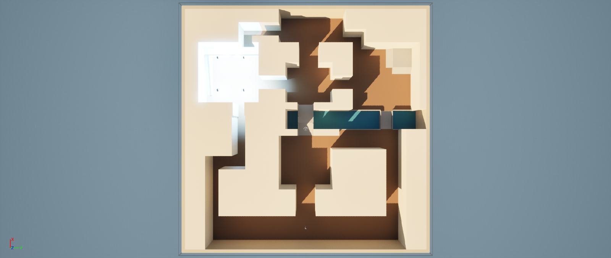 |
| スポーン | 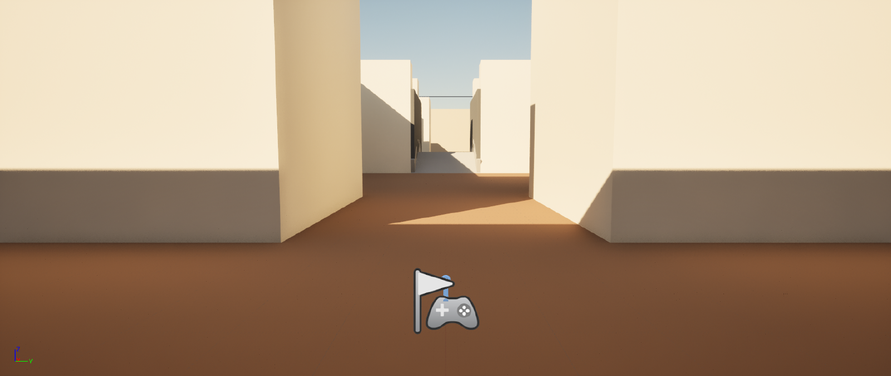 |
| 路地 | 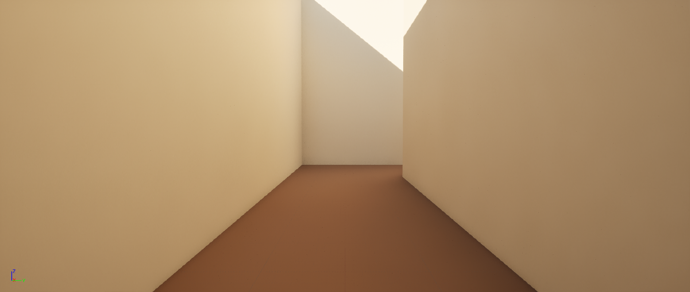 |
| A の中（屋根あり、2 階の回廊とスロープ） | 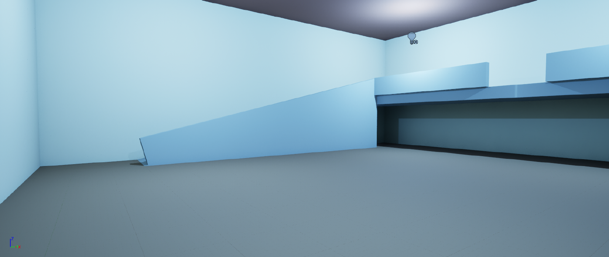 |
| 橋 | 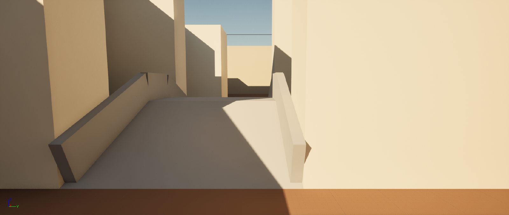 |
| 岸壁（手すりの向こうに B の広場） | 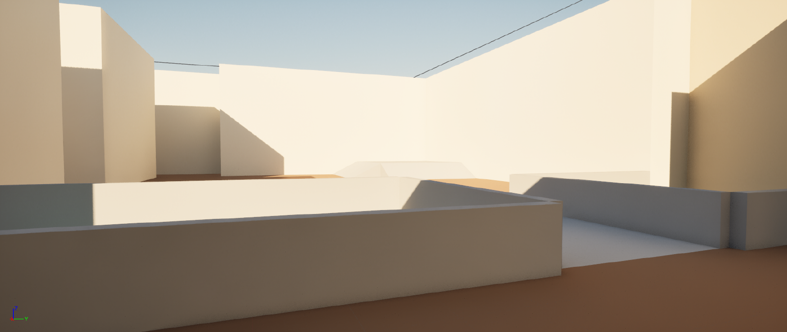 |
| B の高台と段 | 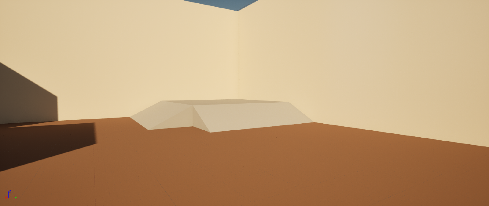 |

未確認：
- 歩く操作（WASD とジャンプ）での手触り。PIE ではキー入力が届かず（購入フェーズ中）、`playtest`（ナビメッシュに沿った移動）と、プレイヤーの位置のスイープで確かめた
- 見た目：A の中の灯り（暖色、強さ 8000）は、エディタの画面では効いて見えなかった（青い空の光が勝つ）。PIE の見え方は未確認。壁の影、屋内の明るさは Step 38 で
- ハード以上の難易度での動き（Bot が出ないため意味がない。Step 29 のあと）
- 橋の最高点のナビメッシュの高さ（1.2m 付近。形は 1.5m。ナビメッシュは足元より少し低く出る）が、実際の移動で問題にならないか（橋を渡る歩行は通った）
- 壁の上と A の屋根の上にナビメッシュの島ができているか（高さ 8m、7.5m）は調べていない（`analyze_level_layout` は、4 サンプル未満の島 31 個を除いて読んでおり、到達できない空間は 0 だった）。島があっても、経路が無いので遊びには影響しない見込み

## 6. Step 29：サイト、遮蔽、バリア

### 6.1 設置エリア（`BP_PlantZone`）
| サイト | 中心 | 大きさ |
|---|---|---|
| A | (17, -23) | 8m × 8m |
| B | (15, 24) | 9m × 9m |

### 6.2 遮蔽（高さ 1m＝しゃがむと隠れる、2m＝立って隠れる）
| 場所 | 置くもの | ねらい |
|---|---|---|
| A 入口のすぐ内側 (10, -21) | 2m × 2m、高さ 2m | 安全に設置できるが、外から見張れない |
| A 中央の柱 4 本 (13, -27) (13, -19) (21, -27) (21, -19) | 1m × 1m、高さ 7m（屋根まで） | 近距離の柱まわりの撃ち合い |
| A 奥 (23, -17) | 2m × 1m、高さ 1m | 2 階の回廊の真下。危険だが路地の奥から見張れる |
| B の井戸 (14, 22) | 直径 2m、高さ 1m | 中央の設置位置 |
| B の荷車 (10, 30) | 3m × 1.5m、高さ 2m | 石橋から入った直後の遮蔽 |
| B の高台の木箱 (22, 30) | 2m × 2m、高さ 1m | 防衛側の強い位置 |
| B の岸の木箱 (7, 18) | 2m × 2m、高さ 2m | 対岸からの射線を 1 か所切る |
| 橋の手前の広場の噴水 (-10, 0) | 直径 4m、高さ 2m | スポーンから橋への直線を切る |
| 屋台 (-6, -5) | 3m × 1.5m、高さ 2m | 広場の遮蔽 |
| 路地の樽 (-10, -26) | 1.5m、高さ 1m | 角の遮蔽 |
| 岸壁の道の木箱 (-14, 28) | 2m、高さ 2m | 対岸から撃たれたときの逃げ場 |
| 鐘楼の下の木箱 (14, 2) | 2m、高さ 1m | 防衛側が橋を見る位置 |

形は箱と円柱でよい（見た目の置き換えは Step 38）。遊んで、位置は調整してよい。

### 6.3 購入バリア（`BP_SpawnBarrier`）
攻撃スポーンの 3 つの出口：路地 (-26, -28)、橋への道 (-26, 0)、岸壁の道 (-26, 27)。
見た目は Step 39（2026-11-15）で、向こうが透けるガラス状の壁（素材 `MI_SpawnBarrier`）に変えた（[28](28_playtest2_fixes.md) §2.2）。当たり判定・幅・`SetBarrierActive` は変更なし。

## 7. Step 29：Bot 用の配置

### 7.1 持ち場（`BP_HoldPoint`、16 個）
| # | Area | 位置 | 見張る方向 | 備考 |
|---|---|---|---|---|
| 1 | A | (24.5, -24, 高さ 3) | 南（入口） | 2 階の回廊 |
| 2 | A | (20, -30) | 南東（入口） | 奥の角 |
| 3 | A | (13, -16) | 南（入口を横から） | 回廊口の脇 |
| 4 | A | (22, -18) | 西（入口） | 裏口の前 |
| 5 | A | (10, -30) | 東（入ってきた背中） | 入口の死角。近距離 |
| 6 | B | (23, 31, 高さ 1) | 南西（石橋） | 高台 |
| 7 | B | (15, 20) | 南（対岸） | 井戸の裏 |
| 8 | B | (9, 16) | 東（石橋から入る所） | 岸の木箱の裏 |
| 9 | B | (24, 16) | 南西 | 裏口の前 |
| 10 | B | (14, 12) | 南東（広場） | アーチの中 |
| 11 | Mid | (14, 1) | 南（橋） | 木箱の裏 |
| 12 | Mid | (18, -4) | 南西（橋と回廊） | |
| 13 | Mid | (22, 1) | 南（鐘楼の下全体） | 鐘楼の裏 |
| 14 | A・前に出る（`bForward`） | (-6, -20) | 西（路地の 2 つ目の角） | |
| 15 | B・前に出る | (8, 26) | 南（石橋） | 石橋の北詰 |
| 16 | Mid・前に出る | (-10, 3) | 南（橋への道） | 噴水の裏 |

### 7.2 裏取りの経由点（`BP_FlankPoint`）
| Side | Order 0 | 1 | 2 | 3 |
|---|---|---|---|---|
| A の背後へ | 橋の北詰 (8, 0) | 広場 (-14, -4) | 船着き場 (-28, -28) | 路地の 2 つ目の角 (-10, -20) |
| B の背後へ | 橋の北詰 (8, 0) | 広場 (-14, 4) | 船着き場 (-28, 27) | 岸壁 (-3, 26) |

跳ね橋（Step 35）が上がっている間は経路が切れる。経路が見つからなければ、その場で下りるのを待つ（最大 8 秒。過ぎたら裏取りをやめて持ち場へ戻る）。

### 7.3 `BP_PR_MapInfo` と `BP_AreaName`
- `SiteDestA` (17, -23)、`SiteDestB` (15, 24)。ミニマップの範囲は -3600〜+3600
- `BP_AreaName` は §3 の表の 1 行につき 1 個。`Area`：ASite・AMain・Alley 系・AShort・DefA 系は A、BSite・Quay 系・StoneBridge・BShort・DefB は B、MidLane・MidPlaza・Bridge・BellTower・TowerBack・Lane は Mid、スポーンは None
- `PredictSite`：Alley 系と AMain は 1、Quay1 と StoneBridge は 2、ほかは 0（ミッドは今の「Y の変化」で決める）

### 7.4 配置パターン
`DT_DefenseSetups` は行（エリアごとの人数）をそのまま使える。前に出る持ち場が各エリアに 1 つある前提も同じ。変更不要のはずだが、5 人の行（`Five_` で始まる行）で持ち場が足りるか確認する（A 5、B 5、Mid 3）。

## 8. Step 29：画面まわりと完了条件

- ミニマップ画像 `T_PR_Minimap_Canal` を、L_Pind と同じ手順（[18](18_skills_minimap.md) §7）で作る。2 階の回廊は 1 階と重なるので、屋根と 2 階を一時的に隠して撮る
- マップ紹介の鳥瞰カメラを `BP_PR_MapInfo` に設定する
- HUD に現在地の名前が出る

### 完了条件
- L_Canal を開いて PIE：紹介画面 → 購入 → 戦闘 → 設置 → 解除または爆発 → 次ラウンド、が通る
- 配置パターンどおりのエリアに Bot が出る。2 階と高台の持ち場に立てる
- A 側の Bot を倒すと寄りが起きる。設置すると取り返しに来て、解除までたどり着ける（A・B 両方）
- 裏取りの経路をたどれる（作戦を一時的に裏詰めに固定して確認）
- **ユーザーが遊んで形を確認する**。OK が出たら、起動マップ（`GameDefaultMap` / `EditorStartupMap`）を L_Canal に変える。L_Pind は残す（マップ選択の画面は作らない）

### 8.1 実装結果（Step 29、2026-11-12）

> Step 38b（2026-11-14）：遮蔽の箱の見た目を飾りで作り込んだ（箱の位置・大きさ・形は変更なし。[26](26_art_meshy.md) §9）。道の角・壁ぎわに、乗れる小さな樽の飾り 21 個（12 か所、当たり判定あり）を置いた：一覧と残りの通路の幅は [26](26_art_meshy.md) §10.4。持ち場・経由点・設置エリア・購入バリア・スポーン・橋から離してあり、経路の長さは変わらない。

> Step 42b（2026-11-16）：角の飾り 21 個のうち 11 個を、小箱 3・麻袋 2・植木鉢 3・壺 3 に入れ替えた（樽は 10 個。位置と場所の数は同じ、1 か所の幅・高さは樽以下。種類の表は `map_art_l_canal.py` の `DECO_KINDS`）。運河の水面に小舟 2 艘（当たり判定なし）。経路 6 本の長さの差は 0.007% 以内、小物の上から新しく見える視線は 0（[29](29_pind_tropical.md) §4 Step 42b D）。

作ったもの・変えたもの：
- `docs/tools/map_layout_l_canal.py` に Step 29 の配置を足した（遮蔽 `COVERS`、設置エリア `ZONES`、バリア `BARRIERS`、持ち場 `HOLDS`、経由点 `FLANKS`、場所の名前 `AREAS`）。L_Canal 以外で実行すると止まる確認を入れた。`MapName` は `CANAL`。位置が歩ける範囲の中か、遮蔽・手すりから 0.45m 離れているかを調べる `check_points()` を持つ（Unreal の外で実行すると結果を出す。今は問題 0）。再実行しても同じ結果になる
- `BP_PR_MapInfo`：変数を 4 つ足した（`MinimapLabelA` / `MinimapLabelB`（Vector2D、ミニマップの A / B の文字の、ワールドの X・Y）、`ForwardDestA` / `ForwardDestB`（Vector、前に出るときの寄り先））。クラスの初期値は L_Pind の元の値（(2300, ∓2700)、(200, ∓3500, 0)）
- `BP_PR_HUD.DrawMinimap`：A / B の文字の画面位置を、`MapInfo.MinimapLabelA/B` と `MapMinX/MaxX/MinY/MaxY` から計算するようにした（式：x = MapX + ((LY − MapMinY) / (MapMaxY − MapMinY)) × MapS − 0.02 × MapS、y = MapY + ((MapMaxX − LX) / (MapMaxX − MapMinX)) × MapS − 0.03 × MapS）。L_Pind では以前の 0.1625 / 0.8375、0.2125 と同じ値になる。B の文字の Y は専用の式に分けた（A と B で Y が違うため）
- `BP_PR_HUD.MapDotActor`：先頭に `IsValid` の確認を足した（ラウンドの切り替えで消えた Bot を読む既存の不具合の修正）
- `BP_PR_Director.PlanOne`：Plan 2 の `Reinforce` の寄り先を、直書きの (200, ±3500) から `MapInfo.ForwardDestA/B`（Bot の Y < 0 なら A）に変えた（L_Pind では同じ値）
- `T_PR_Minimap_Canal`（`Content/PARORANT/UI/`、1024×1024、圧縮・ミップ・ストリーミングの設定は `T_PR_Minimap_Pind` と同じ）、素材 `MI_Canal_Wood`
- L_Canal の `MapInfo`：`MapName` CANAL、`SiteDestA` (1700, -2300, 0)、`SiteDestB` (1500, 2400, 0)、`MinimapTex` = `T_PR_Minimap_Canal`、`MinimapLabelA/B` = 設置エリアの中心、`ForwardDestA` (-1000, -2000, 0)（路地の 2 つ目の角）、`ForwardDestB` (-300, 2600, 0)（B 側の岸壁）、`IntroCamLoc` (0, 0, 6840)・`IntroCamRot` (-90, 0, 0)
- 変えなかったもの：`DT_DefenseSetups`（A 5 / B 5 / Mid 3 ＋ 前に出る各 1 で、全行の人数以上。3 人の行は A・B・Mid の最大 3、5 人の行は A 3・B 3・Mid 2 が最大）、`AreaOf` の ±1300 の閾値（スポーン 2 か所だけが `Area` = None で、そこでの分類は Y の判定に落ちる。支障なし）、ミッドの寄り先 (2200, 0)（下の「気づいた点」）、`WBP_MapIntro`（ウィジェットにサイトの印は無く、`LegendText` の文字だけ。サイトの印は 3D の `BP_PlantZone`）

置いたもの（L_Canal、座標は m。持ち場の高さは床の上面）：

| 種類 | 名前・座標 |
|---|---|
| 設置エリア | PlantZone_A (17, -23) 8m × 8m、PlantZone_B (15, 24) 9m × 9m（A の文字だけ屋根の上、Z=9m に上げた） |
| 購入バリア（初期は無効） | Barrier_Alley (-26, -28) 幅 4m、Barrier_Mid (-26, 0) 幅 6m、Barrier_Quay (-26, 27) 幅 6m |
| 遮蔽 15 個（仕様の 12 か所。柱 4 本を含む） | A 入口 (10,-21) 2×2×2、柱 (13,-27) (13,-19) (21,-27) (21,-19) 1×1×7、A 奥 (23,-17) 2×1×1、B 井戸 (14,22) 円柱 d2×1、B 荷車 (10,30) 3×1.5×2、B 高台の木箱 (22,30) 2×2×1（高台の上、Z 1〜2）、B 岸の木箱 (7.5,18) 2×2×2、噴水 (-10,0) 円柱 d4×2、屋台 (-6,-5) 3×1.5×2、樽 (-10,-26) 円柱 d1.5×1、岸壁の木箱 (-14,28) 2×2×2、鐘楼の木箱 (14,2) 2×2×1 |
| 持ち場 16 個 | A: A1 (24.5,-24) 高さ 3 / A2 (20,-29) / A3 (13,-16) / A4 (22,-18) / A5 (10,-30)。B: B1 (24,31) 高さ 1 / B2 (15,20) / B3 (9,16) / B4 (24,16) / B5 (14,12)。Mid: Mid1 (16,2) / Mid2 (18,-4) / Mid3 (22,1)。前に出る: AFwd (-6,-20) / BFwd (8,26) / MidFwd (-10,3) |
| 裏取りの経由点 8 個（Z=20cm） | A の背後（Side 1）：(8,0) → (-14,-4) → (-28,-28) → (-10,-20)。B の背後（Side -1）：(8,0) → (-14,4) → (-28,27) → (-3,26) |
| 場所の名前 22 個 | WALK の各行 1 個。表示名は船着き場、路地、路地の角、市場の入口、市場、回廊、橋への道、橋の手前の広場、橋、鐘楼の下、鐘楼の裏、アーチ、岸壁の道、岸壁、小路、石橋、Bの広場、教会前、教会の脇道、市場の裏口、広場の裏口。`Area` と `PredictSite` は §7.3 のとおり（`Alley1〜3`・`AMain` = A・1、`Quay1`・`StoneBridge` = B・2、スポーン 2 か所 = None・0）。箱の高さは Z -0.5〜9m（L_Pind は約 -0.75〜3.25m。2 階の回廊と高台に立っても入るように） |

仕様との差分（実物の形に合わせた）：
- 遮蔽の数：仕様の表は 12 行だが、柱 4 本を 1 行にまとめているため、実物は 15 個
- 持ち場 A2：(20,-30) は A_Slope の手すり（Y -30.25〜-30）の上にあたるため (20,-29) に、B1：(23,31) は高台の木箱 (21〜23, 29〜31) の角なので (24,31) に、Mid1：(14,1) は鐘楼の木箱 (13〜15, 1〜3) の縁なので、箱の裏の (16,2) に動かした
- 持ち場の向き：位置から「見張る場所」の座標への方向で決めた（`HOLDS` の末尾 2 つ）。仕様の方角の言葉（東・西）のうち、A4 の「西（入口）」と AFwd の「西（路地の 2 つ目の角）」は、実際の入口と角がそれぞれ南（-X）にあるため、入口・角の方向（南）にした。Mid2 と B4 も目標に向けた
- B の岸の木箱 (7,18) → (7.5,18)：運河の手すり（X 6〜6.25）と重ならないように
- A の PlantZone は 8m × 8m（クラスの初期値は 9m）なので、`Zone` の Extent と `FloorMark` の拡大を、レベルに置いたものの上で変えた
- ミニマップの A / B の文字の位置を `MapInfo` へ移した（L_Pind では同じ値）。`PlanOne` の `Reinforce` の座標も `MapInfo` へ移した。`WBP_MapIntro` のサイトの印は、そもそもウィジェットが無かった（§2.4 の記述は、3D の `BP_PlantZone` の文字のこと）
- ミニマップ画像：A の屋根、2 階の回廊と手すり、灯り 4 個を一時的に隠し、太陽の向きを真上近く（ピッチ -88°。撮影後に元の -27° へ戻した）にして撮った。太陽が低いと 8m の壁の影で床が黒くなり、地形が読めなかったため。OrthoWidth 7200、真下向き、最終色（LDR）。A が左上、B が右上、スポーンが下で合っている
- 起動マップは L_Pind のまま。L_Canal で遊ぶには、エディタで `L_Canal` を開いて PIE（またはレベルのダブルクリックで開いてから「プレイ」）

確認（L_Canal の PIE。難易度は設定の初期値のまま）：
- 紹介画面（鳥瞰、マップ名「CANAL」）→ スキル選び → 購入フェーズ → 戦闘 → ラウンド終了が動いた。ミニマップ（A・B の文字が青い設置エリアの上、現在地の名前「船着き場」）が出た。バリアは購入フェーズに有効（青い板が見えた）。ラウンドを 4 回進めた。エディタのログ（`Saved/Logs/PARORANT.log`）を読んだところ、実行時のエラーは 1 件だけで、`BP_PR_HUD.MapDotActor`（ミニマップの Bot の点）が、ラウンドの切り替わりで消えた Bot を読んだもの（Accessed None と同じ種類。Step 22 のころのログにも同じ表れがあり、今回の変更が原因ではない既存の不具合）。`MapDotActor` の先頭に `IsValid` の確認を足して直し、直したあとで L_Canal をもう 1 回 PIE（ラウンド 2 回、`PlantSpike` で終了させて切り替えも通した）して、実行時のエラーが出ないことをログで確認した
- Bot：3 人の行（PushMid、A1・B・MidFwd など）で、持ち場に付いた。2 階の持ち場（A1、Z=300）、高台の持ち場（B1、Z=100）にも立った。前に出る持ち場（AFwd、BFwd、MidFwd）にも立った
- 設置と取り返し：`GameMode.PlantSpike` を呼んで A (1700, -2300) に設置 → 3 人（2 階の A1、Mid1、A の前に出る Bot を含む）が数秒でスパイクの横（約 0.9m）に着き、「ROUND LOSS - SPIKE DEFUSED」になった。B (1500, 2400) でも、B の Bot（高台から下りる）がスパイクの近くまで向かった（1400, 2420 付近）。このラウンドは終了したが、解除による終了か、プレイヤーが倒されたかは確かめていない（敵のスコア 3）
- 裏取り：`StartFlank(1)` を呼ぶと `FlankPath` = (800,0,20) → (-1400,-400,20) → (-2800,-2800,20) → (-1000,-2000,20)（`Order` 順）になり、Bot が橋を渡り、2 点目へ向かう途中でプレイヤーを見て交戦（State 1）に入った（橋の頂上付近 (519,-65,198) で止まった。止まったのではなく交戦）
- 経路（ナビメッシュ、`find_path`）：防衛スポーンから全持ち場へ経路があり、すべて部分経路ではない（9〜63m）。2 階の持ち場の高さは 310、高台は 110 に投影された。裏取りの経由点はすべて経路でつながる（A の背後 106.5m・15.8 秒、B の背後 107.5m・15.9 秒、防衛スポーンから走り 675cm/s で）
- L_Pind の PIE：紹介画面（「PIND」）→ 購入フェーズ → 戦闘。Bot が持ち場に付く（A・B・Mid）。ミニマップの A / B の文字は、青い設置エリアの上で、以前と同じ位置。現在地の名前「攻撃スポーン」が出る。L_Pind の `MapInfo`（クラスの初期値を使っている）は、`MinimapLabelA/B` (2300, ∓2700)、`ForwardDestA/B` (200, ∓3500, 0) で、元の値と一致
- コンパイル：`BP_PR_MapInfo`・`BP_PR_HUD`・`BP_PR_Director` は編集のたびにコンパイルが通った（`hasCompileErrors` = false を `BP_PR_HUD` で再確認。ログにコンパイルのエラーは無い）。全 Blueprint を一括でコンパイルするスクリプトも流したが、エラーを数える部分が効いていたか確かめていないため、「全部エラー 0」とは言わない。保存済み
- 保存してレベルを開き直したあとも、`PlantZone_A` の `Zone` の Extent（400, 400, 150）、`FloorMark` の拡大（8）、`SiteLabel` の位置（Z 900）、`MapInfo`、バリアの幅が残っていることを確認した

画像：

| 内容 | 画像 |
|---|---|
| ミニマップ画像（`T_PR_Minimap_Canal`） | 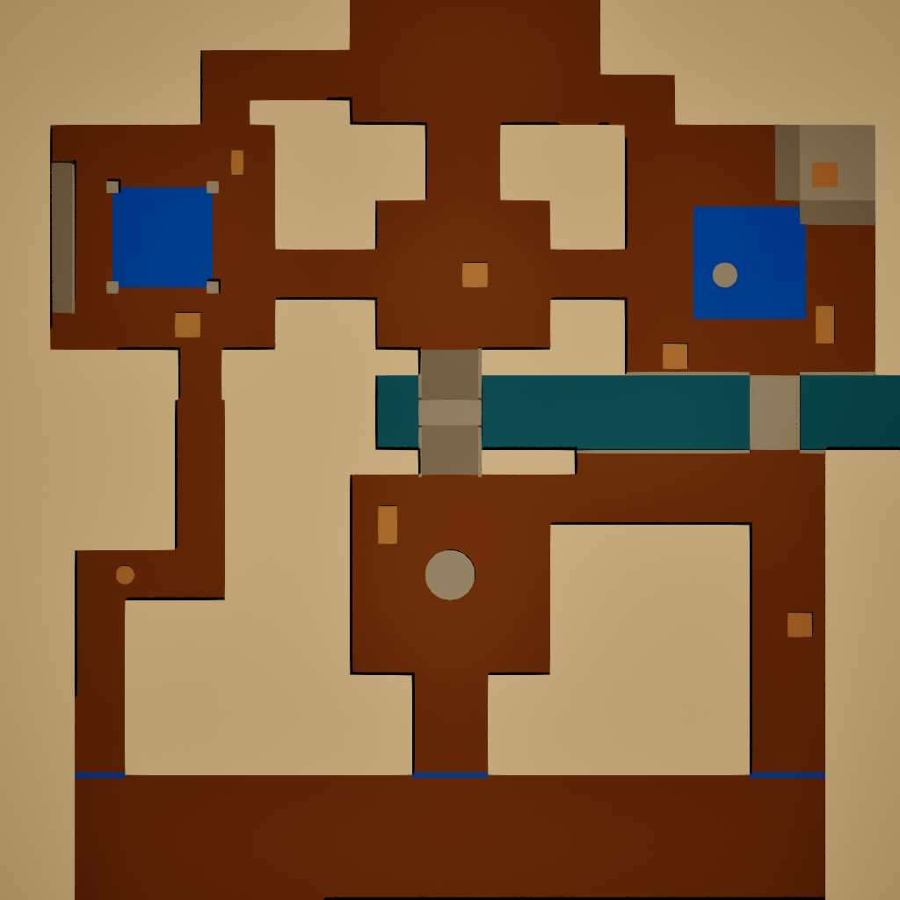 |
| 紹介画面（CANAL。A の屋根のため A の青い印は見えない） | 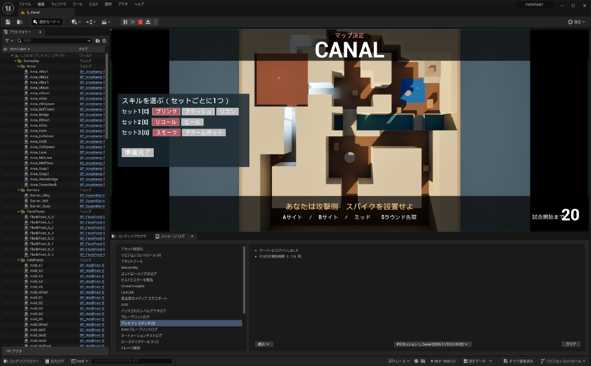 |
| 購入フェーズ（ミニマップと現在地の名前、バリア） | 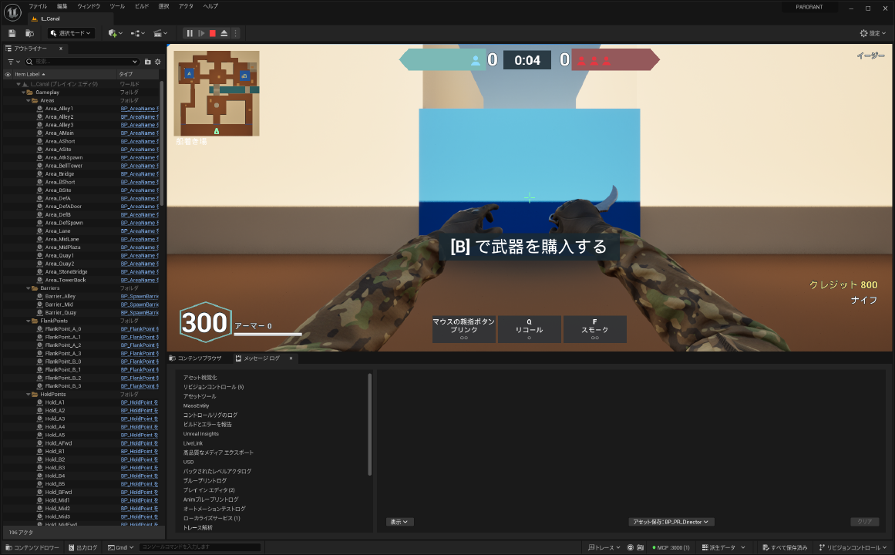 |
| A のスパイクを取り返した（ROUND LOSS - SPIKE DEFUSED） | 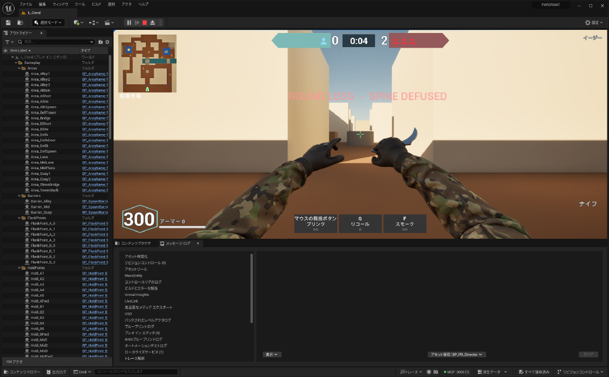 |
| L_Pind の購入フェーズ（ミニマップの A / B） | 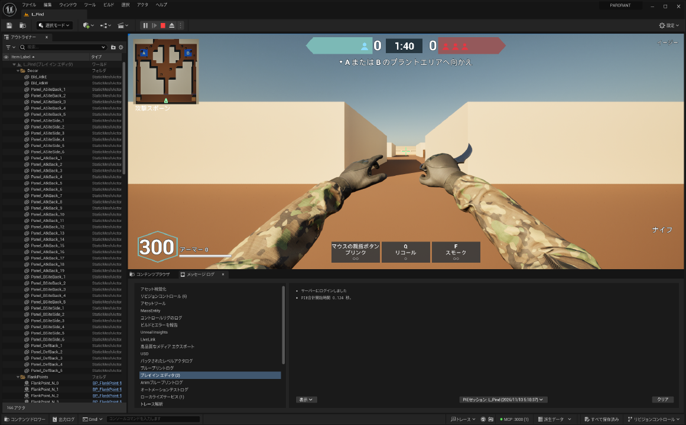 |

気づいた点（試遊で見てほしい。値は調整してよい）：
- 紹介画面（真上のカメラ）では、A の屋根で A の設置エリアの青い印が見えない（B は見える）。A の文字は屋根の上に上げたが、横向きの文字のため真上からはほとんど見えない。屋根の扱い（紹介画面の間だけ屋根を隠す、など）は Step 38 か、ユーザーの判断
- 噴水（高さ 2m）は、橋の頂上（Z=1.5m）に立つ Bot から見ると上を越えて、攻撃スポーン付近が見える（裏取りの確認で、橋の頂上の Bot がスポーンのプレイヤーを見つけた）。仕様の「スポーンから橋への直線を切る」は、平らな地面の高さでしか成り立たない。噴水を高くする、橋の頂上の見通しを変える、などは試遊で決める
- ミッドの寄り先は L_Pind と同じ直書きの (2200, 0)±300（`SiteDest`）のまま。L_Canal では (22, 0) で鐘楼の裏にあたり、ほぼ歩ける範囲に収まる（Y が -3〜-2 だと壁際）。ナビメッシュが近くの歩ける点へ寄せるため支障は見ていないが、気になるなら `MapInfo` へ移す
- 裏取りは約 16 秒。橋の頂上からスポーンを見通せるので、裏取りの Bot は橋の上で交戦に入りやすい（A・B 側の背後へ回る前に、ミッドの見張りに見つかる）
- `WBP_GameHUD.UpdateArea` は毎フレーム `AreaInfoAt` を呼ぶ（Step 27 の引き継ぎ）。箱は 22 個になったが、見直さず今のまま（遊んで重ければ 0.2 秒おきにする）
- 持ち場のうろつき（HoldThink の ±4m）は 2 階の回廊の縁や高台でも働く。落ちて下の階で待つことがあるかは、長時間の観察をしていない

未確認：
- 難易度の別（ハード以上）での動き。今回の PIE は設定の初期値（難易度の値を 2 に変えて起動したが、HUD の表示は「イージー」のままだった。表示の対応は確かめていない）のみ。Bot は持ち場に付き、探知・撃ち合いも起きたが、ハードの `Predict` による寄りは確認していない
- `PlanOne`（Plan 2）の `Reinforce` が新しい寄り先 (-1000,-2000) / (-300,2600) へ向かうこと。確率で決まるため PIE では起こせなかった（グラフの読み戻しで `SelectVector(ForwardDestA, ForwardDestB, Y < 0)` が `Reinforce.Dest` につながっていることだけ確認）
- Bot を倒したあとの寄り（`[Director]` の分類・寄り）。プレイヤーが操作できなかったため、倒す操作を起こしていない
- 5 人の行（`Five_`）で実際に A 3・B 3・Mid 2 が立つこと（人数の足りることは持ち場の数から確認した。3 人の行だけ PIE で確認）
- ミッド（Mid）側へ寄る Bot の動き、B の取り返しで解除まで進むこと（B は Bot がスパイクへ向かうことまで。解除の確認は A のみ）
- 購入バリアを通れないこと（PIE で青い板が出ることのみ）。設置エリアの中での実際のプレイヤーの設置・解除操作（キー入力が PIE に届かない）
- 床の見た目・明るさ、A の中の灯り

## 9. Step 35：跳ね橋と鐘

仕様の値は [20](20_canal_town_concept.md) §4.5（予告 3 秒、上がっている間 6 秒、下りる 1 秒、周期 約 45 秒、初回は戦闘開始から 20〜35 秒後）。

### 9.1 `BP_Drawbridge`（新規）
| 項目 | 内容 |
|---|---|
| 部品 | 橋板 2 枚（南半分・北半分。岸側を軸に回る）、欄干、両端の灯り（PointLight）、`NavModifier`（NavArea_Null、ふだんは無効）、両端の見えない壁 2 枚（Pawn だけ止める、ふだんは無効） |
| 状態 `BridgeState` | 0 下りている／1 予告／2 上がっている／3 下りる途中 |
| 上がるとき | 橋板を 75° まで 0.8 秒で回す。`NavModifier` と見えない壁を有効にする。橋板は視線と弾を止める |
| 橋の上にいるキャラクター | 上がる瞬間に橋の範囲にいたら、近い方の岸の外側へ移す（プレイヤーも Bot も） |
| 時刻の管理 | `BP_PR_GameMode` の `MatchTick` から。フェーズ 1・2 の間だけ動く。ラウンド開始で下りた状態に戻す |

### 9.2 鐘
- `BP_PR_GameMode.bBellRinging`：予告の開始から、下り終わるまで true
- true の間、Bot の「走る足音を聞く」判定（`HearRunRange`）を無効にする。銃声は聞こえる
- Bot の足音（`BP_PR_Bot` の Tick で鳴らしている音）の音量を 0.2 倍にする
- 音：`SFX_Bell`（[24](24_presentation_audio.md) §5 で作る。先にこの Step をやる場合は `SFX_Beep` を低いピッチで代用）
- HUD：予告の間、ミニマップの橋の位置に印を点滅させる

### 9.3 完了条件
- 橋が周期どおりに上下する。上がっている間、プレイヤーも Bot も渡れず、橋ごしに見えない
- 上がっている間に橋を通る寄りを起こすと、Bot が回り道をするか待つ（渡ろうとして橋の前で走り続けない）
- 鐘の間に Bot の近く（15m 以内）を走っても、警戒（State 3）に入らない
- L_Pind には橋が無いので、何も起きない（エラーも出ない）

### 9.4 置き換えた固定の橋の記録（Step 35、2026-11-13）

L_Canal の固定の橋（Step 28）を、岸側の固定部分と `BP_Drawbridge` に置き換えた。消したアクタ（名前、位置 cm、回転 pitch/yaw、拡大 x/y/z）：

| 名前 | 位置 | 回転 | 拡大 |
|---|---|---|---|
| `Bridge_Up`（SM_Ramp） | (200, -250, 0) | 0 / 90 | 5 / 4 / 1.5 |
| `Bridge_Top`（立方体） | (300, 0, 75) | 0 / 0 | 2 / 5 / 1.5 |
| `Bridge_Down`（SM_Ramp） | (400, 250, 0) | 0 / -90 | 5 / 4 / 1.5 |
| `BridgeRail_Up_E` / `_W` | (0, ±237.5, 125) | 20.56 / 0 | 4.272 / 0.25 / 1 |
| `BridgeRail_Top_E` / `_W` | (300, ±237.5, 200) | 0 / 0 | 2 / 0.25 / 1 |
| `BridgeRail_Down_E` / `_W` | (600, ±237.5, 125) | -20.56 / 0 | 4.272 / 0.25 / 1 |

残したもの：`BridgeBarrier_E` / `_W`（見えない壁、両脇）。足したもの：`Bridge_LandS`（X -2〜0、高さ 0〜0.75m）、`Bridge_LandN`（X 6〜8）、岸側の欄干 `BridgeRail_LandS_E/W`・`BridgeRail_LandN_E/W`、`Drawbridge`（`BP_Drawbridge`、原点）。橋板が下りているとき、形（高さの変化）は従来と同じ（X 0〜2 が上り、2〜4 が頂上 1.5m、4〜6 が下り。運河の上は板だけで、下は空）。

### 9.5 実装結果（Step 35、2026-11-13）

足したもの：
- `BP_Drawbridge`（`Content/PARORANT/Blueprints/World/`）：L_Canal の原点に 1 個（`Drawbridge`）。部品＝橋板 2 枚（`HingeS` X=0、`HingeN` X=600 を軸に回る。各板は上り部分 `Pc*1`（板、欄干 0.5m）と平らな部分 `Pc*2`）、両端の灯り `LightS` / `LightN`、見えない壁 `WallS`（X=-40）/ `WallN`（X=640）（Pawn だけ止める、ふだん無効）、`EvacBox`（橋の範囲の検出用）、`NavMod`（NavModifier）。下りたときの板は従来の橋と同じ高さの変化。板の下は空
- 変数（Tuning）：`WarnTime` 3、`UpTime` 6、`LowerTime` 1、`RaiseTime` 0.8、`Period` 45（予告の開始から次の予告の開始まで）、`FirstMin` 20 / `FirstMax` 35、`RaiseAngle` 75、`BellInterval` 1.7、`BellVolume` 0.8、`BlinkRate` 4、`LightDim` 4000 / `LightFlash` 20000、`EvacSouthX` -120 / `EvacNorthX` 720 / `EvacZ` 130、`MarkPos` (300, 0, 0)。状態：`BridgeState`（0 下り／1 予告／2 上がり／3 下りる途中）、`Angle`、`TargetAngle`、`AnimSpeed`、`NextT`（-1＝未予定）、`StateEndT`、`NextBellT`、`GM`
- 関数：`DoTick`（Tick から。GameMode の `Phase` が 0 のとき `NextT`≥0 なら `ResetDown`、1・2 のとき `CombatStep` と `BellTick`。角度の補間と `ApplyAngle`、予告の間の灯りの点滅）、`CombatStep`（初回の予定、状態ごとの時刻判定）、`StartWarn` / `StartRaise` / `StartLower` / `FinishLower` / `ResetDown`、`Evacuate`、`SetWalls`、`SetNav`（`NavMod.SetAreaClass` を `NavArea_Null` と `NavArea_Default` で切り替え。ナビメッシュの作り直しはしない）、`GMSet`、`SetLights`、`BlinkLights`、`BellTick`、`LogT`（ログ `[Bridge] warn／up／lowering／down／reset／scheduled／bell t=…`）
- `BP_PR_GameMode`：`bBellRinging`（予告の開始から下り終わりまで true）、`BridgeState`（0〜3）、`BridgePos`（ミニマップの印の位置）
- `BP_PR_AIController`：関数 `HearRunNow`（`bBellRinging` なら 0、それ以外は `HearRunRange`）。`CheckHearing` の走る足音の判定の距離を、この関数の値に差し替えた（銃声はそのまま）
- `BP_PR_Bot`：変数 `StepVolume` 0.5、`BellStepMul` 0.2、関数 `StepVol`（鐘の間は 0.1）。Tick の足音の `VolumeMultiplier` をこれにつないだ
- `BP_PR_HUD`：関数 `DrawBridgeMark`（`BridgeState`==1 の間、ミニマップの橋の位置にオレンジの四角を 0.17 秒周期で点滅）。`DrawMinimap` の B の文字のあとで呼ぶ
- `SFX_Bell`（`Content/PARORANT/Audio/`。Step 35 では `SourceAudio/gen_bell.py` の仮の音（2.8 秒）だったが、**Step 36 で `SourceAudio/gen_ambience.py` の音（2.5 秒）に作り直した。今使われているのは `gen_ambience.py` の方**。`gen_bell.py` は記録として残す。アセット名は同じ）
- `docs/tools/map_layout_l_canal.py`：橋の部分を §9.4 の形に変更、`BP_Drawbridge_C` を再実行のたびに消して原点に 1 個置く（`DEL_BP` に追加、`spawn_bp`）。レベルにはスクリプト全体ではなく、橋の部分だけを同じコードで実行した

仕様との差分・仮決め：
- 時刻の管理を `MatchTick` からではなく、`BP_Drawbridge` 自身の Tick が `GameMode.Phase` を読む形にした（L_Pind のグラフを一切変えず、橋が無いレベルで何も動かない）。ラウンド開始（`Phase`==0）で下りた状態に戻る。`Phase`==3・4 では止まるだけ（橋と鐘はそのまま、次のラウンドの購入フェーズで戻る）
- 橋板の欄干は高さ 0.5m（板と一緒に回る）。上がった板が岸側へ張り出さないため。岸側の固定部分の欄干は従来どおり 1m
- 退避は上がり始め（`StartRaise`）の時点。橋の範囲（X -60〜660、Y ±260）にいる Character（プレイヤー、Bot）を、X<300 なら X=-120、それ以外は X=720 へ移す（Z は 130）。予告の間に橋を渡っていた Bot は上がった瞬間に岸へ出る
- 見えない壁は橋の両端の岸側（X=-40、X=640。高さ 5m）。橋の両脇は従来の `BridgeBarrier_E/W` のまま
- 鐘は予告の開始から下り終わりまで 1.7 秒ごとに鳴らす（`PlaySoundAtLocation`、距離減衰なし）
- 灯りは常時 4000、予告の間だけ 0〜20000 で点滅（仮）
- ミニマップの印は予告（`BridgeState`==1）の間だけ。上がっている間は出さない（仕様どおり）

確認（L_Canal の PIE。`BP_PR_GameInstance.bSkipTitle` を一時的に true にして起動し、確認後に false へ戻した。周期などの変数は PIE の中だけ変えた）：
- 上がる・下りる：スクリーンショット `images/bridge35_down.png`（下り）、`images/bridge35_up.png`（上がり。板が 75° に立ち、両側の板で射線が切れる）。ログ（既定の周期）：`scheduled t=36.0`（戦闘開始）→ `warn t=60.9`（初回は 24.9 秒後、仕様の 20〜35 秒）→ `up t=63.9`（+3.0 秒）→ `lowering t=69.9`（+6.0 秒）→ `down t=70.9`（+1.0 秒）。ラウンドの切り替わり（上がっている最中）に `reset` が出て下りた状態に戻る
- 渡れない：上がっている間、プレイヤーを (-300,0) から (300,0) へスイープさせると `WallS` の面（X=-55）で止まった。運河には落ちない（壁の手前で止まる）
- ナビ：下りているとき、プレイヤーの `playtest`（ナビメッシュに沿った移動）は橋の頂上（Z 248）を通って (1000,100) へ着く（X -500→1000 を 1.8 秒で直進）。上がっているとき、同じ目的地への経路は北へ回って石橋（Y 約 2480）を通る（t=6.2 秒で (-201,1986) まで進んでから「ゴールから遠ざかる」ため stuck 判定になったが、石橋を渡る区間（(-187,2036) → B サイト (1500,2400)）は 2.9 秒で到達）。下りると直進に戻った
- 退避：下りた橋の上（X=250）のプレイヤーに `StartRaise` を呼ぶと (-120, 0, 132)、X=380 では (720, 40, 132) へ移った。Bot（`BP_PR_Bot6`、X=450）は (720, 0, 123)
- 鐘：鳴っている間（`bBellRinging` を true）、Bot の近く（15m 以内、約 4m まで）をプレイヤーが走って通っても、`State` は 0 のまま。鳴っていないとき同じ条件で State 3（`InvestigateLocation` はプレイヤーの位置）。`StepVol`：鐘の間 0.1、それ以外 0.5（`StepVol` を直接呼んで確認、`PlaySoundAtLocation` のピンへのつなぎは `inspect_graph` で確認）
- 鐘の音：`[Bridge] bell` のログが 1.7 秒ごとに出る（再生の呼び出しが通った）。wav は無音ではない（`manage_audio play_sound` の測定で、ピーク -15.9 dB、wav のピーク -3.3 dBFS）。聞こえ方は未確認
- ミニマップ：予告の間、橋の位置にオレンジの四角が出る（`images/bridge35_minimap.png`。点滅のため、撮った瞬間によっては消えている）
- 橋が上がっている間の Bot：`StartFlank(1)` を呼んだ Bot が、橋の前で止まらず、北岸を東へ（Y が増える方向に）進んだ（(951,20) → (1008,171) → (1064,316)）。別の記録では、約 12 秒後に石橋を渡って対岸の岸壁を戻る途中（(-406,1330)）、(-1601,-249)、(-2662,-517)（裏取りの 2 つ目・3 つ目の点へ）に着いた。`Reinforce`（寄り先 (-1000,-2000)）の Bot は、運河の西の端（Y<-6）を回って (-712,-1963) に着いた（A 側は運河が無いので石橋ではない）。どちらも橋の前で固まらなかった
- L_Pind：PIE で購入フェーズ・戦闘が動き、`[Bridge]` のログは出ず、`Blueprint Runtime Error` は 0 件
- 実行ログ（`Saved/Logs/PARORANT.log`）の `Blueprint Runtime Error`：0 件。変更した Blueprint は編集のたびのコンパイルが通った（全 Blueprint の一括コンパイルは実行していない）

未確認：
- 鐘の聞こえ方と音量、橋が上がる・下りるときの見た目（板がレベルの壁に当たらないか、横からの見え方）、灯りの点滅の見え方
- プレイヤーが橋を渡っている最中に上がったときの手触り（退避は瞬間移動）、Bot が橋の上にいるときの動き（静止している Bot の退避だけ確認）
- ハード以上での、橋が上がっている間の裏取り・寄りの様子（難易度の別での通し）
- 実際の流れでの `Reinforce`／Director の寄りが橋の前で止まらないか（呼び出しで起こした 1 例のみ）
- 全ラウンド通した長時間の周期（既定の `Period` 45 秒で 2 回目の予告）

試遊で見てほしい・聞いてほしい点：
- 鐘の音（仮）の音色と、鳴り続ける間隔 1.7 秒、音量 0.8、橋から遠い場所での聞こえ方（距離減衰なし）
- 橋が上がる 0.8 秒と下りる 1 秒の速さ、上がった板の見た目（岸に立つ壁）、橋の上で上がり始めたときの退避
- 鐘の間に Bot の近くを走って気づかれないか、鐘が止まってからはまた気づかれるか
- 上がっている間の石橋への遠回り（時間の長さ）と、橋ごしの射線が切れるか
- 灯りの点滅（予告）とミニマップの印の見やすさ
