# 26. 見た目の実装仕様と Meshy の使い方（Step 38）

方針は [20](20_canal_town_concept.md) §3・§5・§7。進め方は [21](21_impl_rules.md)。2026-11-12 作成。
使える道具：Meshy（サブスクリプション）、Blender MCP、Unreal MCP（EngineWire）。

## 1. 大原則：遊びの形と見た目を分ける

- **当たり判定と視線は、Step 28・29 の箱（ブロックアウト）のまま変えない。** Meshy で作ったメッシュは見た目だけで、当たり判定を付けない（または箱 1 個の単純な判定にして、元の箱と同じ大きさにそろえる）
- 理由：生成したメッシュは形が不ぞろいで、当たり判定に使うと「見えているのに撃てない」「引っかかる」が起きる。撃ち合いの公平さを守る
- 置き換えの手順：箱の位置と大きさを記録 → 見た目のメッシュを同じ場所に置く → 箱は非表示にして当たり判定だけ残す

## 2. Meshy に向くもの・向かないもの

| 対象 | 向き | 作り方 |
|---|---|---|
| 小物のうち、**当たり判定に関わる遮蔽**（木箱、樽、井戸、荷車、屋台、噴水、柱） | × | **Meshy は使わない**（Step 38b、2026-11-14 決定。試作の樽で、見えないのに弾が当たる隙間が最大 62cm 出たため）。当たり判定の箱に素材を塗り、薄い飾りを足す（§9） |
| 飾りだけの小物（街灯、看板、鉢植え、ゴンドラ、係留の杭、鐘）と、**道の角に置く乗れる小さな樽**（簡易コリジョン付き） | ◎ | Meshy で作る（樽は作成済み。整え方と置き方は §10） |
| 目印になる建物（鐘楼、教会の正面、橋の欄干の飾り）、場外の遠景の建物 | ○ | Meshy で作る。場外は遠くから見るだけなので粗くてよい |
| 歩く範囲の壁・床・屋根・アーチ | × | 箱とスロープに単色の素材を塗り、腰壁・縁取り・窓枠は Unreal の箱で足す。生成物を並べると継ぎ目が合わない |
| 敵・味方のキャラクター | △ | 今の SWAT を塗り直す（単色寄りの素材＋輪郭線）のが第一案。作り直すなら §5 |
| 一人称の腕と武器 | × | 今のものを使い、腕の素材だけ単色に変える |

## 3. Meshy の使い方（2 通り）

### 3.1 ブラウザで作る（設定なしで今すぐできる）
1. meshy.ai にログインし、Image to 3D（絵から）か Text to 3D（文から）で作る。**絵から作る方が、見た目をそろえやすい**
2. 仕上がりを見て、気に入ったものを Remesh でポリゴン数を減らす（小物は三角形 500〜3,000、目印の建物は 5,000〜15,000 が目安）
3. FBX（または GLB）でダウンロードし、`download/meshy/<名前>/` に置く
4. Claude に「`download/meshy/barrel` を取り込んで」と頼む（§4 の処理を行う）

### 3.2 Claude から直接作る（API キーの設定が必要）
- Meshy 公式の MCP サーバー（`@meshy-ai/meshy-mcp-server`）がある。文・絵からの生成、Remesh、リグ付け、アニメ付けなどを Claude から呼べる
- 準備：meshy.ai の設定画面で API キーを作り、MCP サーバーを Claude Code に登録する（手順は公式リポジトリの README）。**API キーの入力はユーザーが行う**（Claude には貼らない。`.env` や設定ファイルは Git に入れない）
- API がプランに含まれるか、1 回あたりのクレジットは、契約中のプランのページで確認する
- 登録後は、Claude が「生成 → Remesh → ダウンロード → Blender で整える → Unreal に取り込む」を通しで行える。**クレジットを使うので、まとめて作る前に個数と内容をユーザーに確認する**

## 4. 取り込みの手順（生成物 1 個ごと）

1. **Blender（MCP）で整える**
   - 大きさを実寸（m）に合わせる。§6 の表の寸法にそろえる
   - 原点を底面の中央にする。回転と拡縮を適用する
   - 向きをそろえる（正面が +X）
   - 余計な床板や浮いた破片を消す
   - 色：生成された絵柄のテクスチャが単色の世界から浮く場合は、テクスチャを捨てて部位ごとの単色（2〜4 色）にする
   - FBX（cm、+X 前、+Z 上）で書き出す
2. **Unreal に取り込む**：`/Game/PARORANT/Art/Props/`（小物）、`/Game/PARORANT/Art/Landmarks/`（建物）。名前は `SM_<名前>`。当たり判定は付けない
3. **置く**：§1 の手順で、対応する箱の位置へ。Bot の持ち場や設置エリアの上に、見た目がはみ出していないか確認する
4. **確認**：PIE で、見た目の陰に隠れた Bot が撃てること／見えない所に弾が当たらないこと（箱と見た目のずれが 15cm 以内）

## 5. キャラクターを作り直す場合（任意）

第一案は「今の SWAT を塗り直す」。作り直すのは、世界観に合う見た目がどうしても欲しい場合だけ。

- 今のアニメ（走り、横走り、発砲、死亡）は `SK_Swat8` のスケルトン（Mixamo 系）用。新しい体を別のスケルトンにすると、アニメが全部使えなくなる
- 手順の案：Meshy で T ポーズ（両腕を横に伸ばした立ち姿）の人型を作る → Blender で今のスケルトンに合わせてスキンを付け直す（または Meshy のリグ付けの結果を、Unreal の IK Retargeter で今のアニメに対応付ける）→ 当たり判定の部品（頭・胴・脚）の位置を合わせ直す
- 手間が大きく、失敗しやすい。やる場合は 1 体だけ先に試し、ユーザーが見てから残りを決める

## 6. Step 38 の作業一覧

### 6.1 素材（単色、`M_NatureFlat` のインスタンスを増やす）
| 素材 | 色の目安 | 使う場所 |
|---|---|---|
| 漆喰（黄土） | 明るい黄土 | 建物の壁の基本 |
| 漆喰（薄赤） | くすんだサーモン | 壁の差し色（A 側） |
| 漆喰（クリーム） | 今の壁の色 | 壁の差し色（B 側） |
| 石 | 明るい灰 | 腰壁、縁取り、橋、手すり |
| 素焼き | 赤茶 | 屋根 |
| 石畳 | 灰がかった茶 | 広場の床 |
| れんが | 赤茶（暗め） | 路地の床 |
| 板 | 茶 | 船着き場、岸壁 |
| 水 | 緑がかった青、少し透ける | 運河 |
| 木（鎧戸・扉） | 深緑、えんじ | 窓と扉 |

A 側と B 側で壁の色を変え、色で場所が分かるようにする。

### 6.2 建物の作り込み（Unreal の箱で）
- 壁の下 1m に石の腰壁、上端に縁取り、屋根（素焼き色の傾いた板）
- 窓（くぼみ＋鎧戸）と扉を、歩く範囲から見える壁に付ける。当たり判定なし
- アーチ（市場の入口、アーチ、回廊）
- 場外：運河の向こうと北側に、高さ 12〜20m の建物の影と鐘楼

### 6.3 Meshy で作る小物（寸法は当たり判定の箱と同じ）
| 名前 | 寸法（m） | 個数 | 対応する箱（[22](22_map_canal.md) §6.2） |
|---|---|---|---|
| 木箱（大） | 2 × 2 × 2 | 3 | A 入口、B の岸、岸壁の道 |
| 木箱（小） | 2 × 2 × 1 | 2 | 高台、鐘楼の下 |
| 樽 | 直径 1.5、高さ 1 | 1 | 路地 |
| 井戸 | 直径 2、高さ 1 | 1 | B 中央 |
| 荷車 | 3 × 1.5 × 2 | 1 | B の石橋側 |
| 屋台 | 3 × 1.5 × 2 | 1 | 広場 |
| 噴水 | 直径 4、高さ 2 | 1 | 広場の中央 |
| 街灯 | 高さ 3.5 | 6 | 飾り（当たり判定なし、通路の端） |
| ゴンドラ | 長さ 8 | 2 | 運河（飾り） |
| 鐘楼 | 6 × 6 × 25 | 1 | 鐘楼の下の北（場外の目印） |

生成するときの文の例（絵から作る場合は、同じ内容の絵を先に用意する）：
`low poly stylized wooden barrel, flat colors, hand-painted look, clean silhouette, game prop, no ground plane`

### 6.4 キャラクターと表示
- Bot：単色寄りの素材に塗り直し、赤い輪郭線を付ける（ポストプロセスの輪郭、または裏返した外殻のメッシュ）。味方 Bot（Step 37）は水色
- 腕：迷彩をやめて単色に
- 設置エリア：青い板をやめ、石畳に描いた枠と「A」「B」の文字にする

### 6.5 光の仕上げ
- [20](20_canal_town_concept.md) §5.1 の設定を基準に、建物の高さが決まった状態で、日なたと日陰の配分を見直す（太陽の向きは、路地が日陰・広場が日なたになる角度を選ぶ）
- 露出を固定する（屋内の市場と屋外で、明るさが勝手に変わらないように）
- 屋内の市場に暖色の明かり、街灯に弱い光
- ミニマップ画像を撮り直す

### 6.6 完了条件
- スクリーンショット（スポーン、路地、市場の中、橋、岸壁から対岸、広場）を `docs/images/` に置く
- §4 の確認（見た目と当たり判定のずれ）を、置き換えた遮蔽の全部で行う
- フレームレートが落ちていない（PIE で `stat fps`、Step 29 の時点と比べる）
- **見た目はユーザーが確認する**

## 7. 実装結果（Meshy を使わない部分、2026-11-14、ブランチ `step38/art`）

Meshy・画像生成は使っていない（クレジットの使用はユーザーの確認待ち）。小物（木箱、樽、井戸、荷車、屋台、噴水）の形は箱のまま、素材だけ塗り直した。実装は `docs/tools/` の 3 つのスクリプト（再実行しても同じ結果）：

| スクリプト | 役割 |
|---|---|
| `map_layout_l_canal.py` | ブロックアウトとゲーム配置（Step 28・29）。最後に `map_art_l_canal.py` を実行する。`ART_ONLY = True` を先に定義して実行すると、ブロックアウトは作らず見た目だけを作り直す |
| `map_art_l_canal.py` | 素材の色、壁の塗り分け、腰壁・縁取り・窓・扉・屋根・アーチ、場外の建物と鐘楼、街灯、床の舗装。最後に `map_light_l_canal.py` を実行する |
| `map_light_l_canal.py` | 光の値（太陽、環境光、空、露出、A の灯り、街灯）。単独でも実行できる |
| `map_minimap_l_canal.py` | ミニマップ画像の撮り直し（部品を隠す、太陽を真上近くへ、撮影後に戻す） |

### 7.1 作り方と大原則の確認
- 当たり判定・視線・ナビメッシュは変えていない。足した見た目は、アクタ `ArtHost`（plain Actor、タグ `CanalArtHost`）の `InstancedStaticMeshComponent`（`ISM_<key>` 12 個）と、タグ `CanalArt` の薄い板・点光源だけ。すべて NoCollision、`CanEverAffectNavigation` = false（確認：タグ付きの全コンポーネントで 0 件の違反）
- `ISM_<key>` は Python から足せないため、Unreal MCP の `control_actor edit_component`（`componentType` = `InstancedStaticMeshComponent`、`meshPath` = Cube）で `ArtHost` に先に足してある（`map_art_l_canal.py` の先頭に書いた）。足りなければ不足の一覧を出して止まる。保存してレベルを開き直しても、ISM のインスタンスが残ることを確認した（1,337 個）
- 再実行は「タグ `CanalArt` のアクタを消す」「ISM の中身を空にする」だけで、ゲーム用の配置（持ち場、エリア名、設置エリア、MapInfo、跳ね橋）には触らない。`map_layout_l_canal.py` の「全 StaticMeshActor と PointLight を消す」は、タグ `CanalArt` の分を最後に作り直す（`ArtHost` は plain Actor なので残る）
- **影**：場外の建物（漆喰の ISM、屋根の `ISM_roof_far`）と鐘楼は影を落とさない。最初は影を落とす設定にしたところ、太陽の向き（高さ 27°、向き 40°＝南西から）で、南・西の外の高い建物の影が 20m 以上マップの中へ入り、日なたになるはずの船着き場・広場・壁の面を日陰にしていた（環境光を 1.8 → 6.5 まで上げても平らになるだけだった）。マップの中の屋根（8m の壁の上）と `A_Roof` は影を落とす（路地の日陰は 8m の壁が作る）
- 壁からの出っ張りは 10cm 以内（腰壁 7cm、縁 10cm、帯 6cm、窓の枠 5cm、鎧戸 8cm、扉 8cm、柱 10cm）。例外は高さ 3.4m 以上の梁（アーチ）と、高さ 3.5m 付近の街灯の傘（26cm）、屋根の張り出し（35cm、高さ 8m 以上）。いずれも頭より上で、歩く範囲・撃つ高さに出ない

### 7.2 素材の色（`M_NatureFlat` のインスタンス、リニア値）

| 素材（`MI_Canal_*`） | 色（R, G, B） | 使う場所 |
|---|---|---|
| `Plaster_Ochre`（漆喰・黄土） | 0.48, 0.37, 0.21 | A 側の壁の基本、B 側の差し色、場外の建物 |
| `Plaster_Salmon`（漆喰・薄赤、くすんだサーモン） | 0.45, 0.28, 0.23 | A 側の差し色、西の外周壁、場外の建物 |
| `Plaster_Cream`（漆喰・クリーム。旧 0.64/0.56/0.43 より少し落とした） | 0.53, 0.49, 0.40 | B 側の壁の基本、北・東の外周壁、場外の建物、鐘楼 |
| `Stone`（石。既存の色を明るく） | 0.36, 0.35, 0.33 | 腰壁、縁取り、窓枠、アーチ、橋、手すり、噴水・井戸 |
| `Roof`（素焼き。既存の色を明るく） | 0.27, 0.095, 0.05 | 屋根 |
| `Cobble`（石畳） | 0.26, 0.22, 0.18 | 床の既定（広場、橋の手前、B の広場、教会前など） |
| `Brick`（れんが、暗め） | 0.26, 0.13, 0.09 | 路地（Alley1〜3、市場の入口） |
| `Planks`（板） | 0.29, 0.18, 0.10 | 船着き場、岸壁の道、岸壁、A の天井 |
| `Tile`（屋内のタイル。明るい砂色） | 0.34, 0.28, 0.21 | A の市場の床 |
| `Water`（水。緑がかった青） | 0.03, 0.19, 0.24 | 運河（不透明のまま。「少し透ける」は未実装） |
| `Wood`（木箱、荷車、屋台、樽） | 0.34, 0.21, 0.10 | 遮蔽の木 |
| `Shutter_Green` / `Shutter_Red`（鎧戸の深緑・えんじ） | 0.06, 0.17, 0.10 / 0.22, 0.05, 0.06 | 窓の鎧戸（面ごとに交互） |
| `Door`（扉） | 0.20, 0.11, 0.06 | 扉 |
| `Glass`（窓ガラス） | 0.025, 0.035, 0.05 | 窓 |
| `Iron`（鉄） / `Lamp`（灯りの傘） | 0.035, 0.035, 0.04 / 0.80, 0.62, 0.30 | 街灯の柱と腕 / 傘 |
| `Wall_Ring`（外周の壁、港の石壁） | 0.40, 0.37, 0.32 | 南の外周壁（船着き場の壁） |
| `M_PR_ZoneFrame`（枠、マスク、新規マテリアル） | 0.78, 0.72, 0.55 | 設置エリアの枠線 |

- 壁（28 個の箱）の色：A 側（Y が -4 より小さい）は黄土・薄赤・クリームの順、B 側（Y が 4 より大きい）はクリーム・黄土・薄赤の順、中央は クリーム・薄赤・黄土の順に、隣り合う（接している）箱と同じ色にならないように貪欲に割り当てる。1 つの箱は 1 色。値の根拠：夕暮れ寄りの光（太陽の高さ 27°、暖色）で橙に寄りすぎないよう、R/G/B の差を小さく（彩度を落として）、明るさは旧い壁（0.64）より少し下げた。最初の案（黄土 0.50/0.36/0.17、薄赤 0.47/0.24/0.18）は橙が強すぎたので、上の値に落とした
- `MI_Nature_*`（L_Pind と共用）は変更していない。L_Canal のアクタに `MI_Canal_*` を割り当てた

### 7.3 足した部品の数
| 種類 | 数 |
|---|---|
| 壁の面（歩ける範囲・運河から見える面の連続区間） | 80 面。腰壁（板 2 枚）、縁、階の帯 |
| 窓（枠、ガラス、鎧戸 2 枚） | 106 個（1 面に 0〜4 個）。ISM のガラス 340、鎧戸 212 |
| 扉（枠と板） | 55 個（水に面した面にはつけない） |
| 屋根（壁の箱の上。素焼き色の傾いた板 2 枚、細い箱は平らな板） | 54 枚（28 個の箱） |
| アーチ（梁、柱 2 本、角の段、45 度の入り） | 4 か所（A の市場の入口、橋への道と広場の間、回廊の入口、アーチ＝B への入口） |
| 場外の建物の影（高さ 12〜20m、屋根、煙突、窓の列） | 37 棟（外周の外 3m に北・南・東・西の 4 つの帯。鐘楼の足元の分は省いた） |
| 鐘楼（仮の塔。6 × 6 m、高さ 約 28m。胴、帯、鐘の部屋と開口、段の屋根、尖塔） | 1（位置 (44, 3)。Meshy の予定だった箱を積んだ仮の塔） |
| 街灯（壁掛けの細い柱と傘。弱い暖色の点光源、影なし） | 9 個 |
| 床の舗装（薄い板 1cm、タグ `CanalArt`） | 8 枚（れんが 4、板 3、タイル 1） |
| ISM のインスタンス合計 | 1,337（stone 538、roof 54、roof_far 73、shutter_g 104、shutter_r 108、door 55、glass 340、iron 19、lampglass 9、漆喰 37） |
| 新規アクタ | 18（`ArtHost` 1、舗装 8、街灯 9） |

### 7.4 設置エリアの表示（§6.4）
- `BP_PlantZone` の `FloorMark`（Cube、青い `MI_Solid_Blue`）の素材を、マスクの枠線の素材 `M_PR_ZoneFrame` に変更（UV の外側 2% を線にする。8〜9m の枠で線の太さ 16〜18cm）。`SiteLabel` は床に寝かせた大きな文字（`WorldSize` 380、位置 Z=4cm、向きは文字の上が北）。設置の判定（`Zone` の箱、`SiteName`、BP のグラフ）は変えていない
- `map_layout_l_canal.py` の「A の文字を屋根の上（Z=9m）へ」をやめた。A の中は屋根の下なので、紹介画面（真上のカメラ）では A の枠は見えない（B は見える。下の「気づいた点」）
- L_Pind も同じ BP を使うので、FloorMark の素材と文字の向きが変わる。L_Pind を開いて確かめた（枠と、床に寝た大きな文字。破綻なし。レベルは保存していない）。**FloorMark の当たり判定を BP で NoCollision にした**（薄い 2cm の板。元の設定は確かめていない。足した部品ではなく共用の BP の変更）
- ミニマップ画像（`T_PR_Minimap_Canal`）を撮り直した（`docs/images/art38_minimap.png`）。A・B の枠と文字が写り、HUD の A／B の文字とも合う

### 7.5 光の仕上げ（§6.5）
値の前 → 後（`SunLight`、`SkyLight`、`SkyAtmosphere`、`PP_Mood`、`A_Lamp_*`、`Art_StreetLamp_*`）。詳しい経緯は [20](20_canal_town_concept.md) §5.1。

| 対象 | 前 | 後 |
|---|---|---|
| 太陽 | 高さ 27°、向き 40°、強さ 7、色 (255, 235, 204) | 変更なし（路地が日陰、広場が日なたになる向きのまま。±20° の範囲） |
| 環境光（`SkyLight`、リアルタイム取り込み） | 強さ 1.8、色 (224, 235, 255) | 強さ 7.0、色 (236, 242, 252) |
| 空（`SkyAtmosphere`） | `SkyLuminanceFactor` (1, 1, 1) | (2.4, 2.4, 2.4)。露出を固定すると空が暗い紺になるため |
| 露出（`PP_Mood`） | ヒストグラムの自動露出（Min -10、Max 20、バイアス 1.0） | Min = Max = EV 1.5 で固定、バイアス 1.0 |
| A の灯り（`A_Lamp_0〜3`、PointLight） | 8000 cd、半径 18m、**色が青（R104, G176, B255）**。`unreal.Color(255, 176, 104)` の引数順は (B, G, R) で、橙のつもりが青になっていた。屋内が青白かった原因 | 110 cd、半径 18m、色 (255, 214, 164)。`map_layout_l_canal.py` の色指定もキーワード（r=, g=, b=）に直した |
| 街灯 | 無し | 9 個。30 cd、半径 9m、色 (255, 190, 120)、影なし、Movable |

- 露出は、屋内の市場と屋外で勝手に変わらない（Min = Max）。固定の EV では、屋外の日なたが白く飛ばず、A の中も読める明るさを選んだ（EV 3.0 は暗すぎ、EV 2.0 でも日陰が暗かった）
- 日陰の底上げは環境光（7.0）で行った。10 にすると広場の床が白っぽく平らになり、4.5 以下では船着き場（外周の壁と facade に挟まれた深い日陰）が黒くつぶれたので、7.0 にした。日陰は青みのスレート色、日なたは暖色。外の建物の影を切ったあと、船着き場の壁の面と広場は日なた、路地は日陰、になっている
- 光の値の読み方：このプロジェクトの太陽は 7 lux（物理値の約 1/10,000）の尺度なので、点光源の強さも桁が小さい（8000 cd は日なたの 1,000 倍以上で白く飛ぶ）

### 7.6 確認したこと
- ナビメッシュの経路（`find_path_to_location_synchronously`、区間の合計。作業前 → 後）：攻撃スポーン → A（路地経由）80.415m → 80.415m、→ B（岸壁・石橋）67.782m → 67.782m、→ A（橋・ミッド経由）49.284m → 49.284m、防衛スポーン → A 32.020m → 32.020m、→ B 28.771m → 28.771m、攻撃スポーン → 橋 → 防衛スポーン 46.138m → 46.138m。差 0%（±1% 以内）
- 視線（可視性チャンネルのライントレース、12 本、目の高さ 1.6m）：作業前の記録（`baseline.json`）と、当たった・当たらなかったと当たるまでの距離、当たったアクタが全部同じ
- 足した部品のうち、当たり判定あり、ナビメッシュに影響するものは 0 件
- マップチェック：エラー 0、警告 1（`PP_Mood` のコリジョンの半径 0。L_Pind から引き継いだもの）、性能の警告 1（`ArtHost` が大きなアクタ。影を落とす ISM が屋根の 1 つだけになって 4 → 1 に減った）。ログの `ブループリントランタイム エラー`（Blueprint Runtime Error）は、この Step の PIE 5 回の間は 0 件（ログの最後のエラーは作業前の 15:09 UTC のもの）
- PIE（L_Canal）：紹介画面、スキル選び、購入フェーズ、戦闘が動き、HUD のミニマップに新しい画像（A・B の枠と文字）が出た。味方の発言と敵の発見の表示も出た。プレイヤーを橋の手前、橋の上まで歩かせた
- フレーム時間（PIE、`stat unit`、エディタの画面。「前」は ArtHost とタグ `CanalArt` のアクタを `hidden in game` にして同じ視点で測った近似で、光と素材は同じ。**値は最終の光と影の設定（外の建物の影なし）で測り直した**）：

| 視点 | 前（部品を隠した） → 後（最終） |
|---|---|
| 紹介画面（真上の斜め、屋根が多い）。最初の設定（外の建物が影あり）での値 | 79.9 FPS・12.7ms（GPU 11.3ms、描画 480 回） → 69.2 FPS・14.5ms（GPU 13.1ms、描画 558 回） |
| 戦闘中、橋の手前の広場で北向き。最初の設定（外の建物が影あり） | 66.3 FPS・15.5ms（描画 511 回） → 61.6 FPS・16.2ms（GPU 15.6ms、描画 581 回） |
| 戦闘中、橋の手前の広場で北向き。**最終**（外の建物は影なし、環境光 7.0） | 66.3 FPS・15.5ms → 約 62 FPS・約 16.0ms（描画 約 560 回） |

  足した部品の描画で 約 0.5〜1.7ms（3〜13%）増えた。大きくは落ちていない（60 FPS を保つ）。数字は画面の小さな文字を読んだもの（±1 FPS）。窓を減らす・屋根を寄せる余地はある

### 7.7 画像（`docs/images/art38_*.png`）
| 場所 | 画像（前＝`canal28_*`・`canal29_*`・`bridge35_*`） |
|---|---|
| スポーン（路地の入口、バリアの手前） | 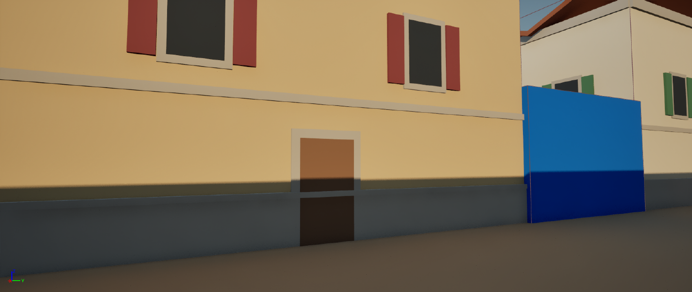（前：[canal28_spawn](images/canal28_spawn.png)） |
| 路地 | 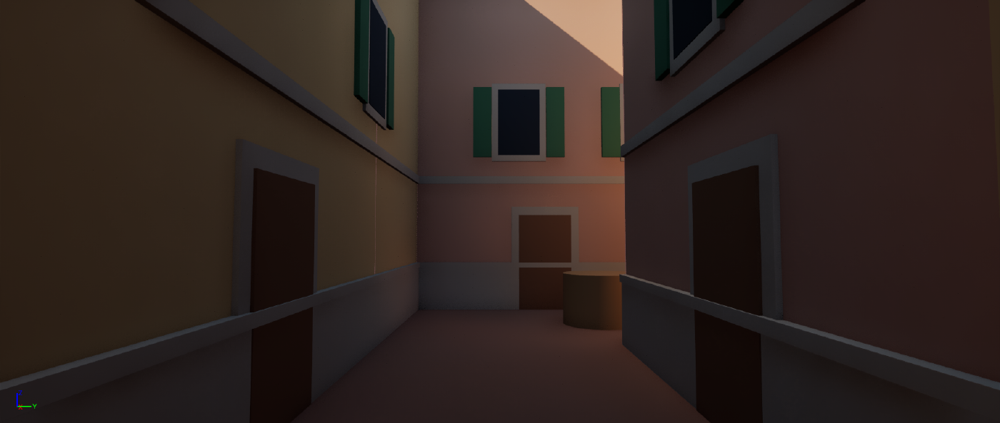（前：[canal28_alley](images/canal28_alley.png)） |
| A の中 | 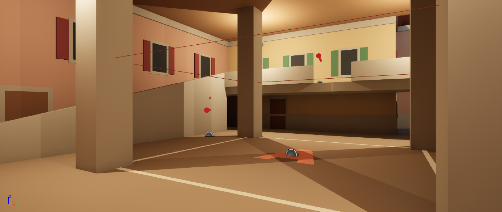（前：[canal28_asite](images/canal28_asite.png)） |
| 橋 | 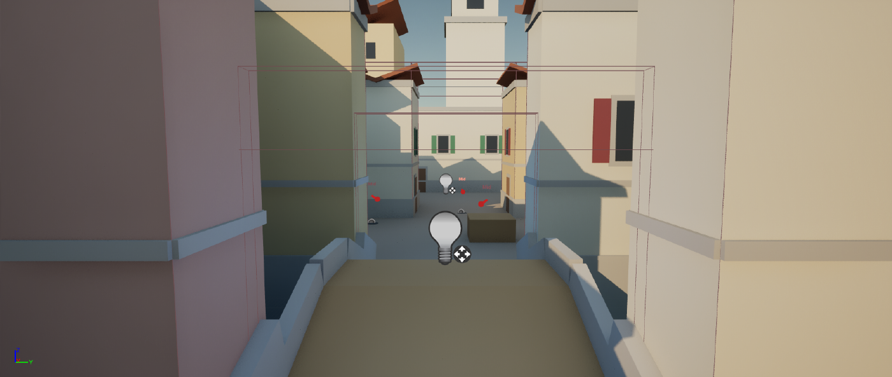（前：[canal28_bridge](images/canal28_bridge.png)） |
| 岸壁から対岸（B の広場） | 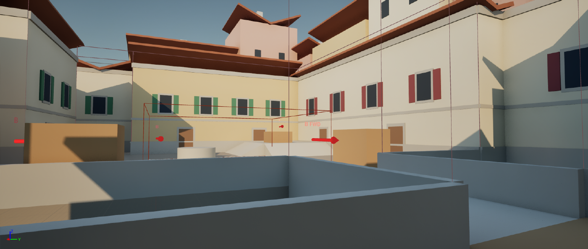（前：[canal28_quay](images/canal28_quay.png)） |
| 橋の手前の広場 | 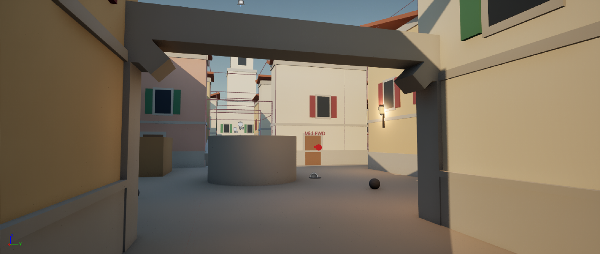 |
| B の広場（設置エリアの枠と文字） | 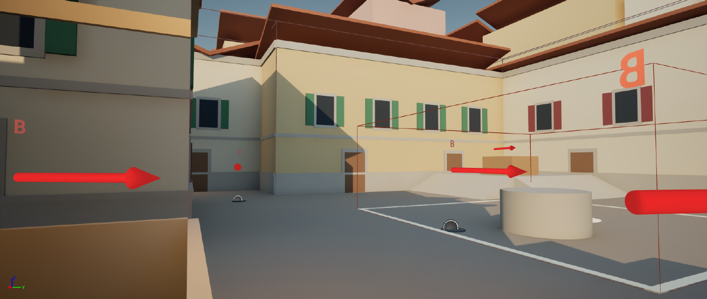（前：[canal28_bsite](images/canal28_bsite.png)） |
| 全景（斜め上から） | 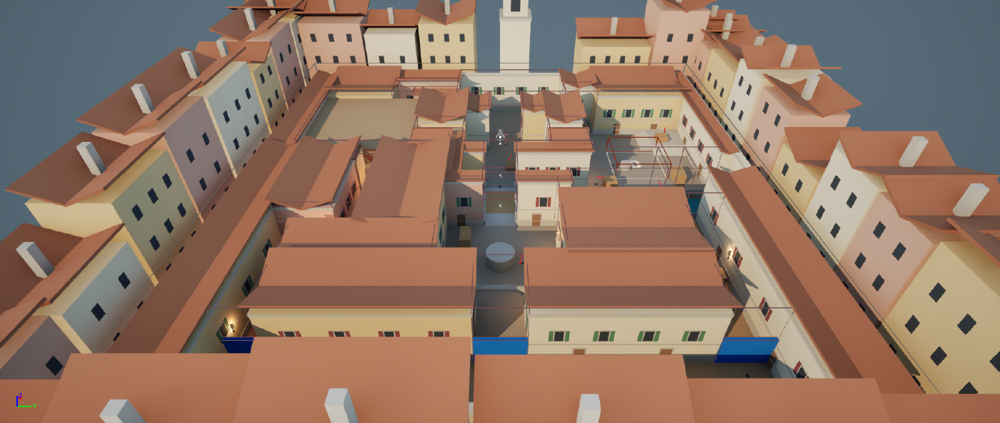（前：[canal28_topdown](images/canal28_topdown.png)） |
| ミニマップ（撮り直し） | 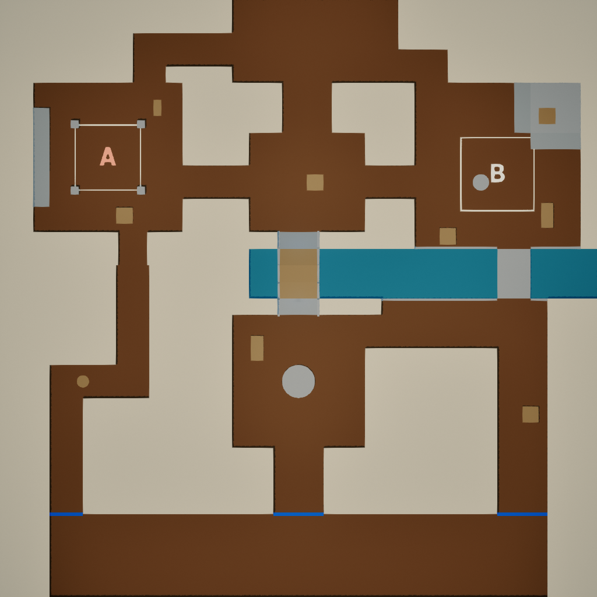（前：[canal29_minimap](images/canal29_minimap.png)） |
| PIE：戦闘中の広場（HUD つき、ミニマップは撮り直したもの） | 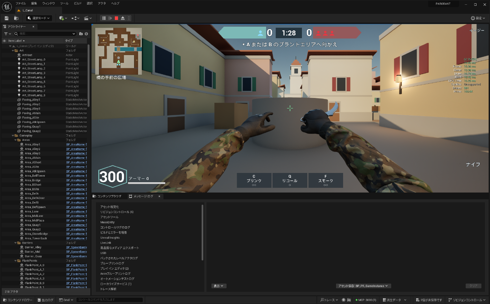 |
| PIE：味方 Bot（青）が路地にいる | 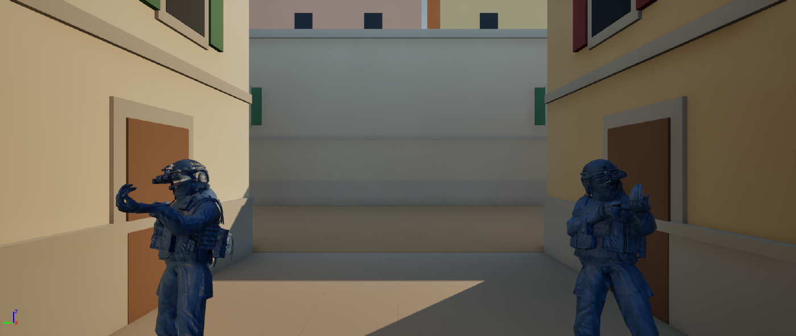 |
| PIE：敵 Bot（暗い色の SWAT）。A の中（2 階の回廊と 1 階）、B（日なた、遠く） | 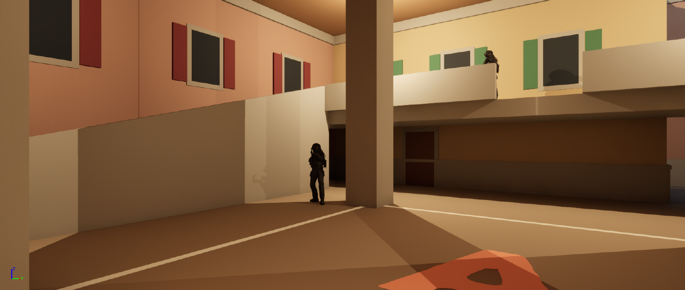　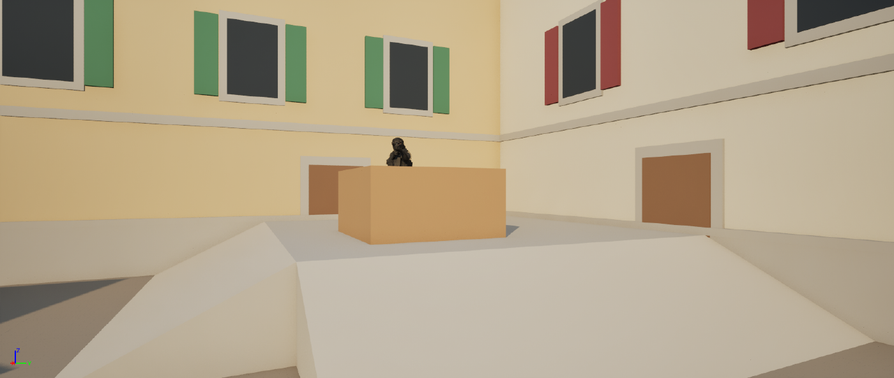 |
| L_Pind の設置エリア（共用の `BP_PlantZone`。上から、目の高さ） | 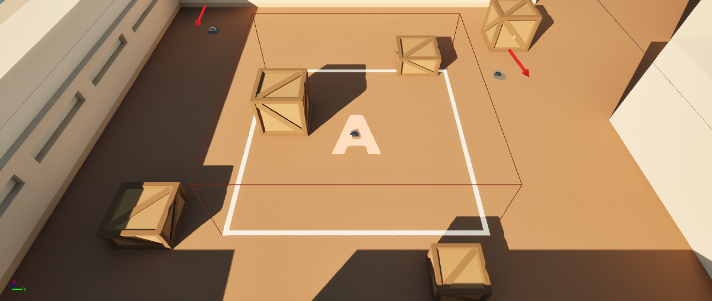　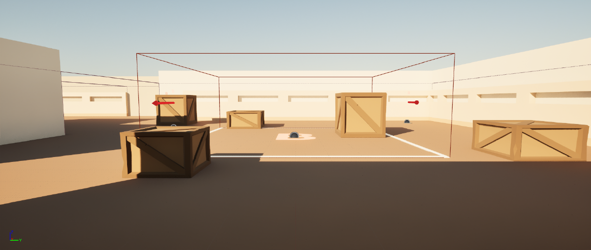 |

### 7.8 仕様との差分・気づいた点
- 部品は個別のアクタではなく ISM（11 コンポーネント、1 アクタ）。ISM は MCP で足すため、`map_layout_l_canal.py` だけでは完全に再現できない（`ArtHost` と `ISM_<key>` が要る。無いと、不足を出して止まる）
- 水は不透明のまま（色だけ変更）。「少し透ける」は半透明の素材が要るため見送り
- 壁の色は 28 個の箱を 1 色ずつ。merge した大きな箱が 1 つの建物に見えるため、隣の箱との境目が建物の切れ目に見える所がある
- 窓は壁の表面に貼った板。くぼみにはしていない（仕様どおり）
- 屋根の妻側（長手の端）は、傾いた板 2 枚だけで三角形を塞いでいない（地上からは見えにくい）
- 跳ね橋の板（`BP_Drawbridge`）の素材は変えていない（日陰で暗い茶に見える）
- 紹介画面（真上のカメラ）は、屋根が全体を覆うため通りがほとんど見えない（A の枠は屋根の下で見えない。B の枠は見える）。屋根を紹介画面の間だけ隠すか、紹介のカメラを少し斜めにする、は未実施（判断が要るため）
- 味方 Bot（青）と敵 Bot（暗い色）は、日なたの壁・日陰の床のどちらの前でも見える（最終の光で、味方は路地、敵は A の中と B で確認）。最初の設定では、外の建物の影のせいで船着き場が深い日陰になり、味方が暗い青に沈んで見えた（影を切って解消）。ハードでの動きの中の見え方は未確認
- 場外の建物と鐘楼は、遠くから見る箱の影。窓は暗いガラスの板だけ
- `ArtHost` のマップチェックの性能の警告（大きなアクタ）は残した。ISM を屋根・漆喰と小物に分けると消えるかもしれない

### 7.9 未確認・次の判断
- Meshy で作る小物と鐘楼、キャラクターの塗り直し・輪郭線、腕の単色化は未着手（クレジットとユーザーの確認待ち）
- ハード以上の難易度での Bot の見え方、スモークやフラッシュの見え方
- 見た目（色の好み、窓や腰壁の大きさ）はユーザーの確認待ち

## 8. Meshy の試作 1 個目（樽）の結果（2026-11-14、ブランチ `step38b/meshy-barrel`）

路地の樽の箱 `Cover_Barrel`（(-10, -26)、直径 1.5m・高さ 1m）の見た目だけを、Meshy で作った樽に置き換えて、世界観に合うかを確かめた。当たり判定は箱のまま（変更なし）。

### 8.1 生成の設定
`meshy-t2`（スマートトポロジー）、テキストから生成、三角形 2,000、合計 15 クレジット（メッシュ 5 + テクスチャ 10）。素材は `download/meshy/barrel/`（FBX 約 4.9MB、色のテクスチャ約 4.8MB。`download/` は Git の対象外）。今回の作業でクレジットは使っていない。

### 8.2 取り込みで実際にやったこと
- **Blender MCP は接続できなかった**（localhost:9876 に繋がらない）ため、Unreal だけで行った。原点の移動・拡縮の適用・FBX の書き直しはしていない
- Unreal 5.3 の取り込み（Interchange）は、スクリプトから渡した変換（`import_translation`）と取り込み先の名前（`destination_name`）を無視する。メッシュ名は `SM_Barrel` になったが、テクスチャは `barrel_base_color` になったので、`rename_asset` で `T_Barrel_BaseColor` に直した
- メッシュ：三角形 2,086、高さ 100cm（Z は -50〜+50 の中央原点）、直径 約 84cm（X 83.9、Y 83.0）。原点は高さの中心なので、置くときに Z を +50cm × 縮尺ずらして底面を床に合わせた。これは「原点を底面の中央に」ができていない代わりの対処（次回は Blender で直す）
- コリジョンなし（`auto_generate_collision` を切った）、Nanite なし、LOD なし
- テクスチャ：`/Game/PARORANT/Art/Props/T_Barrel_BaseColor`、Maximum Texture Size = 1024（読み戻しで 1024）。sRGB、WORLD グループ
- 素材 `M_Barrel`（パラメータ：`Desat` 彩度を落とす 0〜1、`Brightness` 明るさの倍率、`FlatMix` 0〜1、`WoodColor`・`RingColor`、`RingMaskGain`、`Roughness` 0.85、Metallic 0）
  - `MI_Barrel`：テクスチャのまま（`Desat` 0、`Brightness` 1、`FlatMix` 0）。**今、レベルに置いているのはこれ**
  - `MI_Barrel_Flat`：`FlatMix` 1。テクスチャの「青 − 赤」で鉄の輪のマスクを作り、板 = `MI_Canal_Wood` の色（0.34, 0.21, 0.10）、輪 = `MI_Canal_Stone` の色（0.36, 0.35, 0.33）に置き換える。形による陰影はメッシュのまま

### 8.3 大きさと置き方（樽 2 個、縮尺 0.88）
- 元の樽は高さ 100・直径 84 の縦長（比 1.19:1）。箱は直径 150・高さ 100（比 1.5:1）。1 個を箱いっぱいに伸ばすと横に 1.8 倍の太った樽になって不自然なので、比を保ったまま **同じ樽を 2 個、縮尺 0.88（高さ 88、直径 約 74）で並べた**
- 位置：箱の中心から X に ±37cm（路地 Alley2 の幅方向）、向きは 20° と 200° でずらした。外側の端は箱の中心から 約 74cm で、半径 75cm の箱の円柱に収まる（はみ出し 0）
- 3 個（縮尺 0.83、高さ 83）も考えたが、上の隙間が 17cm になり 15cm を超えるので 2 個にした
- アクタ：`Art_Barrel_1`・`Art_Barrel_2`（`StaticMeshActor`、NoCollision、`CanEverAffectNavigation` = false、タグ `CanalArt`、フォルダ `Art`、影を落とす設定のまま）
- 箱 `Cover_Barrel` は消さず、Visible を切り Hidden in Game にして、当たり判定だけを残した（衝突は QUERY_AND_PHYSICS のまま）
- スクリプト：`map_art_l_canal.py` の §7（樽の定数 `BARREL_*`）で作る。「タグ `CanalArt` のアクタを消す」で毎回作り直されるので二重にならず、最後に `Cover_Barrel` を再び非表示にする。`map_layout_l_canal.py` は、`SM_Barrel` があれば `Cover_Barrel` を最初から非表示で作る。`ART_ONLY` の再実行を 2 回行い、樽は 2 個のまま・箱は非表示のままを確認した

### 8.4 当たり判定とのずれ（数値）
水平方向の光線（高さ 10・30・50・70・90cm、箱の中心から 150cm の円周 36 方向、箱の中心へ向けて、合計 180 本）で、エンジンの可視性トレースの結果（箱 `Cover_Barrel` に 180 本とも命中。距離は解析値と最大 0.36cm 違い）と、樽のメッシュの三角形（2,086 × 2）との交点までの距離を比べた。

- **見えているのに弾が抜ける（見た目が箱の外）：0 本**。最小のずれも +2.1cm で、見た目は箱の中に収まる
- **見えないのに弾が当たる**（箱に当たった所と見た目の表面の距離。樽に当たる光線 106 本）：最大 62cm、平均 22.6cm。5cm 以下 12 本、10cm 以下 32 本、15cm 以下 48 本（45%）、30cm 以下 68 本。大きいのは 2 個の樽が接する付近で、箱の円周に対して樽が引っ込む方向
- 高さ 88cm 未満の光線 144 本のうち 38 本（26%）は樽の見た目にまったく当たらず箱だけに当たる（2 個の樽のすき間を抜ける方向）。高さ 90cm の 36 本は、樽の天面（88cm）と箱の天面（100cm）の間（上の隙間 12cm）。**15cm 以内という目安は、横方向では満たせていない**（円柱の箱に 2 個の円柱を入れる限り、2 個の間と両わきに隙間が出る）
- 樽の見た目の中心（高さ 44cm）へ向けたトレースは、箱 `Cover_Barrel` に当たる（`Art_Barrel_1`・`_2` ともに）
- Bot が樽の陰に隠れたときの影響：隠れた体のほとんどは 2 個の樽の背で覆われる。撃たれる側は、樽の間とわきの空きの方向（約 4 分の 1 の光線）で「見えないのに当たる」ことがある。見えている樽の面を撃ったのに弾が抜けることは、この配置では起こらない。体感への影響は、遊んでの確認待ち

### 8.5 画像（`docs/images/meshy_barrel_*.png`）
| 画像 | 内容 |
|---|---|
| 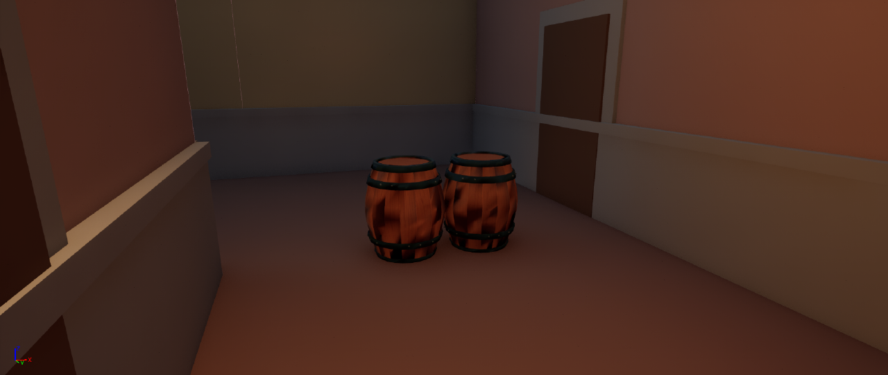 | 斜め、目の高さ 1.6m、距離 約 4m（`meshy_barrel_near.png`） |
| 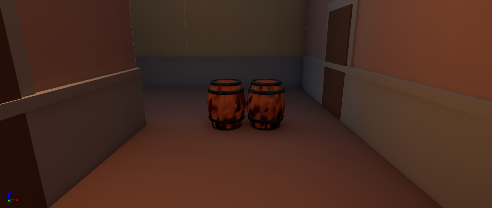 | 正面（路地の幅方向に 2 個が並ぶ）、1.6m、4.5m（`meshy_barrel_front.png`） |
| 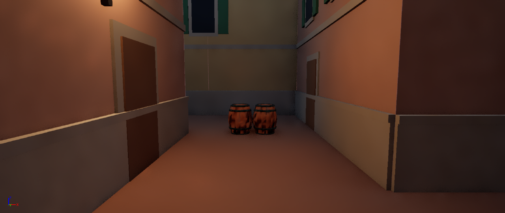 | 路地の入口寄りから、約 7.5m（`meshy_barrel_far.png`） |
| 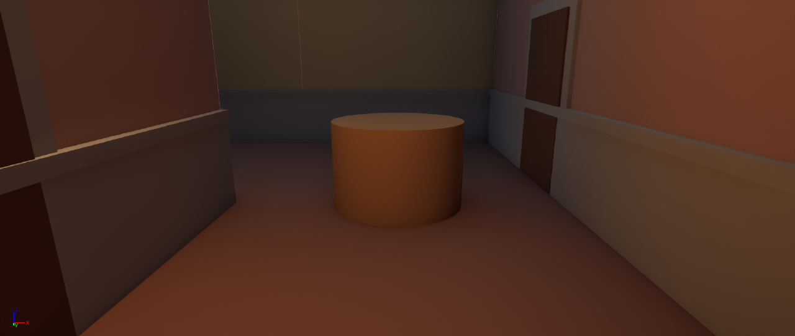 | 比較：元の箱（樽を隠した）、正面と同じ視点（`meshy_barrel_before.png`） |
| 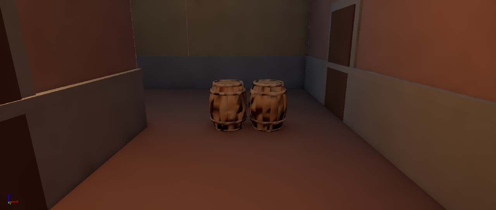 | 単色版 `MI_Barrel_Flat`、正面と同じ視点（`meshy_barrel_flat.png`） |

### 8.6 見た目の判定（あなたの目ではなく、実装者の判定。最終判断はユーザー）
- ①**浮いているか**：テクスチャ版は、まわりの単色の壁・床・木箱より浮く。彩度が高く（板がはっきりしたオレンジ、輪が黒に近い青灰）、板目と焼き込みの暗いまだらが細かく、単色の壁に対して絵柄が目立つ。ただし暗い路地の中では、色の系統（橙〜赤茶）は壁や床と同じなので、「別の絵柄のものが置かれている」程度で、ひどくは浮かない
- ②**大きさ**：人に対して自然（高さ 88cm の樽が腰より少し下）。2 個並びは、1 個の巨大な樽より自然
- ③**影**：影は落とす設定（床に弱い接地の影が見える）。路地は日陰で、もともと床との明暗差が小さいため、影は目立たない
- ④**焼き込みの影・ハイライト**：テクスチャに焼き込まれた暗いまだらが板の途中に残り、夕暮れの横からの光と無関係な場所に暗い筋が出る。ハイライトの焼き込みは目立たなかった。メッシュ自体の凹凸も大きく（板が歪む）、遠目には汚れた樽に見える
- **色の対処**：単色版（`MI_Barrel_Flat`）を作って並べた。板は `MI_Canal_Wood`、輪は `MI_Canal_Stone` の色にしたところ、壁・木箱（単色）と色の調子が合い、まだらの焼き込みも消えた。ただしマスクが輪の細かい部分をなめらかに拾うため、輪が薄茶に見え、輪郭の鮮やかさは減る。テクスチャ版の `Desat`（彩度を落とす）と `Brightness`（明るさ）もパラメータにしてあるが、画像は撮っていない
- **判定**：世界観（単色の箱・壁）には**単色版の方が合う**。テクスチャ版は絵柄が強く、9 種類を並べると小物だけ細かくなって浮く。ただし単色版でもメッシュの凹凸が残るので、質感は低ポリの手作り感になる。レベルには今、テクスチャ版（`MI_Barrel`）を置いている。切り替えは `BARREL_MAT`（`map_art_l_canal.py`）を `MI_Barrel_Flat` にして再実行

### 8.7 次に 9 種類を作るときの注意
- Blender が使える状態で、原点を底面中央・縮尺の適用・向きを揃えてから書き出す（今回は Unreal の取り込みが変換を無視するため、配置側で補正した）
- 箱が円柱・正方形の物は、元のメッシュの縦横比が箱と違うと、はみ出すか隙間ができる。生成の文に寸法の比（例：直径 1.5、高さ 1）を入れる、または箱の比に合わせて 1 個で作る（2〜3 個並べると円柱の箱では横の隙間が 15cm を超える）
- 色のテクスチャは 1024 に落としても重いが、単色化するなら使わない。生成時にテクスチャなし（メッシュのみ、5 クレジット）で作れば、色は素材で付けられる（15 → 5 クレジット）
- 形の凹凸（板の歪み）が大きいので、`meshy-t2` の三角形数は 2,000 でも十分。凹凸を抑えたければ生成の文に「clean smooth silhouette, regular planks」を足す
- 取り込み後は、必ず 2 つの確認を行う：箱の外にはみ出さないこと（ずれ -0）、隙間の分布（8.4 と同じ光線の確認）。今回の確認スクリプトは `Saved/Scratch/` にあり（Git の対象外）、必要なら `docs/tools/` に移す
- 未確認：PIE での実際の撃ち合い（Bot が樽の陰で撃たれる）、ハード、フレーム時間の測定（樽 2 個・約 4,200 三角形で影響は無視できる程度のはず。PIE は起動して、実行時エラー 0 件を確認した）

## 9. 遮蔽の作り込み（Step 38b、2026-11-14、ブランチ `step38b/meshy-barrel`）

方針：**Meshy は遮蔽に使わない**。遮蔽の箱（`Cover_*`、docs/22 §8.1）は当たり判定も見た目の本体も元のまま（位置・大きさ・形・素材を変えない）。その表面に、当たり判定なしの薄い飾り（出っ張り 3cm 以内）を `ArtHost` の ISM で足した。`Cover_Barrel` は表示に戻し（試作の Meshy の樽 `Art_Barrel_1`・`_2` は外した）、`map_layout_l_canal.py` の「`SM_Barrel` があれば樽の箱を隠す」処理も消した。実装は `map_art_l_canal.py` §7（`deco_*` 関数）。

### 9.1 足した ISM と素材
`ISM_<key>` を MCP の `edit_component` で `ArtHost` に 5 個足した（合計 17）：`ISM_iron_cyl`・`ISM_stone_cyl`・`ISM_door_cyl`・`ISM_water_cyl`（メッシュは `/Engine/BasicShapes/Cylinder`。直径 1m、高さ 1m に拡縮して使う）と `ISM_plank`（Cube、`MI_Canal_Planks`。今回は使っていない）。素材は既存の `MI_Canal_*`（木の縁取りと継ぎ目は `Door`（濃い茶）と `Iron`、輪は `Iron`、石は `Stone`、水は `Water`、天幕は `Shutter_Red`（えんじ）と `Plaster_Cream`）。`ISM_KEYS` に `CYL_KEYS` を足し、円柱用の key は Cylinder メッシュにするよう `map_art_l_canal.py` を直した。

### 9.2 遮蔽ごとの飾り
| 遮蔽 | 飾り（箱の表面からの出っ張り） | 画像 |
|---|---|---|
| 木箱（大）2×2×2（A 入口、B の岸、岸壁の道） | 太い縁取り（幅 14cm、3cm）、縦の板の継ぎ目（0.4m ごと、1.2cm）、X 字の筋交い（幅 12cm、3cm）、上面の縁取りと板の線 | 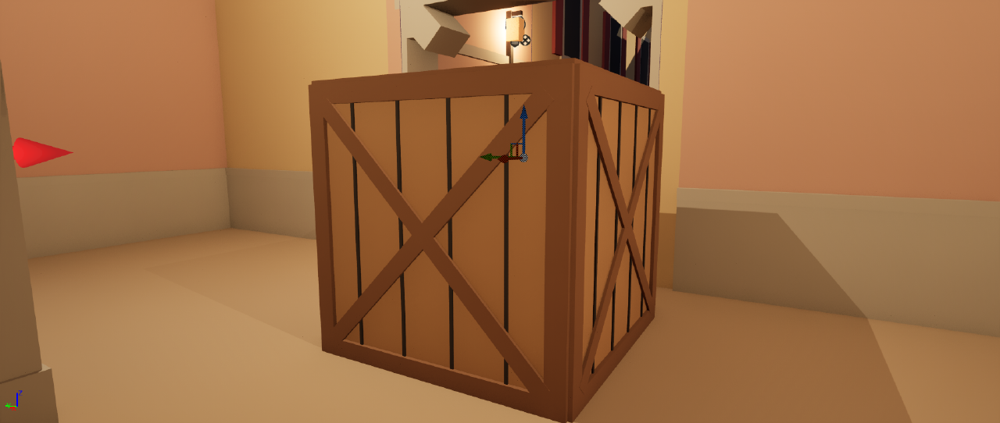 |
| 木箱（小）2×2×1・2×1×1（高台、鐘楼の下、A 奥） | 細い縁取り（幅 10cm、3cm）、横の板の継ぎ目（板幅 約 33cm）、1 本の筋交い（面ごとに向きを変える）、上面の縁取りと板の線 | 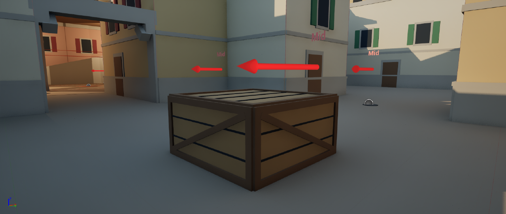 |
| 樽（`Cover_Barrel`、直径 1.5×高さ 1、大きな 1 個の樽） | 鉄の輪 3 本（直径 +6cm＝出っ張り 3cm、太さ 9cm）、ふたの縁（上に 2.5cm、出っ張り 1.5cm）、板の継ぎ目の縦線 20 本（1.6cm）、ふたの板の線 7 本 | 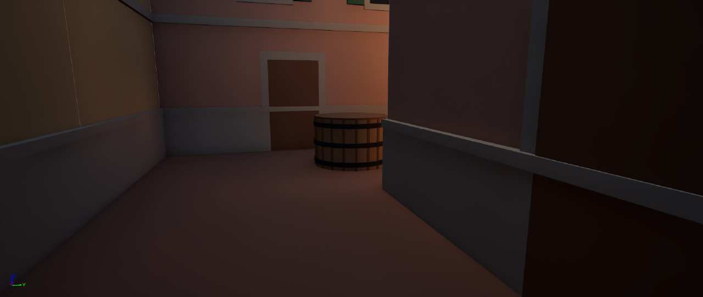 |
| 井戸（直径 2×高さ 1） | 石の段の境（横線 2 本）と縦の継ぎ目（段ごとにずらす、12 本×3 段）、縁（+2cm）、暗い穴と水の面（上に 2.5cm と 3cm）、上に細い木の柱 2 本（高さ 1.6m、断面 12cm）と梁・巻き上げの軸、小さな屋根（床から 2.7〜3.3m、幅 1.5m）。頭より上で、視線を新しく遮らない | 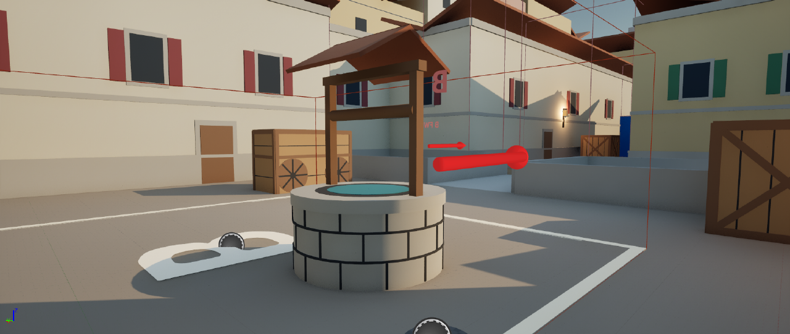 |
| 荷車（3×1.5×2） | 枠と荷台の縁、板の線、上面の縁取り、側面の車輪（直径 1.1m の円盤、厚み 2cm、両側に 2 個ずつ）、ハブ、スポーク 8 本（上に 1cm）、後ろの取っ手（面に沿った鉄の棒、3cm） | 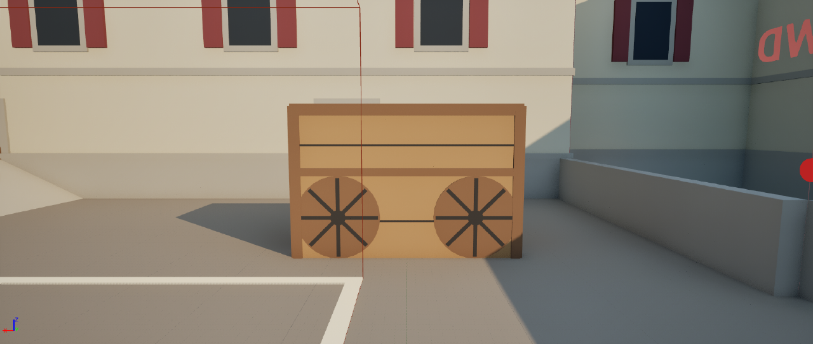 |
| 屋台（3×1.5×2） | 台の縁取りと板の線、長い面の上端に赤とクリームの縞の布の垂れ（3cm）、天幕（赤とクリームの縞の薄い板 3 枚、厚み 3cm、箱の真上の範囲だけ。高さ 2.07〜2.5m で北が高い）、四隅の細い柱（8cm）。上に乗れる形ではない（箱は 2m で、天幕は薄い） | 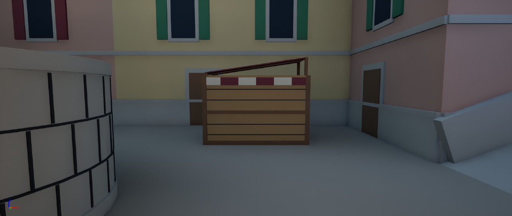 |
| 噴水（直径 4×高さ 2） | 台座と縁（+2cm）、石の段の境（横線 2 本）と縦の継ぎ目（28 本×3 段）、水の面（直径 3.4m、上に 3cm）、上に出る部分は細く：中央の柱（直径 0.55m、高さ 1.1m）、受け皿 2 枚（直径 1.5m と 0.8m）、先端 | 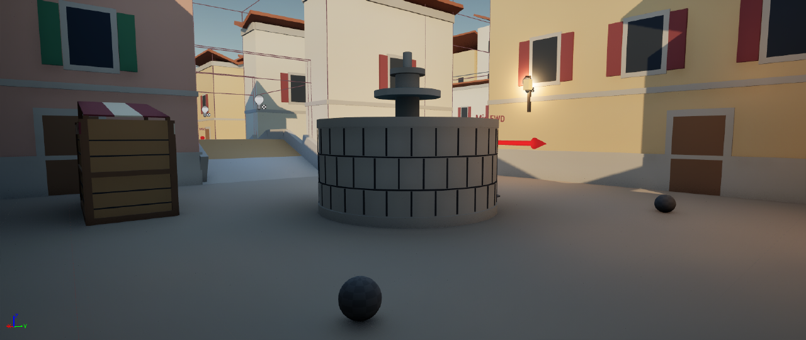 |
| 柱（A の 4 本、1×1×7、石） | 台座（高さ 35cm、+3cm）、柱頭（高さ 30cm、+3cm）、中ほどの帯（+2cm）、縦の溝 2 本×4 面 | （A の中は光が弱く、画像は撮っていない） |

### 9.3 確認
- 当たり判定の箱は変更なし（位置・大きさ・形を変えていない。素材も変えていない）。飾りの ISM 17 個は NoCollision、`CanEverAffectNavigation` = false（違反 0 件）
- 視線：可視性チャンネルのライントレースを、遮蔽 15 個（柱 4 を除く）の中心を挟む水平の線、4 方向×2 高さ（1.6m、0.6m）の 88 本で、作業前と作業後（飾りの配置後）を比べた。当たった・当たらなかった、当たったアクタ、当たるまでの距離（誤差 2cm 以内）が **88 本とも同じ**（差 0 本）
- 経路 6 本の長さ（`find_path_to_location_synchronously` の区間合計、m。**docs/26 §7.6 の 6 本とは経由点が違う**ので、元の数値とは比べない。経由点は §10.6 に書いた）：作業前 → 後は 6 本とも差 0%
- フレーム時間（エディタのビューポート、橋の手前の広場を北向き、240 フレームの平均）：作業前 15.76ms（63.4 FPS）→ A・B の後 16.15ms（61.9 FPS）。A だけの値は測っていない（§10.7）
- **未確認**：箱の上に足した細い部分（井戸の屋根と柱、屋台の天幕、噴水の中央の柱と受け皿）が、視線を新しく遮るかどうか。上の視線の確認は水平のトレース（高さ 0.6m と 1.6m）なので、当たり判定なしの飾りには当たらない。高い所（樽の上、B の高台、橋の頂上）からの見え方は確かめていない。井戸の屋根は幅 1.5m・床から 2.7〜3.3m、天幕は箱の真上の範囲で高さ 2.07〜2.5m。出っ張りの 3cm 以内は、作業の最後に直した（筋交いを 3.2cm → 3.0cm、井戸の穴・水と噴水の水が 3.2〜3.6cm → 2.5〜3.0cm。再実行後の確認は §10.6 と同じ数値）
- 見た目の判定（実装者の目）：木箱は、縁取りと筋交いで箱らしくなり、単色の壁に対して浮かない。大と小の違い（縦の継ぎ目と X 字、横の継ぎ目と 1 本）が分かる。樽は暗い路地でも輪と継ぎ目が見える。井戸は石積みの線が太めで、少しうるさい。荷車の車輪は大きく、側面が賑やかになった。屋台は天幕が低く平ら（水平に近い）。噴水は柱が細く、全体は大きな石の円柱のまま。**色や飾りの量はユーザーの確認待ち**

## 10. 乗れる樽の飾り（Step 38b、2026-11-14、ブランチ `step38b/meshy-barrel`）

方針：Meshy で作った樽（§8）は、遮蔽には使わず、**道の角・壁ぎわに置く小さな段差の飾り**として配る。VALORANT にある、意味のない小物の段差と同じ役割（寂しい角を埋める。ジャンプで乗れる）。簡易コリジョンを付け、遮蔽の箱と同じ当たり判定（プレイヤーと Bot が通れない、弾が止まる、視線を遮る）にした。クレジットは使っていない（Meshy・画像生成のツールを呼んでいない）。

### 10.1 Blender で整えた内容（Blender MCP は接続できた。Blender 5.2.1）
スクリプト `docs/tools/blender_barrel_small.py`（Blender の Python で実行。新しいコレクション `BarrelWork` の中だけで作業し、書き出したあと、読み込んだオブジェクト・メッシュ・素材・画像・コレクションを消す。既存の Cube・Camera・Light には触れていない。`download/` の元の FBX は変更していない）：
1. `download/meshy/barrel/barrel.fbx` を読み込み、回転（X=90°）・拡縮・位置を適用
2. 重なった頂点の結合（0.2mm。実際に消えた頂点は 0）、読み込みで付いたカスタム法線の消去、Shade Smooth by Angle（35°。Blender 5.x では Auto Smooth が無くなったためこの方法）。三角形 2,086、頂点 1,142（Unreal では UV の継ぎ目で 4,082 に分かれる）
3. 高さ 70cm（一様拡縮。直径は 58.7 × 58.1cm）、原点を底面の中央（XY は外形の中心、Z は底）
4. FBX で書き出し（`download/meshy/barrel/barrel_small.fbx`、メッシュのみ、+Z 上）。単位の設定は試して決めた値（`apply_unit_scale=False`、`FBX_SCALE_NONE`）：`apply_unit_scale=True` では Unreal の取り込みで 0.7cm に、頂点を 100 倍して同じ設定にすると 70m になった
- 元の樽は、8 角形に近い面の板と、別部品の鉄の輪 3 本（43 個の部品）でできている。浮いた破片は無いので削除していない。「形の乱れ（へこんだ板）を軽く均す」は、板の継ぎ目と輪の段差を残すためにやっていない（Unreal で見て、凹みは気にならなかった）
- 面のまだら：読み込み時の法線（FBX のカスタム法線）を捨てて角度で再計算した。画像（`deco38_*.png`）では、焼き込みの暗いまだらはテクスチャ側の模様として残るが、面の陰影のちらつきは無い

### 10.2 Unreal の取り込みとコリジョン
- `/Game/PARORANT/Art/Props/SM_BarrelSmall`（新規。`SM_Barrel` は試作の樽のまま残した。レベルの樽は新しい方だけを使い、古い方を参照するアクターは無い）。高さ 70cm（Z は 0〜70）、直径 58.7 × 58.1cm、原点は底面の中央、三角形 2,086、Nanite なし。素材 `MI_Barrel`（テクスチャ版のまま。画像で見て、まわりから浮かない。`Desat`・`Brightness` は変えていない）
- 簡易コリジョン：**凸形状 1 個（頂点 64 まで。`set_convex_decomposition_collisions(hull_count=1, max_hull_verts=64)`）**、上面は平ら。`CollisionTraceFlag` は `UseSimpleAsComplex`（複雑トレースと単純トレースが同じ形になる）。アクタの当たり判定は遮蔽の箱と同じ `BlockAll`（`QUERY_AND_PHYSICS`）、ナビメッシュに影響する、静的
- 見た目とコリジョンの差（水平の光線 8 高さ × 24 方向 = 192 本で、エンジンのトレースと見た目の三角形（2,086）との交点までの距離を比べた）：

| 案 | 見えないのに当たる（コリジョンが外側）最大 | 見えているのに抜ける（内側）最大 | 平均 | 3cm 超 |
|---|---|---|---|---|
| 10 角柱（`NDOP10_Z`、上面平ら） | 7.81cm（頂点で見ると最大 6.86cm） | 0.57cm | 4.67cm | 129 / 192 |
| **凸形状 1 個（採用）** | **2.68cm** | **2.07cm** | **0.80cm** | **0 / 192** |

  樽が胴の中ほどに膨らんでいて上下が絞られているため、10 角柱では上下の縁で 7cm 近く外側に出た。上面（垂直の光線）：半径 0〜16cm でコリジョンが見た目より 1.2〜1.6cm 高く、縁（半径 22〜26cm）では見た目より 0.1〜4.0cm 低い。3cm を超えるのは上面の縁の外周（半径 26cm 付近、最大 4.0cm）だけ
- 凸形状の頂点は Python から読めない（`KConvexElem` の頂点が公開されていない）ため、コリジョンの形は上のトレースで測った

### 10.3 乗れること（PIE、`BP_PR_GameInstance.bSkipTitle` を一時的に true にして確認し、false に戻した）
- ジャンプの高さ：`JumpZVelocity` 420、重力 980 → 頂点 約 90cm（PIE で測った最高点：床から 89.6cm）。プレイヤーのカプセルは半径 55cm、半高 96cm。最大段差（`MaxStepHeight`）45cm なので、70cm の樽は歩いては上がれず、ジャンプが要る
- 樽（`Deco_Barrel_D07_1`、縮尺 1.04、高さ 72.8cm）の上へ、**1.6m 手前から走ってジャンプ**（走る速さ 675cm/s、スペースキー）：着地して `MOVE_Walking`、位置 Z=169.8（= 樽の上面 72.8 + 96 + 1）、1.6 秒以上止まったまま（滑り落ちない）。上空（高さ 190cm）へ置いて落とした場合も同じ高さに止まり、3 秒間動かなかった。樽の天面は直径 59cm でカプセル（直径 110cm）より小さいが、壁ぎわの樽なので、壁にカプセルが当たる位置が樽の天面の上にあり、立てる。壁から離れた開けた場所の樽（置いていない）では確かめていない
- 樽に乗ると目の高さ 約 2.3m（`deco38_onbarrel_view.png`。樽の上のカメラ位置からの画像）。PIE のゲーム画面（HUD つき）：**`deco38_pie_onbarrel_hud2.png`**（`D06_1` の樽の上に立ったところ。Z=162.5＝樽の上面 65.8 + 96 + 0.7。鐘楼の下を見渡す。奥に `D07` の樽が見える）、`deco38_pie_onbarrel_hud.png`（`D07_1` の樽の上。壁を向いている。HP の数字は敵 Bot の射撃で減っている）、`deco38_pie_hud_roundloss.png`（広場へ移したところ、敵 Bot に倒されて「倒された」の表示。難易度はイージー）
- Bot は乗らない（乗る処理は作っていない。ナビメッシュは樽の上に無い）

### 10.4 置いた場所（12 か所、樽 21 個）
置き方：角の内側へ寄せ（壁から 5〜10cm）、1 か所に 1〜3 個、縮尺 0.90〜1.10、向きはばらばら、2 個目以降は角に沿ってずらす。位置の決定は `map_art_l_canal.py` §8 の `DECO_SITES`（計算結果をそのまま書いた表）。再実行しても同じ結果で、冒頭でタグ `CanalDeco` のアクタを消してから作り直す。アクタは `Deco_Barrel_<番号>_<n>`、タグ `CanalDeco`、フォルダ `Art/Deco`。座標は m（+X が北、+Y が東）。「残りの幅」は、その場所を含む歩ける範囲（`WALK` の長方形）の**短い辺**から、樽の群が壁から張り出している深さ（0.6〜1.4m）を引いた値（その向きの通路の、樽を置いたあとに残る幅。長い辺の向きは長さなので数えない）。

| 番号 | 場所 | 樽の位置（X, Y m） | 個数 | 残りの幅 |
|---|---|---|---|---|
| `D01` | 船着き場の南西の隅 | (-35.69, -29.69) 縮尺 0.96 向き 234° (-35.69, -29.08) 縮尺 0.91 向き 183° (-35.08, -29.71) 縮尺 0.91 向き 153° | 3 | 8.8 m |
| `D02` | 船着き場の北東の隅 | (-35.66, 29.65) 縮尺 1.07 向き 80° (-35.64, 28.94) 縮尺 1.03 向き 352° | 2 | 9.3 m |
| `D03` | 路地の 1 つ目の折れ（外側の角） | (-8.34, -29.67) 縮尺 0.91 向き 104° | 1 | 3.4 m |
| `D04` | 路地の 2 つ目の折れ（外側の角） | (-11.70, -18.31) 縮尺 0.93 向き 111° | 1 | 3.4 m |
| `D05` | 橋の手前の広場の南東の角 | (-2.35, -7.66) 縮尺 1.06 向き 209° (-2.37, -6.98) 縮尺 1.03 向き 22° | 2 | 14.7 m |
| `D06` | 鐘楼の下の北西の角 | (8.33, 7.66) 縮尺 0.94 向き 154° (8.33, 7.02) 縮尺 0.96 向き 286° | 2 | 11.4 m |
| `D07` | 鐘楼の下の北東の角（鐘楼の裏の脇） | (19.65, 7.65) 縮尺 1.04 向き 207° (19.62, 6.97) 縮尺 1.01 向き 353° | 2 | 11.3 m |
| `D08` | A の市場の北西の隅 | (8.31, -14.32) 縮尺 0.92 向き 273° | 1 | 17.4 m |
| `D09` | 広場の裏口の奥の隅 | (29.67, 17.67) 縮尺 0.93 向き 14° (29.63, 16.97) 縮尺 1.03 向き 113° | 2 | 3.3 m |
| `D10` | 教会前の南東の隅 | (35.63, -7.64) 縮尺 1.04 向き 209° (35.61, -6.95) 縮尺 0.99 向き 239° | 2 | 9.3 m |
| `D11` | B の広場の南の壁ぎわ | (21.87, 14.35) 縮尺 0.91 向き 233° (22.58, 14.39) 縮尺 1.10 向き 139° | 2 | 19.3 m |
| `D12` | 岸壁の道の南の壁ぎわ | (-18.70, 24.35) 縮尺 1.03 向き 166° | 1 | 5.3 m |

- 通路の幅：幅 4m の路地（`D03`・`D04`）は 1 個だけを、折れの外側の角（歩く線から外れた隅）に置いた。残りの幅は 3.4m。`D09`（広場の裏口 `DefB`、幅 4m）は 2 個を奥の北東の角に置き、残りの幅は 3.3m（歩く線は南西側を通る）。仕様の「幅が 4m 未満の路地では 1 個だけ」の対象は 4m 未満で、4m ちょうどの `D09` は 2 個にした（判断が要るなら 1 個に減らせる）。通れる幅が 2.5m を切る場所は無い（最小は `D09` の 3.3m）
- 守った決まり（オフラインの計算 `Saved/Scratch/deco_sites.py` で全部確認した。問題 0）：壁から離さない、設置エリアの縁から 2m 以内に置かない、持ち場・経由点から 1.5m（半径込み）以内に置かない、購入バリアの 2.5m 以内、スポーン（(-32, 0)、(31, 2)）から 6m 以内に置かない、橋（跳ね橋・石橋）の出入口 3m 以内に置かない、運河の縁 1.5m 以内に置かない、高台・段・2 階の回廊の下に置かない
- 最初の案から外した場所（視線の確認で見つかったもの）：橋の手前の広場の西側の 2 つの角（樽の上から、地面からは見えない `Hold_BFwd`（40m 先）と `Hold_Mid2` が見えた＝橋の上の欄干越しの新しい長い視線）、A の市場の北西の角の 2 個目（`Cover_A_Entry`（高さ 2m）の向こうの `Hold_A5` が見えた）。広場の西側の 2 角は取りやめ、A の角は 1 個にした

### 10.5 視線の比較（樽の上と地面）
各樽について、樽の上（目の高さ = 樽の高さ + 1.6m。上面の中心と、四方 20cm ずらした 4 点の 5 点）と、地面（同じ XY で目の高さ 1.6m、樽は無いとして）から、持ち場 16 個（床の高さ + 1.6m。`Hold_A1` は床 3m）と設置エリア A・B の中心（高さ 1m）へ、可視性チャンネルのライントレース（計 18 目標）。
- **地面から見えず、樽の上から（どれかの点で）見える組：0 組**（最初の案の 3 樽を取りやめたあと。必須の「いちばん近い持ち場 2 つと最寄りの設置エリア」は最初から 0 組）
- 地面から見える目標の数と、樽の上から見える数は 21 個とも同じ（`D04` は 2 と 2、`D08` は 4 と 4、`D11` は 6 と 6、他）

### 10.6 ナビメッシュと経路 6 本
- 置いたあとに RebuildNavigation（コンソール）を実行。樽の中心 21 か所がナビメッシュ上に無いことを確認（`project_point_to_navigation`、半径 3cm。同じ樽から 1.2m 離れた点が投影できる＝調べ方が効いている、を 10 か所で確認）。L_Canal は実行時の再生成が `DynamicModifiersOnly` なので、静的な障害物はビルドの結果がレベルに保存される（保存した）
- 経路 6 本（区間の合計 m。`find_path_to_location_synchronously`。**docs/26 §7.6 の 6 本とは経由点が違う**（元の経由点の記録が残っていないため作り直した）ので、元の数値とは比べず、この作業の前後を比べた。経由点：攻撃スポーン (-32, 0)、防衛スポーン (31, 2)、A (17, -23)、B (15, 24)）：

| 経路（経由点） | 前 | 後 | 差 |
|---|---|---|---|
| 攻撃 → A（路地）：(-20,-28)、(-10,-22)、(0,-20)、A | 74.689 | 74.689 | 0% |
| 攻撃 → B（岸壁・石橋）：(-20,27)、(3,26)、B | 67.072 | 67.072 | 0% |
| 攻撃 → A（橋・ミッド）：(-22,0)、(3,0)、(14,-2)、(14,-10)、A | 68.052 | 68.052 | 0% |
| 防衛 → A | 32.032 | 32.032 | 0% |
| 防衛 → B | 28.112 | 28.114 | +0.01% |
| 攻撃 → 橋 → 防衛：(-22,0)、(3,0)、防衛 | 63.607 | 63.607 | 0% |

  全持ち場 16 個と裏取りの経由点 8 個へ、攻撃スポーンと防衛スポーンの両方から経路がある（24 個とも成功）。±2% 以内
- 遮蔽まわりの視線 88 本（§9.3 と同じ線）は、樽を置いたあとも作業前と同じ（差 0 本）

### 10.7 フレーム時間・その他の確認
- フレーム時間（エディタのビューポート、橋の手前の広場を北向き、240 フレームの平均。**作業前＝A・B とも無し**）：15.76ms（63.4 FPS）→ A・B の後 16.15ms（61.9 FPS）。+0.39ms。足した部品は ISM 1,907 個（A の飾りで +570 個）と樽 21 個（各 2,086 三角形）
- PIE の `stat unit`（HUD の画面の右、エディタが重なった状態）：52〜61 FPS、フレーム 16〜19ms
- 実行ログ（`Saved/Logs/PARORANT.log`）：この作業の PIE の間に `ブループリントランタイム エラー`（Blueprint Runtime Error）は 0 件（ログにある 38 行は、1 時間前の別の作業の PIE のもの。`SkillPress` の Accessed None で、今回の作業とは無関係）
- `BP_PR_GameInstance.bSkipTitle` は PIE のために true にし、終わったあと false に戻した（保存していない。戻したあとの値を読んで false を確認）
- Bot のスポーン位置（PIE の購入フェーズに `control_actor list` で読んだ）：敵 Bot は持ち場に出る（(20.4, -29.2)、(12.4, 21.5)、(-9.5, 3.0)＝`Hold_A2`・`Hold_B2` 付近・`Hold_MidFwd` 付近）、味方 Bot は攻撃スポーンの (-34.5, ±1.5)。**樽はどのスポーン位置からも 2m 以上離れている**（最も近い樽でも 8m 以上）
- `SM_BarrelSmall`・`MI_Barrel`・`L_Canal` を `validate_assets`（Data Validation、素材の使用フラグ込み）で確認：3 つとも valid。取り込みのやり直しのときにログに「ForceDeleteObject failed to delete SM_BarrelSmall, this package is now potentially corrupt」が出た（古い `SM_BarrelSmall` の削除を試みて失敗したもの。その後は上書きの取り込みで作り直し、保存済みのアセットは valid）。エディタを再起動したあとに、アセットが開けることを確認してほしい
- 出っ張りの修正のあとの再実行（`map_art_l_canal.py`）：樽 21 個が作り直されるので、そのあと RebuildNavigation → 経路 6 本・視線 88 本・ISM の違反・樽の中心がナビメッシュに無いこと（0/21）・保存、を同じ数値で確認した。**このスクリプトを再実行したあとは、必ずナビメッシュをビルドし直す**
- 既知の点：`ISM_plank` は今回の作業では使っていない（空のまま）。`MI_Canal_*` は、スクリプトが実行のたびに再保存するので、`git status` で「変更あり」と出る（値は同じ。コミットしていない）。フレーム時間はエディタのビューポートで測ったもので、PIE の「作業前」の値は無い

### 10.8 見た目の判定（実装者の目。最終判断はユーザー）
- 画像：`deco38_D01.png`（船着き場の隅、3 個）、`D03`（路地の折れ、1 個）、`D05`（広場の隅、2 個）、`D07`（鐘楼の下、日なた、2 個）、`D09`（広場の裏口の奥、2 個）、`D11`（B の広場の壁ぎわ、2 個）、`D12`（岸壁の道の壁ぎわ、1 個）、`deco38_onbarrel_view.png`
- 浮いているか：テクスチャ版 `MI_Barrel` は、日なた（D07、D11）でも日陰（D01、D03）でも、床や壁（単色）から浮かない。板の橙と輪の青灰が壁の色と同じ暖色系で、遮蔽の木箱（大・小、§9）とも合う。§8.6 で心配した「絵柄が強い」は、小さな樽が角に 1〜3 個ある使い方では目立たない
- 置き方：角に寄せて、向きと大きさが少しずつ違い、わざとらしい並びにはなっていない。**D12（岸壁の道の南の壁ぎわの 1 個）は、壁の真ん中に 1 個だけで、少し寂しい（角ではない）**。D03・D04 も 1 個で、角の隅に小さく見える
- 暗い所（路地、A の中）では樽の輪が黒く見える。明るさの調整（`Brightness`）はしていない

## 11. 実装結果（Step 38c：Bot と腕の塗り直し、輪郭線、紹介画面の屋根、2026-11-14、ブランチ `step38c/characters`）

Meshy・画像生成・外部素材のダウンロードは使っていない。作成スクリプトは `docs/tools/char_materials_38c.py`（輪郭線と敵のマテリアル）、`char_arms_38c.py`（腕）、`map_introhide_l_canal.py`（紹介画面で隠す物のタグ）。

### 11.0 実行時エラーの修正（別コミット）
- 原因：`BP_PR_Character.SkillPress` の先頭の分岐（`SkillMode == Slot + 1` の判定）が、`SkillSel[Slot]` を読むために「GameInstance へのキャスト」（`K2Node_DynamicCast_AsBP_PR_Game_Instance_1`、実行の線の上にある方）の出力を使っていた。そのキャストは、分岐のあとの経路（スキル回数の確認のあと）でしか実行されないため、先頭では未実行で Accessed None になっていた（ログ 2026.11.13-15.06.46 UTC の 19 回）
- 直し方：`SkillPress` の先頭（入口と最初の分岐の間）に、`GetGameInstance` → `Cast To BP_PR_GameInstance` を 1 つ足して実行し、`GetSkillSel` の `self` をその出力につなぎ替えた。スキルの動き（分岐の条件、呼ぶ関数）は変えていない
- lint（`BP_PR_Character`、`unguarded_read`）は 1 件のみ（`UpdateArms` の `CurrentWeapon`、キャストではなく「何もつながない Set」。今回のエラーとは無関係で、PIE のログにも出ていない）。ほかの入力イベントにキャストの結果をキャストの通らない経路で読む形は見つからなかった

### 11.1 輪郭線（裏返した外殻）
- 方式：UE 5.3 のマテリアルでカリングを反転できないため、**Two Sided + Masked**、`TwoSidedSign` が負（裏面）のピクセルだけ残し（`OpacityMask = saturate(-TwoSidedSign)`）、頂点を法線方向に膨らませた（World Position Offset）単色の Unlit マテリアル `M_Outline`。深度テストがあるので壁越しには出ない
- 膨らませる量は `clamp(カメラまでの距離 × ScreenScale, MinWidth, MaxWidth)` cm（画面上でほぼ一定の太さ）。`ScreenScale` = 0.003（10m で約 3cm ≒ 3px、30m で約 9cm）、`MinWidth` 1cm、`MaxWidth` 8cm
- 色：`MI_Outline_Enemy`（0.50, 0.02, 0.02、暗めの赤）、`MI_Outline_Ally`（0.05, 0.45, 0.90、水色）
- 実装：`BP_PR_Bot` に `OutlineMesh`（SkeletalMeshComponent、`SK_Swat8`、`SwatMesh` の子、CastShadow 切、NoCollision）と関数 `ApplyLook`（`SetLeaderPoseComponent(SwatMesh)` で本体に追従、`Team` で赤か水色のマテリアルを 3 スロットに設定、敵は `SwatMesh` の `Body_001`／`HeadGear_001` を `M_EnemyBody`／`M_EnemyHead` に差し替え）を足し、`BP_PR_AIController.AllyInit`（OnPossess から呼ばれる）の最後で呼ぶ。`Die` の先頭で `OutlineMesh` を非表示にする（倒れた Bot の輪郭は消える）。`BP_PR_EnemyBot` は `BP_PR_Bot` の子なので、そのまま使う
- 当たり判定（Head／Body／Leg）、弾の当たり方、Bot の強さは変えていない

### 11.2 敵と腕の色
- 敵：元の `T_Swat_Body_BC`／`T_Swat_Head_BC` の彩度を 80% 落とし（`Desat` 0.8）、`Tint`（1.7, 2.3, 3.8）を掛けた寒色（濃い紺）。装備の明暗は元のテクスチャのまま残る（テクスチャは描き直していない）。味方（`Tint` 1.5, 4, 9 の水色）とは、色も輪郭も別
- 腕：`M_ArmsFlat`（`Tint` だけの単色）のインスタンス `MI_Arms_Sleeve`（0.07, 0.085, 0.11）と `MI_Arms_Glove`（0.02, 0.02, 0.025）。`BP_PR_Character.ApplyArmLook`（BeginPlay の先頭で呼ぶ）で、`FirstPersonMesh`（スロット 0 袖・1 手袋）、`RifleArms`（同）、`KnifeArms`（スロット 0）に設定。武器の見た目は変えていない
- `SKM_Hands`（ナイフの腕）は 1 スロットで手と袖が一緒のため、袖の色 1 色になる

### 11.3 紹介画面の屋根
- `BP_PR_GameMode.SetIntroHide(bHide)`：タグ `IntroHide` のアクタを `SetActorHiddenInGame`、`CanalArtHost` タグのアクタ（`ArtHost`）の、タグ `IntroHide` のコンポーネントを `SetHiddenInGame`。`PlayIntro` の先頭で隠し、紹介が終わったとき（ウィジェットを外した直後、ビューを戻す前）に戻す。タグが付いた物が無い（L_Pind など）と何もしない
- 隠す物：`A_Roof`（A サイトの元からある屋根）、`ArtHost` の `ISM_roof`（マップの中の建物の屋根 54 枚）。`ISM_roof_far`（場外の建物）は残した。**アーチの梁と天幕は隠していない**（アーチの梁は `ISM_stone` に壁の部品と混在しており、分けるには ISM を足す必要があるため）。真上から見て梁は細く、通りは読める
- 画像：`docs/images/intro38_canal.png`（通り、運河、橋、A の枠と文字、B の枠と文字が読める）

### 11.4 確認したこと
- 輪郭：味方 2 体（10m）が水色、敵が赤の輪郭で、日陰の路地・日なたの壁の前のどちらでも一目で見つかる（`char38_ally_10m.png`、`char38_enemy_10m_shade.png`、`char38_enemy_alley.png`）。倒れた敵では `OutlineMesh` が非表示（`isVisible` false、生きている敵は true）
- 壁越しに出ない：敵と撮影位置の間に壁（PIE 内だけの立方体）を置いた画像で、輪郭も体も出ない（`char38_wall.png`）
- 腕：単色の紺（`char38_arms.png`）
- フレーム時間（PIE、同じ位置・同じ向きで味方 2 体＋敵 3 体のいる広場、ベンチマーク 5 秒）：味方 2 体を向いた状態 63.0 FPS（15.9ms）、向きを変えて Bot が視界に無い状態 60.2 FPS（16.6ms）。輪郭の追加による差は誤差の範囲（60 FPS を保つ）。敵 5 体の状態では測っていない
- `Blueprint Runtime Error`：この PIE 数回の間は 0 件（`SkillPress` をスロット 0・1・2 で購入フェーズ・戦闘中に呼んだ分を含む）。`unguarded_read` の AssetCheck 警告は数えていない

### 11.5 未確認・次の判断
- 30m の敵、A の中・B の高台の敵、しゃがみ・発砲・走りでの外殻のずれ、フラッシュとスモークの中での見え方、リコンで壁越しに表示された敵（既存の `RevealUntil` の表示）、ハードで数ラウンド流しての実行時エラー、L_Pind の PIE は未実施（撮影位置を探すのに時間がかかったため。ユーザーが遊んで見る項目）
- 輪郭の太さ（`ScreenScale`）と色、敵の紺（`Tint`）は遊んでの調整（`MI_Outline_*` の `ScreenScale`、`M_EnemyBody` の `Tint`）
- スキルの効果（回数が減る・効果が出る）の確認は 11.6 を参照

### 11.6 SkillPress の確認（0 の修正）
- L_Canal の PIE で `SkillPress` をスロット 0・1・2 で、購入フェーズ中（0 のみ）と戦闘中（0・1・2）に `call_actor_function` で呼び、`Blueprint Runtime Error` は 0 件（修正前は呼ぶたびに 2 件）。購入フェーズの終わりにスロット 2 でも呼んだ（`TryBuySkill` のあと）
- **スキルの効果（回数が減る、効果が出る）は確認できていない**：呼んだ時点でスキルの回数が 0（購入していない、または購入フェーズが終わっていた）で、`[Skill] ... used` のログが出なかった。分岐の条件・呼び出す関数は変えていない（先頭にキャストを足しただけ）ので動きは変わらない見込みだが、実際に購入して撃つ確認はユーザーの試遊に任せる

### 10.9 Meshy の小物の一覧（Step 42b 追記、2026-11-16。詳細は [29](29_pind_tropical.md) §4 Step 42b）

`Content/PARORANT/Art/Props/` に、樽のほかに次の 9 個を足した（`docs/tools/import_props_42b.py`、Blender 側は `docs/tools/blender_props_42b.py`）。素材は共通の親 `M_Prop`（片面）・`M_PropFoliage`（両面）のインスタンス（`Desat` で彩度を落とす、`Brightness` で明るさをそろえる）。

| メッシュ | 使い方 | 三角形 | 大きさ cm | コリジョン |
|---|---|---|---|---|
| `SM_PalmTall`・`SM_PalmBent`・`SM_TropicBush`・`SM_Rowboat`・`SM_Parasol` | 場外の飾り（PIND。小舟は CANAL の運河にも） | 3,055・2,841・1,967・2,523・1,576 | 高さ 900・550・110・128（長さ 380）・240 | なし |
| `SM_CrateSmall`・`SM_SackPile`・`SM_PotPlant`・`SM_Amphora` | 角の小物（樽以外が PIND に 15 個、CANAL に 11 個。樽と同じ決まり） | 988・2,078・2,172・1,616 | 高さ 60・55・115（鉢 約 55）・75 | 凸 1 個（`UseSimpleAsComplex`）。ずれは Blender の実測で、見えないのに当たる最大 5〜9cm、見えているのに抜ける最大 7〜24cm |

- 取り込み：`AssetImportTask`（Interchange）で `UCX_<名前>_00` が凸 1 個になる。樽のときの「`import_translation` を無視する」問題は、Blender で原点と大きさを整えてあるので起きない。素材とテクスチャは `import_props_42b.py` が `MI_*`・`T_*_BaseColor`（最大 1024）に整える
- 置く決まりは §10.4・§10.6 と同じ。オフラインの計算は `docs/tools/map_deco_sites_l_pind.py`（PIND）、小物の上からの新しい視線の確認は `docs/tools/map_deco_check_l_pind.py`（`DECO_TAG` で PIND／CANAL 共通）、経路は `map_verify_l_pind.py`・`map_verify_l_canal.py`
- 見た目の判定：9 個とも使えた。写実寄りの小舟・壺は `Desat` 0.4 で、ほかと同じ調子に収まった

### 10.10 角の小物のコリジョンの作り直し（Step 42c、2026-11-16）

- 樽以外の 4 種のずれをエンジンの中で測った（`docs/tools/map_props_trace_42c.py`。測り方は [29](29_pind_tropical.md) §4「42c 続き」）。小箱は「見えているのに抜ける」0、「見えないのに当たる」最大 5.7cm で、凸 1 個のまま。
- 麻袋（凸 4 個）、壺（凸 3 個、胴・首・口）、植木鉢（鉢だけ凸 1 個）に作り直した（`blender_props_42b.py` の `col_mode`：`islands:4`、`zsplit:3`、`potisland`。環境変数 `PROPS_COLMODE`・`PROPS_COLTRIS` で試せる）。Blender の最短距離の最大：麻袋 24.2→2.7、植木鉢 17.4→10.1、壺 15.9→14.1（口の内側を含む）。
- エンジンのレイでは、麻袋 22.3cm・植木鉢 25.7cm（抜ける）、壺 70.5cm（口の穴で当たる）が残った。レイに沿った差は輪郭のへりで大きく出る。10cm を切れなかった項目として記録。

### 10.11 当たり判定の方針の変更（Step 42c 続き 3、2026-11-16）

- 麻袋・壺：Collision Complexity を Use Complex Collision As Simple に変更（見た目の三角形をそのまま使う。凸形状は残るが使われない）。エンジンのトレースで、見えているのに抜ける最大 0.06cm（麻袋）・0cm（壺）、見えないのに当たる 0cm。プレイヤーが上に立てる、足もとで引っかからない（[29](29_pind_tropical.md) §4「42c 続き 3」）
- 植木鉢：鉢だけの凸 1 個のまま、三角形の上限を 32 から 120 に。上限で底が円錐になっていたのが 25.7cm の原因（測り方の問題ではない）。抜ける最大 9.32cm、当たる 0.04cm
- 注意：Python でフラグだけ変えても当たり判定は作り直されない。`allow_cpu_access` を True→False にして変更イベントを出す（`import_props_42b.py`）
